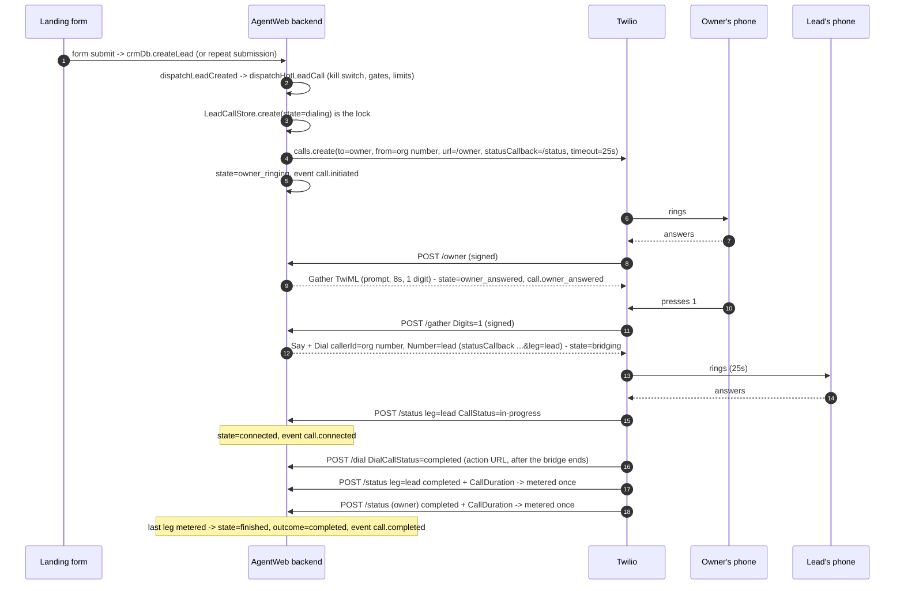

# Hot-lead auto-call (ENG-2271)

When a landing-page form lead arrives with a phone number, AgentWeb phones the
business owner from a Twilio number the org owns and says "New lead from
<business name>. Press 1 to connect to them now." On `1` it dials the lead and
bridges the two. The outcome and every step are written to the lead's timeline.

It is a second subscriber to the same moment as the Slack lead alert
([lead-notifications.md](./lead-notifications.md)). It never delays, replaces or
suppresses that alert: a skipped or failed call leaves the Slack message as the
fallback.

Status of this document: written against the complete ENG-2271 feature branch,
including the number-provisioning and destination-verification Emma tools.
Everything marked **to confirm with Twilio** or listed under "Not
verified" has never been run against a real Twilio account.

## Operator quick reference

- **Turn the whole feature off:** set the AW-Settings item `hot_lead_call_mode`
  to `off` (anything but `on`, or delete it). It takes effect within ~30s per
  backend instance. No operator route or command exists for this: edit the
  AW-Settings item directly. See [Turn it off](#turn-it-off).
- **Turn off one org:** `update_hot_lead_call_settings({enabled: false})` (the org's
  owner/admin, through Emma), or set `hotLeadCall.enabled` to `false` on the org item.
- **A call looks stuck or unbilled:** [Stuck records](#stuck-records) (how to
  find them, what each state means, where the spend events live).
- **A number may be billed but not recorded:** search the backend logs for
  `ORPHAN` (`ORPHAN number`, `ORPHAN RISK`), then [Orphan numbers](#orphan-numbers).
- **Why no call happened:** the lead's timeline shows `call.skipped` with a
  reason, or nothing at all when the refusal is silent by design; see
  [Outcomes and timeline events](#outcomes-and-timeline-events) and
  [Other symptoms](#other-symptoms).
- **Before first use anywhere:** [Go-live checklist](#go-live-checklist). The
  first customer is Haven (a customer org); Harsha (company owner) allocates the
  Twilio rates and approves production org-config writes; Anurag owns go-live.

## Call flow



Branches (all end in `finished` once every leg that was dialed is metered):

| Situation | Webhook that decides | Outcome | Timeline events after `call.initiated` |
| --- | --- | --- | --- |
| Owner presses 1, lead answers | `/gather`, lead `/status` | `completed` | `call.owner_answered`, `call.connected`, `call.completed` |
| Owner presses another digit | `/gather` | `owner_declined` | `call.owner_answered`, `call.owner_declined`, `call.completed` |
| Owner hangs up on or ignores the prompt | owner `/status` terminal | `owner_declined` | `call.owner_answered`, `call.owner_declined`, `call.completed` |
| Owner never picks up (no-answer, busy, failed, canceled) | owner `/status` terminal | `owner_no_answer` | `call.owner_no_answer`, `call.completed` |
| Owner presses 1, lead does not answer | `/dial` with `no-answer`, `busy` or `failed` | `lead_no_answer` | `call.owner_answered`, `call.lead_no_answer`, `call.completed` |
| Lead number no longer valid at bridge time | `/gather` | `lead_phone_invalid` (record stays `owner_answered` until the owner leg ends) | `call.owner_answered`, `call.failed` (reason `lead_phone_invalid`), `call.completed` |
| Kill switch or config turned off while the owner is on the line | `/owner` or `/gather` | `aborted` | at `/owner` (still ringing): `call.failed` (reason `aborted`), `call.completed`; at `/gather` (owner was on the prompt): `call.owner_answered`, `call.failed` (reason `aborted`), `call.completed` |
| Owner hangs up while the lead is still ringing (`/dial` reports `canceled`) | `/dial`, then `finishIfComplete` | `bridge_unconfirmed` | `call.owner_answered`, `call.completed` |
| Bridge ended but `/dial` never reported a result | `finishIfComplete` | `bridge_unconfirmed` | `call.completed` |

The leg-metering rule behind "finished": the store refuses to move a terminal
record, so each leg is metered while the record is still live and the LAST leg
to be metered performs the terminal transition. A record therefore stays live
until the final status callback of every dialed leg has arrived.

## Components and file map

All paths are under `backend/src/`.

| Piece | File |
| --- | --- |
| Hook (second subscriber to the lead-created moment) | `services/orgLeadNotificationService.ts` `dispatchLeadCreated` calls `dispatchHotLeadCall` first, fire-and-forget. The batch path `dispatchLeadsCreated` deliberately does not. |
| Orchestrator: gates, limits, create-first, place call | `services/hotLeadCallService.ts` (queue source `hot_lead_call`, `maxAttempts: 1`, registered in `app.ts`) |
| Org config type and strict validator | `services/hotLeadCallConfig.ts` |
| Org/list/owner routing for the call | `services/voice/hotLeadCallContext.ts` |
| Global kill switch | `services/voice/hotLeadCallMode.ts` |
| Plan entitlement (the `hot_lead_call` subscription feature) | `services/voice/hotLeadCallEntitlement.ts` |
| Quiet hours, abuse limits, slot reservation | `services/voice/hotLeadCallLimits.ts`, `services/voice/limitStore.ts` (DynamoDB), `services/voice/fakeLimitStore.ts` (tests) |
| Call record (state machine storage) and timeline events | `services/voice/leadCallStore.ts`, `services/voice/leadCallStore.types.ts` |
| Twilio seam (`placeCall`, `buyNumber`, `releaseNumber`, `validateSignature`) | `services/voice/voiceProvider.ts` (the only file that imports `twilio`), `services/voice/fakeVoiceProvider.ts` |
| Webhook URLs | `services/voice/voiceUrls.ts` |
| TwiML builders (hand-built XML, XML-escaped) | `services/voice/twiml.ts` |
| Webhook routes, mounted at `/api/webhooks/twilio-voice` | `routes/twilioVoiceWebhook.ts` (`/owner`, `/gather`, `/dial`, `/status`) |
| Per-leg metering | `services/voice/voiceUsage.ts` `recordCallUsage` -> `recordVendorUsage` |
| Rate card and runtime rate overrides | `utils/vendorRateCard.ts`, `routes/adminVendorRates.ts` |
| Twilio credentials | `utils/secretsManager.ts` `getTwilioCredentials` |
| Emma settings tools | `emma/hotLeadCallTools.ts` |
| Emma setup tools (number provisioning, destination verification) | `emma/hotLeadCallSetupTools.ts`, `services/voice/numberProvisioning.ts`, `services/voice/destinationVerification.ts`, `services/voice/setupWrites.ts` |
| Admin UI for rates | `partner-portal/src/components/admin/VendorRatesTab.tsx` (Admin > Revenue & billing > Vendor Rates) |

Tests worth knowing: `__tests__/hotLeadCall.e2e.test.ts` (the calls: real
orchestrator + real webhooks + real store on an in-memory DB fake, signed with
Twilio's own HMAC) and `__tests__/hotLeadCall.e2e.gates.test.ts` (gates, quiet
hours, dedupe, cooldown, caps and silent refusals), sharing
`__tests__/helpers/hotLeadCallE2eWorld.ts`; `__tests__/hotLeadCallService.test.ts`,
`__tests__/twilioVoiceWebhook.test.ts`, `__tests__/hotLeadCall.flagOff.test.ts`
(Slack path identical with the switch off), `__tests__/hotLeadCallLimits.dynamodbLocal.test.ts`
and `__tests__/leadCallStore.dynamodbLocal.test.ts` (real DynamoDB expressions
against DynamoDB Local).

### The at-most-once rule (create-first)

A phone call cannot be retried the way a Slack message can. The call RECORD is
the lock:

1. All gates pass and a limit slot is reserved.
2. `LeadCallStore.create` writes `lead.system.hot_lead_call` with `state=dialing`
   using a create-if-absent conditional write. `false` means a record already
   exists: do not dial. A lead gets at most one call record, ever (v1).
3. `placeCall`. Success: `owner_ringing` + `call.initiated`. Twilio rejected it
   (HTTP 4xx other than 408, `placed: 'no'`): terminal `failed` /
   `place_rejected` + `call.failed`. Anything ambiguous (timeout, 5xx, no
   response, no sid): the record stays `dialing` with `outcome=placement_unknown`
   + `call.failed` (reason `placement_unknown`), and is NEVER retried.
4. A `dialing` record can still be adopted: the first signed owner-leg callback
   (`/owner` or the owner `/status`) for the same `jobKey` supplies the CallSid,
   moves the record to `owner_ringing`, writes `call.initiated`, and the call is
   metered normally.

The queue job row also dedupes the same job key (`sha256(orgId, listId, leadId
[, submissionId])`).

## Org config: `Organization.hotLeadCall`

Validated by `hotLeadCallConfigOf` (strict: any invalid field, or an unknown key,
makes the whole config invalid; a stored config that fails validation means "no
call, Slack only"). Validation applies to every read, including the webhooks.

| Field | Rule |
| --- | --- |
| `enabled` | boolean, required. Enabled requires `destinationVerifiedAt`, `twilioNumber` and `quietHours`; a half-configured org can only be saved disabled. |
| `destinationPhone` | required. Canonical E.164, US or CA only (Puerto Rico, Guam and other +1 territories refused); premium, toll-free, personal, shared-cost, UAN and VOIP number types refused. Must differ from `twilioNumber`. |
| `destinationVerifiedAt` | system-managed, ISO timestamp (set by confirming the verification code). |
| `twilioNumber`, `twilioNumberSid` | system-managed. Same phone rules; sid must match `PN` + 32 hex. |
| `leadTypes` | non-empty subset of the lead origins; default `["form_fill"]`. In practice the orchestrator only ever calls for `form_fill`; other origins return before any read. |
| `maxAgeMinutes` | integer 1-60, default 10. A lead older than this when the job runs (`submittedAt`, else lead `createdAt`; a missing or unparseable time fails closed) is skipped as `too_old`. |
| `maxCallsPerHour` | integer 1-30, default 6. |
| `maxCallsPerDay` | integer 1-100, default 20. |
| `ownerCooldownMinutes` | integer 1-60, default 2. |
| `announcedName` | required, trimmed, 1-60 chars of letters, digits, space and `. , & ' -`. Spoken in `<Say>`; XML-escaped by the TwiML builder. |
| `quietHours` | `{ start, end, timezone }`, `HH:MM` 24h, `start != end`, defaults 08:00 / 21:00. It is the window in which calls ARE allowed, in the org's IANA `Area/Location` timezone (UTC, abbreviations and `Etc/` refused). `start > end` wraps past midnight. Start inclusive, end exclusive, minute granularity. The lead's own timezone is not considered. Required to enable. |
| `allowedCountries` | non-empty subset of `["US","CA"]` (default both); the lead's number must resolve to one of them. |

The lead's number is read from the lead row at dispatch AND again at bridge time;
national-format numbers are parsed as US. It never travels in a URL or a query.

## Emma tools

Registered as foundation tools. Org membership comes from the authenticated user
(never from arguments); reads need membership, writes need `org:configure`
(owner/admin). Not available in shared sessions.

Settings (merged):

- `get_hot_lead_call_settings({})` returns `configured`, `enabled`,
  `destinationPhone` (masked to the last 4 digits), `destinationVerified`,
  `callerNumberAssigned`, `leadTypes`, `announcedName`, `quietHours`,
  `allowedCountries` and the four limits (defaults when unset). No SIDs or full
  numbers.
- `update_hot_lead_call_settings({...})` takes any of `enabled`,
  `destinationPhone`, `leadTypes`, the four limit fields, `announcedName`,
  `quietHours`, `allowedCountries`. `destinationVerifiedAt`, `twilioNumber` and
  `twilioNumberSid` are refused (system-managed). The first save needs
  `destinationPhone` and `announcedName`. Changing `destinationPhone` drops the
  verification and forces `enabled:false`. Writes are conditional on the stored
  attribute being unchanged since it was read, so a concurrent edit fails
  instead of clobbering.

Setup tools (number provisioning and destination verification). They need `org:configure`, work while the global
kill switch is off, and are blocked in shared sessions. The three that spend
money or cannot be undone (`provision_hot_lead_call_number`,
`release_hot_lead_call_number`, `start_hot_lead_call_verification`) also REFUSE
unattended runs (`context.isUnattendedRun === true`: scheduled or autonomous
turns) with "This needs a person to confirm in an interactive chat".
`confirm_hot_lead_call_verification` has no such refusal:

- `provision_hot_lead_call_number({confirm: true, areaCode?})` buys one US local
  voice-enabled number (the cost is stated in the tool text, read from the live
  rate card). Needs saved settings, one number per org, at most 2 purchases per
  org per rolling 24h and 6 releases per day (reservations are written to the org
  attribute `hotLeadCallProvisioning`, conditional on it and `hotLeadCall` being
  unchanged, BEFORE Twilio is called; a reservation whose purchase then fails
  still counts). A stored `hotLeadCallProvisioning` that is malformed makes both
  tools refuse ("Contact support"). `confirm` is advisory only: the model
  controls it, so it is not an authorization. An ambiguous buy failure is
  logged as `ORPHAN RISK` and is not retried. Only the first month's rent is
  metered.
- `release_hot_lead_call_number({})` turns calling off first, releases the
  number (a 404 from Twilio counts as already gone; any other failure keeps the
  number assigned), then clears `twilioNumber`/`twilioNumberSid`.
- `start_hot_lead_call_verification({})` rings the SAVED destination from the
  org number and reads a 6-digit code (inline TwiML, no webhook). The code is
  stored only as an HMAC in `hotLeadCallVerification`, valid 10 minutes, 5
  attempts; one start per 2 minutes, 5 per day. The start history is kept after a
  successful confirm and after a phone change, so alternating phones cannot reset
  the limits. A corrupt `hotLeadCallVerification` makes start refuse ("Stored
  verification state is invalid. Contact support."). Metered as one estimated
  minute (leg `verify`).
- `confirm_hot_lead_call_verification({code})` checks the code and writes
  `destinationVerifiedAt`.

Order of setup, which the tool text also teaches Emma:

1. `update_hot_lead_call_settings`: destination phone, announced name, quiet
   hours (with timezone), optionally lead types and limits. Saved disabled.
2. `provision_hot_lead_call_number` (spends money, needs explicit user consent).
3. `start_hot_lead_call_verification`, then `confirm_hot_lead_call_verification`
   with the code the owner heard.
4. `update_hot_lead_call_settings({enabled: true})`. Refused unless the phone is
   verified, a number is assigned and quiet hours are set.

Cost bound through these tools: 2 purchases at the card's $1.15 plus 5
verification calls at $0.014 is about $2.37 per org per day at the provisional
rates. First-month rent only; recurring rent is not metered.

General availability precondition: a human-approval gate (a deck-of-one approval
per purchase or release, like `services/crmSequenceActivationGate.ts`) is NOT
built. Until it exists the unattended-run refusal and the per-org caps are the
only controls, so enabling for more than hand-picked orgs needs that gate first.

Verification limits: it proves a phone answered and the code was heard. A
voicemail that plays the message back can also pass it. The spoken code is
believed to be visible in the Twilio call log to anyone with access to the
Twilio account (inline TwiML is normally logged; unverified, see "Not verified").

## Plan entitlement

Calls make AgentWeb pay Twilio, so the feature is tied to the plan, using the
existing subscription-tier mechanism. In the admin Subscription Types editor each
tier has a list of product features; **Hot lead calls** (`hot_lead_call`) is one.
An org is entitled when the tier of its billing owner (`Organization.ownerUserId`;
members and admins follow the owner's plan) lists `hot_lead_call` or `*`.

- A tier row with no saved feature list (rows that predate feature lists) is NOT
  entitled, unlike the other features. The editor displays such a row with every
  feature ticked, and saving it from the editor grants the feature. Tick it only
  for paid tiers and re-check the Free tier after any save.
- Anything unresolvable (no owner, unreadable tier, lookup error) is not entitled.
- Enforced in three places: `provision_hot_lead_call_number` and
  `start_hot_lead_call_verification` refuse with a plain message;
  `update_hot_lead_call_settings` refuses `enabled: true` (saving settings or
  disabling is always allowed); and the orchestrator skips with `call.skipped`
  `not_entitled` before any limit or record, at dispatch and again in the job, so
  an org that loses its plan stops dialing. A call already in flight finishes.
- `release_hot_lead_call_number` and `confirm_hot_lead_call_verification` stay
  available so an org that lost its plan can still stop paying for a number.

## Settings keys (AW-Settings)

| Key | Value | Meaning |
| --- | --- | --- |
| `hot_lead_call_mode` | `on` (case-insensitive, trimmed) | Global master switch. Anything else, a missing row, a read error, or a read slower than 1.5s means OFF. |
| `vendor_rate_overrides` | JSON string | Admin overrides of provisional Twilio rates (see Metering). |

`hot_lead_call_mode` semantics: read from DynamoDB `AW-Settings` (item
`settingName = hot_lead_call_mode`, attribute `settingValue`) and cached per
backend instance for 30 seconds, so a flip takes up to ~30s per instance to
apply, and the failure direction is off. Off means `dispatchHotLeadCall` returns
before any read or write (no lead read, no limit key, no event, no queue job),
and in-flight calls are cut short: an owner who picks up after the switch is
turned off hears a hangup (`aborted`) while the leg is still metered. Under
Jest (`NODE_ENV=test`) it is always off unless overridden.

## Secrets and configuration

- Twilio credentials: JSON secret `{"accountSid": "...", "authToken": "..."}` named
  `prod/AgentWeb/Twilio` in production and `dev/AgentWeb/Twilio` otherwise
  (AWS Secrets Manager). The pair `TWILIO_ACCOUNT_SID` + `TWILIO_AUTH_TOKEN` in
  the environment overrides the secret, but only when BOTH are set (never mixed;
  a partial pair is ignored with a warning). A success is cached 5 minutes; a failed load is remembered for 5 seconds (one Secrets Manager read and one log line per window, callers get the same 503 meanwhile) so unauthenticated requests cannot drive a read per request.
  Missing fields throw. The auth token also verifies inbound webhook
  signatures, so rotating it takes effect within the cache TTL without a
  restart.
- `BACKEND_URL` must be the public origin Twilio can reach (scheme and host
  exactly as Twilio will call it, no trailing path). It builds every webhook URL
  AND is the base the signature is verified against, with `req.originalUrl`
  appended (never the Host header). A trailing slash is stripped. An unset
  `BACKEND_URL` throws before any record is created or call placed when
  `NODE_ENV` is set to anything other than `development` or `test` (production,
  staging); only `development`, `test` or an unset `NODE_ENV` fall back to
  localhost.
- The lead leg's `<Dial>` carries `timeLimit="1800"`: a bridged call is cut off
  after 30 minutes (Twilio's `timeLimit` is the maximum duration of the `<Dial>`
  in seconds; its default is 4 hours). Both legs are metered up to that point.
- Webhook mount: `/api/webhooks/twilio-voice`, no auth middleware; every request
  must carry a valid `X-Twilio-Signature`. The route has its own 64 KB flat-form
  body parser, registered before the global 50 MB parsers.

### Twilio account prerequisites

What the code requires (verified from code):

- A Twilio account whose credentials are in the secret above.
- The caller ID must be a number the account owns (the TwiML `<Dial callerId>`
  and the REST `from`). The provisioning tool buys it: `availablePhoneNumbers('US').local`,
  voice-enabled, optionally by area code. The org's number is always a US local
  number, even for a Canadian owner.
- Outbound calls to US and Canadian numbers only (`allowedCountries`).
- Public HTTPS reachability of `BACKEND_URL` for the four webhooks.

To confirm with Twilio (not verifiable from this repo): Voice Geographic
Permissions must allow outbound calls to the United States and Canada; whether a
purchased US local number needs a regulatory bundle or address on this account;
whether A2P 10DLC applies (it is an SMS registration and this feature sends no
SMS, so it is believed not to apply); account balance and spend limits;
caller-ID reputation and STIR/SHAKEN attestation for the purchased numbers
(affects whether owners see the call as spam).

## Persistent data (data-plane list)

No new table or index. The feature writes:

| What | Where | Written by |
| --- | --- | --- |
| `hotLeadCall` (config) | org attribute on the org item | Emma settings tool, number provisioning, verification |
| `hotLeadCallVerification` (HMAC of pending code, attempts, start history) | org attribute | verification tools |
| `hotLeadCallProvisioning` (purchase/release timestamps for the daily caps) | org attribute | provisioning tools |
| `hot_lead_call_mode` | AW-Settings item | operators |
| `vendor_rate_overrides` | AW-Settings item | admin Vendor Rates tab |
| `system.hot_lead_call` (call record: `state`, `jobKey`, `startedAt`, `updatedAt`, `ownerCallSid`, `leadCallSid`, `outcome`, `meteredLegs`, `lastSequence`) | on the lead row (AW-Leads), no phone number | orchestrator and webhooks |
| Timeline events `call.*` | the lead's `engagements` list | `LeadCallStore.addEvent` |
| `hlc#phone#<hmac>`, `hlc#cool#<orgId>`, `hlc#cap#h#<orgId>#<UTC hour>`, `hlc#cap#d#<orgId>#<local date>` | existing table `AW-MCPSessions` (partition key `sessionId`, attribute `ttl`) | limit store |

Notes:

- Call-event details are scalar only, phone-like text is redacted, and values
  containing the words in `ENGAGED_EVENT_KEYWORDS` (`clicked`, `replied`,
  `received`) are dropped so a call event can never mark a lead as engaged.
- Phone numbers are not stored in the record, the limit keys (an HMAC keyed with
  `JWT_SECRET`; rotating `JWT_SECRET` forgets the 24h phone window) or any
  event, and are redacted to the last digits in logs.
- Putting limit rows in `AW-MCPSessions` reuses a table that has a native `ttl`
  attribute. It is scanned only by the eval credential-cleanup inventory
  (`services/evaluationStore.ts` `prepareCredentialCleanup`), which filters on
  `agentUserId`, so `hlc#` rows are read by that scan but never matched or
  touched. This needs ops to confirm in each environment: the table exists, DynamoDB TTL is enabled on `ttl` (create-tables
  does not enable it), and the backend IAM role may `UpdateItem`, `PutItem` and
  `DeleteItem` on it. Correctness never depends on the TTL reaper: counters are
  bucketed per window and claims are tested against their own expiry.

## Metering and spend

Every Twilio call is billed to AgentWeb's account and recorded through
`recordVendorUsage` (provider `twilio`, feature `hot_lead_call`), priced by
`rateKey` from the vendor rate card (`utils/vendorRateCard.ts`).

| Rate key | Unit | Provisional default | Metered |
| --- | --- | --- | --- |
| `voice_minute_outbound` | minute | $0.014 | per leg, from the `/status` webhook |
| `number_monthly_rent` | number_month | $1.15 | provisioning tool only, at purchase (first month) |

The defaults are PROVISIONAL placeholders at Twilio's public US list price
(checked 2026-10-19) pending the rate allocation from Harsha (get this before
go-live). They can be changed at runtime without a deploy: admin area >
Revenue & billing > **Vendor Rates** tab, or `GET/PUT /api/admin/vendor-rates`
(admin only). Overrides live in the `vendor_rate_overrides` setting; only
`twilio` keys that exist on the card can be overridden; a value must be a plain
decimal, > 0, <= 10 USD per unit, at most 6 decimals; `null` removes an override.
The 10 USD bound only refuses wild values (14 for 0.014 is refused); a smaller slip
such as 1.4 for 0.014 is accepted, and the Vendor Rates tab's confirm dialog (it
warns when a change is more than 10x up or down) is the safeguard for that. Rates are
cached ~60 seconds. Spend events carry the rate-card version, with an
`+ovr:<updatedAt>` suffix when an overridden rate priced them.

Rules the code enforces:

- Voice: one usage event per leg, with the leg's own CallSid, idempotency key
  `twilio:voice:<CallSid>:<owner|lead>`, quantity `ceil(CallDuration / 60)`
  minutes (round up per leg; Twilio's pricing page states a per-minute rate and
  no rounding rule, so rounding up is the conservative choice). A leg with
  `CallDuration` 0 records no event but is still marked metered so the call can
  finish. A missing, empty, blank or non-numeric `CallDuration` is never defaulted to 0: the
  leg is not billed and a warning is logged, so a malformed callback
  undercharges visibly rather than silently.
- The owner leg is billed as an outbound minute for the whole time the owner is
  on the line, including the bridged conversation, plus the lead leg's own
  minutes. Both are outbound dials from our number.
- The leg is marked metered in the same conditional transition that wins the
  right to bill, then billed. A crash between the two undercounts; it never
  double-bills. Twilio's status-callback retries are idempotent on the leg and on
  `lastSequence`.
- The verification call has no status callback and is metered at an
  estimated one minute.
- **Recurring number rent is NOT metered.** Only the first month is recorded at
  purchase. A scheduled job that meters `twilio:number:<sid>:<YYYY-MM>` for every
  stored `twilioNumberSid` each month is a follow-up (see below).
- Calls made while the org is disabled or the switch is off (a call already in
  flight) are still metered from the list owner's id.

## Abuse limits and their known limits

Gates run cheapest first. Stateless gates run at dispatch and again in the job;
the limits that count run once, just before the record is created, and are given
back if the record is not created:

1. Kill switch, origin `form_fill`, org config valid and enabled, lead exists,
   not a smoke-test lead, not a progressive-capture draft, has a phone.
2. Skip gates with a `call.skipped` event: `no_caller_number`, `unsafe_id` (list
   or lead id outside `[A-Za-z0-9_.:-]{1,200}`, which the webhooks would
   reject), `invalid_phone`, `country_not_allowed`, `outside_quiet_hours`,
   `too_old`, then `not_entitled` (the org owner's subscription tier does not
   include the `hot_lead_call` feature; see [Plan entitlement](#plan-entitlement)).
   To stop an anonymous visitor growing a lead row by resubmitting, a lead gets
   at most one `call.skipped` event per distinct reason and at most 5 in total
   (counted from the lead's existing timeline, so two simultaneous submissions
   can overshoot by the number in flight). A `duplicate_phone` refusal for a
   lead that has, or within 200 ms gets, its own call record writes nothing: it
   is the same lead racing itself.
3. Limits, in this order: `duplicate_phone` (same org and number within 24h),
   `owner_cooldown`, `org_hourly_cap` (UTC clock hour), `org_daily_cap` (org's
   local calendar day). Each is one conditional write.
4. `limits_unavailable`: the limit store failed; nothing is dialed, the job
   fails (not retried), an event is written best-effort.

A repeat submission of a lead that already has a call record trips the phone
marker and is silent (the timeline already holds the call). After the 24h phone
window a repeat still cannot dial: the record is permanent.

Known limits, accepted:

- Fixed windows can admit up to 2x a cap across an hour or day boundary.
- Phone-rotating bots can consume the org's hourly and daily caps; the Slack
  alert still fires.
- Whoever submits a number first suppresses calls for that number for 24h.
- The cooldown skips a second genuine lead within `ownerCooldownMinutes`.
- A process crash between reserving and `create` leaves the 24h phone marker and
  the cooldown claim held with no record: a repeat of that number is refused as
  `duplicate_phone` with a silent timeline.
- A lead gets one call record ever. A failed attempt (`place_rejected`) is not
  retried automatically.
- `confirm: true` on the provisioning tool is advisory. The real controls are
  the per-org purchase and release caps.
- Two orgs configured with the same owner phone can ring that person
  simultaneously: caps and cooldown are per org.
- Prompt injection: the destination phone and settings are changed through Emma
  tools, so text the model reads (a lead's form field, a web page) could try to
  steer `update_hot_lead_call_settings` or `confirm_hot_lead_call_verification`.
  The human-approval gate (see Known follow-ups) is a general-availability
  precondition; until then use hand-picked orgs.
- Verification brute force: a code is 6 digits with 5 attempts per code and 5
  codes per day, so a guesser has roughly a 5-in-a-million chance per code and
  about 25-in-a-million per day.
- Phone-marker poisoning: whoever submits a number first holds its 24h marker,
  so a third party can submit a victim lead's number first and suppress the call
  for the genuine submission (the Slack alert still fires).

## Outcomes and timeline events

Event types written to the lead timeline (`eventType`, with a scalar `eventData`):

| Event | Written when | Data |
| --- | --- | --- |
| `call.initiated` | Twilio accepted the owner call (orchestrator), or a signed owner callback adopted the CallSid of an unrecorded call | - |
| `call.owner_answered` | owner picked up (`/owner`), once | - |
| `call.owner_declined` | owner pressed a key other than 1, or hung up on the prompt | - |
| `call.owner_no_answer` | owner leg ended before pickup | - |
| `call.connected` | lead answered (lead `/status` in-progress, or `/dial` completed) | - |
| `call.lead_no_answer` | `/dial` reported no-answer, busy or failed | `dialStatus` |
| `call.completed` | last dialed leg metered; the record is `finished` | `outcome` |
| `call.failed` | `reason`: `place_rejected`, `placement_unknown`, `lead_phone_invalid`, `aborted` | `reason` |
| `call.skipped` | a gate or limit refused (no Twilio call made) | `reason` (list above) |

Record `state`: `dialing`, `owner_ringing`, `owner_answered`, `bridging`,
`connected` (live) and `finished`, `failed`, `skipped` (terminal; `skipped` is in
the type but the orchestrator records skips as events only). `outcome` values:
`completed`, `owner_declined`, `owner_no_answer`, `lead_no_answer`,
`lead_phone_invalid`, `bridge_unconfirmed`, `aborted`, `place_rejected`,
`placement_unknown` (informational on a live `dialing` record).

Webhook answers: a bad or missing signature is 401; credentials that cannot be
loaded 503; a signed request that is not for a live call this job owns gets a
bare `<Hangup/>` with 200 (TwiML endpoints) or an empty 200 (`/status`), and
writes nothing; `/status` answers 500 only when a finished leg cannot be billed
(no owner to bill, or metering lost its race three times). Status callback URLs
carry the Twilio retry override `#rc=3&rp=5xx,ct` so Twilio redelivers a 5xx.

## Failure modes and ops runbook

### Turn it off

- **Everywhere, within ~30s:** set the AW-Settings item `hot_lead_call_mode` to
  anything other than `on` (for example `off`), or delete it. Takes up to 30s to
  reach every instance. There is no operator route or command for it: write the
  item directly (table `AW-Settings`, key `settingName = hot_lead_call_mode`,
  attribute `settingValue`). Nothing in flight is retried; an owner already on the
  prompt is hung up on and billed for the time used.
- **One org:** the org owner/admin (or Emma on their behalf) calls
  `update_hot_lead_call_settings({enabled: false})`, or an operator sets
  `hotLeadCall.enabled` to `false` on the org item. Read on every dispatch and
  webhook (an eventually consistent DynamoDB read, so seconds). The job re-runs
  the gates before it creates the record.
- **Release the number** (stops the monthly charge): `release_hot_lead_call_number`
  which turns calling off first (attended chat only).
- **Rollback of the code:** revert the merge. With `hot_lead_call_mode` off the
  feature is inert; existing org attributes and lead records are ignored by older
  code.

### Stuck records

A record can stay live if a final status callback never arrives (Twilio outage,
5xx beyond the three retries, a `BACKEND_URL` problem) or the process crashed
mid-call. No cron cleans these up and no operator tool lists them.

**Finding them.** Start from what you know:

- A report ("the owner got a call but ...") or one lead: open the lead's timeline
  (`call.*` events) and its `system.hot_lead_call` record.
- Otherwise run a one-off, read-only scan of `AW-Leads`, off-peak (a full scan
  of a large table consumes read capacity). Shape only, not run against
  production here; adjust region and profile, and use `Dev-AW-Leads` in
  development:

  ```sh
  aws dynamodb scan --region us-west-2 --table-name AW-Leads \
    --filter-expression '#s.#k.#st IN (:a,:b,:c,:d,:e) AND #s.#k.#u < :cutoff' \
    --expression-attribute-names '{"#s":"system","#k":"hot_lead_call","#st":"state","#u":"updatedAt"}' \
    --expression-attribute-values '{":a":{"S":"dialing"},":b":{"S":"owner_ringing"},":c":{"S":"owner_answered"},":d":{"S":"bridging"},":e":{"S":"connected"},":cutoff":{"S":"<ISO time 2 hours ago>"}}' \
    --projection-expression 'listId, leadId, #s.#k.#st, #s.#k.#u, #s.#k.ownerCallSid, #s.#k.leadCallSid, #s.#k.outcome'
  ```

  `updatedAt` is an ISO string, so the comparison is lexicographic and correct.
  Anything live that long (a call lasts minutes) is stuck.

**What each state means and what to do:**

- `dialing`, no `outcome`, no `ownerCallSid`: the process died between creating
  the record and `placeCall` (or the post-call update failed). No call was
  placed, or an unrecorded one is still adoptable by its first owner callback.
  Safe. Do nothing: the Slack alert already went out, and by the once-per-lead
  rule the lead is simply never called. (If the owner did get a call, its
  signed callbacks adopt the CallSid and the call proceeds normally.)
- `dialing` with `outcome=placement_unknown`: the placement was ambiguous. Check
  the Twilio call log for a call from the org's number to the owner around
  `startedAt`. If one exists and its callbacks never arrived, Twilio billed it
  and we did not meter it.
- `owner_ringing` / `owner_answered`: the owner leg's final callback is missing.
- `bridging` / `connected`: the bridge ended but a leg callback is missing; the
  call may be unmetered.

**Checking what was billed.** Spend events are in the immutable ledger table
`AW-SpendEvents` (`Dev-AW-SpendEvents` in development), partition key
`billingUserId` (the org's billing owner, which the recorder resolves from the
list owner), sort key `eventId`, and the event id IS the idempotency key:
`twilio:voice:<CallSid>:<owner|lead>`. The owner CallSid is in the record; the
lead's is in the record once seen, or in the Twilio call log as the child of the
owner call. A `get-item` on `(billingUserId, eventId)` shows whether a leg was
metered (a leg that ran 0 seconds has no event by design). Compare the minutes with the
Twilio call log.

**Repairing.** A stuck record only affects that lead (at most one call, ever) and
the metering of that call; it blocks nothing for other leads. Editing the record,
re-allowing a call for a lead, or adding a missing spend event by hand is a
production data change and needs Harsha's approval. Do not do it without that.

### Orphan numbers

Buying and releasing are non-idempotent. Search the logs for `ORPHAN number` or
`ORPHAN RISK`: a number may be billed on the Twilio account and not recorded on
any org. Reconcile in the Twilio console (Phone Numbers > Active numbers)
against `hotLeadCall.twilioNumberSid` of every org, and release strays by hand.
Do not let Emma retry an ambiguous purchase.

### Other symptoms

| Symptom | Likely cause |
| --- | --- |
| Owner is called but hears "application error" | The `/owner` fetch failed: `BACKEND_URL` wrong or unreachable (check scheme and host), or credentials could not be loaded (503), or the signature failed (401). Twilio's call log shows the webhook response. |
| Calls never placed, timeline shows `call.skipped` | The `reason` names the gate. `outside_quiet_hours`, `duplicate_phone` and `owner_cooldown` are expected behavior. |
| No event and no call | Kill switch off, org disabled or config invalid, lead not `form_fill`, smoke-test lead, draft lead, or no phone: all silent by design. |
| `call.skipped` `limits_unavailable` | `AW-MCPSessions` missing, IAM denied, or throttled. Fails closed. |
| `no owner to bill for list` in logs | The list owner could not be resolved; the leg was not metered and `/status` answers 500. |
| Slack alert arrives but no call | Expected whenever any gate refuses; the two paths are independent. |

## Compliance and third parties

Two risks come with a public lead form and must be understood before general
availability:

1. **A third party can be called.** An anonymous visitor can type any phone
   number into a landing-page form. After the business owner presses 1, that third
   party receives a call from the org's Twilio number, and the same victim number
   can be entered at several orgs, so each org's owner connects once.
2. **A number-rotating bot can starve genuine leads.** A script that submits a
   different number each time uses up an org's daily and hourly caps; real leads
   after that are skipped (`org_hourly_cap` / `org_daily_cap`). The Slack alert
   still fires for every lead.

Mitigations to decide before general availability (none of them is built):

- CAPTCHA or honeypot enforcement on the lander endpoint.
- A spoken disclosure to the lead before the bridge. This needs the Twilio
  `<Number url>` whisper, which has not been verified.
- Requiring a name or an email besides the phone number.
- Consent text on the landers.

## Go-live checklist

Owner: Anurag. None of these may be skipped before `hot_lead_call_mode` is turned
on anywhere.

1. Compliance sign-off (decision D7): consent and disclosure for automated calls
   to business owners and for connecting leads, call recording stance (nothing is
   recorded by this feature), regional restrictions.
2. Twilio account: production credentials in `prod/AgentWeb/Twilio`, billing and
   spend limits set, Voice Geographic Permissions allow US and Canada, no other
   restriction on outbound calls (see "to confirm with Twilio").
3. `BACKEND_URL` set to the public HTTPS origin in the production environment and
   reachable from Twilio. Test one signed callback. `JWT_SECRET` must be set in
   production too: it keys the HMAC of the phone-dedupe limit keys and the MAC of
   the verification code (rotating it only forgets the 24h phone window and
   pending codes).
4. `AW-MCPSessions` exists in prod with DynamoDB TTL enabled on `ttl` and the
   backend role allowed `UpdateItem`, `PutItem`, `DeleteItem` on it.
5. Rate card from Harsha: replace or confirm the provisional $0.014/minute and
   $1.15/month, using the Vendor Rates tab or a code change with a
   `VENDOR_RATE_CARD_VERSION` bump.
6. Deploy with `hot_lead_call_mode` OFF first and test the off switch: with it
   off, submit a test lead and confirm nothing is dialed; then flip it on and off
   again and time the effect (~30s). There is no operator route for it: set the
   AW-Settings item directly.
7. Set up the first customer (Haven) through Emma, in an attended chat: save
   settings, provision a number, verify the owner's phone, enable. Each paid step
   needs the org's explicit consent, and the production org-config write needs
   the usual authorization.
8. Staging end-to-end with real phones before production: submit a test lead from
   a real form, owner answers and presses 1, lead answers, both hang up; then
   repeat for decline, owner no-answer and lead no-answer. Confirm the timeline,
   one spend event per leg with plausible minutes, and that the Slack alert is
   unchanged. Fill in the "Not verified" items below from what Twilio actually
   sent.
9. Flip `hot_lead_call_mode` to `on` only after the org itself is enabled, watch
   the first real leads, keep the off command to hand (effective within ~30s).
10. Plan entitlement: tick **Hot lead calls** only on the paid tier(s) that
    include it (Subscription Types editor) and confirm the Free tier does not
    have it. See [Plan entitlement](#plan-entitlement).
11. Decide the mitigations in [Compliance and third parties](#compliance-and-third-parties)
    before general availability (CAPTCHA/honeypot, spoken disclosure before the
    bridge, name or email besides the phone, consent text).
12. Dependency bump (whole backend): adding `twilio` raised axios 1.9.0 to 1.13.5,
    jsonwebtoken 9.0.2 to 9.0.3, jws 3.2.2 to 4.0.1, jwa 1.4.1 to 2.0.1 and some
    patch versions. After the deploy, smoke the Slack, Facebook/Meta and Teams
    (botbuilder) HTTP paths and the Google auth paths. The regression run of the 212
    suites that touch these libraries passed.
13. Rate-card version: `VENDOR_RATE_CARD_VERSION` moved from 2026-09-14 to
    2026-10-19 because a rate was added, so spend events written after the deploy
    carry the new version string for ALL vendors. Amounts are identical (checked
    byte for byte for v0, Apollo, Placid and Remotion); a reconciliation that
    groups by rate-card version will see a new bucket.
14. Known gaps accepted at launch, to be closed before general availability: the
    human-approval gate for provision/release (the tools refuse unattended runs
    and are capped per org, nothing more); recurring number-rent metering is not
    built (only the first month is recorded).

## Not verified without a real Twilio account

None of these has been observed against Twilio. They are assumptions taken from
Twilio's documentation and encoded in tests with synthetic payloads:

- `<Number>` status callbacks (`statusCallbackEvent="initiated ringing answered
  completed"`) for a lead that does not answer or is busy: that they arrive
  with `CallStatus` `no-answer`/`busy`, a `ParentCallSid` equal to the owner
  CallSid, a `SequenceNumber`, and a `CallDuration` (the code treats a missing
  `CallDuration` as unbilled and logs a warning).
- `<Dial action>` behavior when the owner hangs up in the middle of the bridge:
  whether `/dial` is still requested, with which `DialCallStatus`, and whether the
  lead leg is torn down. The code finishes such a call as `bridge_unconfirmed`
  if `/dial` never reports.
- The retry fragment `#rc=3&rp=5xx,ct` on `statusCallback` supplied through the
  REST `calls.create` call (documented for webhook URLs in general; the SDK
  passing the fragment through untouched is assumed), and that Twilio signs the
  URL without it.
- The owner leg's REST `statusCallbackEvent: ['completed']` delivering exactly
  one completed callback with `CallDuration`, including for no-answer (assumed
  `0`).
- Voicemail: the owner's voicemail answering the call. The prompt would play to
  the mailbox; there is no answering-machine detection and "press 1" will not be
  pressed, so it ends as `owner_declined` after the Gather times out, and the
  answered voicemail leg is billed.
- `BACKEND_URL` scheme and port: Twilio signs the exact URL it requested. The code
  strips a trailing slash, so that is not a risk; an `http`/`https` or port
  mismatch between `BACKEND_URL` and the URL Twilio actually calls (for example
  behind a proxy or load balancer) would fail signature checks (401). Confirm
  with the first real callback.
- That the verification code spoken by inline TwiML is visible in the Twilio call
  log (assumed from Twilio logging call instructions; not checked).
- The `X-Twilio-Signature` for form bodies with repeated or empty parameters
  (empty values such as `FinishedOnKey` are signed by Twilio's algorithm; the
  test uses the library's own function).
- That the owner leg is billed for the whole call duration including the bridged
  conversation (`CallDuration` of the owner call covering the `<Dial>`), so
  metering owner and lead legs separately matches Twilio's invoice.
- That the lead's "answered" event arrives as `CallStatus=in-progress` on the
  `<Number>` status callback (the connected transition depends on it; `/dial`
  completed is the backstop).
- That `DialCallSid` is present on a `/dial` request when the lead did not answer
  (without it the lead leg is treated as never created and not awaited).
- The rate and rounding statements: the provisional rates and "no stated rounding
  rule" are recorded in code comments as checked on 2026-10-19 by the
  implementing agent reading Twilio's public pricing page. Nobody has compared
  them with an invoice.
- Per-minute rounding: whether Twilio bills each leg per started minute or per
  second, so whether `ceil` over- or under-counts against the invoice.
- Number purchase: A2P and regulatory-bundle requirements, and the local-number
  price.

## Known follow-ups

- **Recurring number rent metering.** A monthly job that records
  `number_monthly_rent` for every stored `twilioNumberSid` (key
  `twilio:number:<sid>:<YYYY-MM>`). Only the first month is metered today.
- **Stuck-record cleanup.** A documented sweep for records live longer than a
  call can last (and reconciliation of their Twilio legs). No cron exists.
- **Human-approval gate for paid tools (GA precondition).** None exists yet:
  buying and releasing a number refuse unattended runs and are capped per org,
  and `confirm` is advisory. A deck-of-one approval per purchase or release, like
  `services/crmSequenceActivationGate.ts`, is needed before general availability.
- **Missed-call Slack line.** The Slack alert does not say whether the call was
  placed, answered or declined; deliberately deferred so the Slack path stays
  untouched.
- **Retry after `place_rejected`.** v1 gives every lead one call record ever, so
  a definitively rejected placement is never retried. A deliberate retry needs a
  new store operation.
- Voicemail detection and a post-call outcome summary in Emma.
