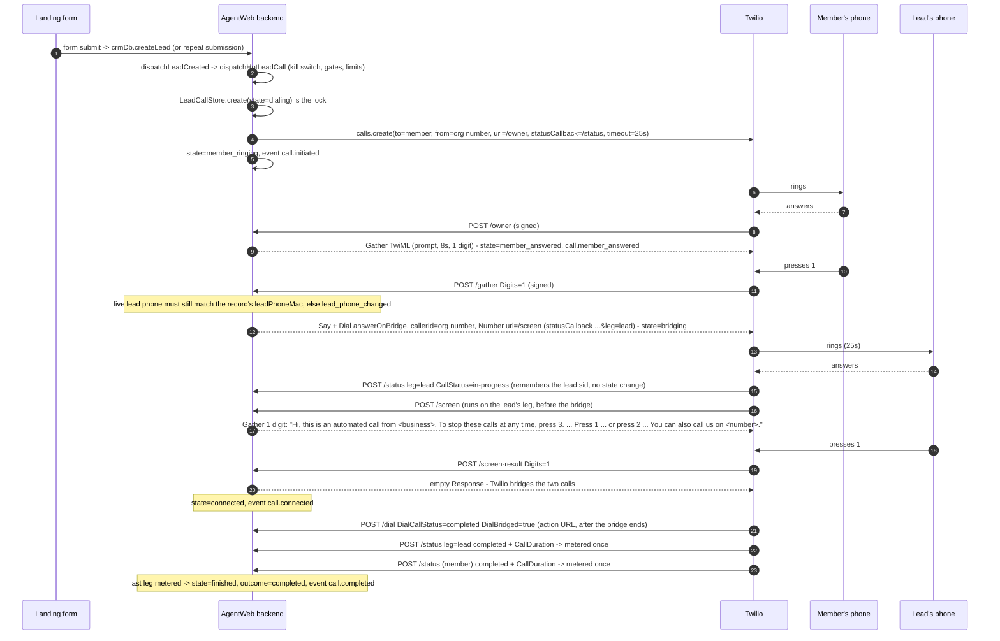

# Hot-lead auto-call (ENG-2271)

When a landing-page form lead arrives with a phone number, AgentWeb phones a
member of the business's team from a Twilio number the org owns and says "New
lead from <business name>. Are you available to take the call now? Press 1." On
`1` it dials the lead, who hears "Hi, this is an automated call from <business name>. To stop these calls at any time, press 3.
We're calling about the enquiry you sent us. Press 1 and we'll connect you to a person now, or press 2 and we'll call you again later.
You can also call us on <the org's number>." and must press 1 as well; only then
are the two calls bridged. A 2 schedules one [retry](#press-2-and-the-retry) about an hour later. The number is spoken digit by digit in 3-3-4 groups; calling it rings the team through the
[inbound callback](#inbound-callbacks) path. Pressing 3 puts the number on the org's [do-not-call list](#do-not-call-list). Which member is rung depends on the
team's priority order and weekly availability windows (see [Who is rung](#who-is-rung)). The outcome and every step are written to the lead's timeline.

It is a second subscriber to the same moment as the Slack lead alert
([lead-notifications.md](./lead-notifications.md)). It never delays, replaces or
suppresses that alert: a skipped or failed call leaves the Slack message as the
fallback.

Status of this document: it describes the code as merged, including the number-provisioning
and team-member verification Emma tools. The behaviour is covered by tests against fakes
and DynamoDB Local; nothing here has been run against a real Twilio account. Everything
marked **to confirm with Twilio** or listed under "Not verified" is an assumption taken
from Twilio's documentation.

## Operator quick reference

- **Turn the whole feature off:** set the AW-Settings item `hot_lead_call_mode`
  to `off` (anything but `on`, or delete it). It takes effect within ~30s per
  backend instance. No operator route or command exists for this: edit the
  AW-Settings item directly. See [Turn it off](#turn-it-off).
- **Turn off one org:** `update_hot_lead_call_settings({enabled: false})` (the org's
  owner/admin, through Emma), or set `hotLeadCall.enabled` to `false` on the org item.
- **A call looks stuck or unbilled:** [Stuck records](#stuck-records) (the daily
  sweep and its `HOT_LEAD_CALL_STUCK_SWEEP` mode, what each state means, where the spend events live).
- **A number may be billed but not recorded:** search the backend logs for
  `ORPHAN` (`ORPHAN number`, `ORPHAN RISK`), then [Orphan numbers](#orphan-numbers).
- **Why no call happened:** the lead's timeline shows `call.skipped` with a
  reason, or nothing at all when the refusal is silent by design; see
  [Outcomes and timeline events](#outcomes-and-timeline-events) and
  [Other symptoms](#other-symptoms).
- **Before first use anywhere:** [Go-live checklist](#go-live-checklist). The
  first customer is Haven (a customer org); Harsha (company owner) allocates the
  Twilio rates and approves production org-config writes; Anurag owns go-live.

## Call flow



Branches (all end in `finished` once every leg that was dialed is metered):

| Situation | Webhook that decides | Outcome | Timeline events after `call.initiated` |
| --- | --- | --- | --- |
| Member presses 1, lead answers and presses 1 | `/gather`, `/screen`, `/screen-result` | `completed` | `call.member_answered`, `call.connected`, `call.completed` |
| Lead answers and presses 3 | `/screen-result` | `lead_opted_out`; the lead hears "<business> will not call this number again. You can reach us on <the org's number>. Goodbye." and the call ends (`<Hangup/>`, no further prompt); the member hears "The lead asked not to be called again. Their details are in your lead alert."; no other member is tried; the stop is written first (see [Do-not-call list](#do-not-call-list)) | `call.member_answered`, `call.lead_declined` (`reason: opted_out`), `call.completed` |
| Lead answers and presses 2 (not available now) | `/screen-result` | `lead_deferred`; the lead hears "Okay. <business> will call you again later. You can reach us on <the org's number>. Goodbye."; the member hears "The lead is not available right now. We will try again later."; no other member is tried; one retry is scheduled (see [Press 2 and the retry](#press-2-and-the-retry)). Option 2 is only spoken when a retry can happen (the lead's first call, retries on); on the retry call, with retries switched off or the kill switch off, or when no retry can be scheduled, a 2 is an ordinary `lead_declined` (bare hangup for the lead, the usual "did not confirm" for the member) | `call.member_answered`, `call.lead_declined` (`reason: not_available_now`, or `not_available_no_retry` for the plain decline), `call.completed` |
| Lead answers but presses another key, says nothing or hangs up | `/screen-result` (a key) or `/dial` (`completed` with `DialBridged=false`) | `lead_declined`; the member hears "The lead did not confirm. Their details are in your lead alert." and no other member is tried | `call.member_answered`, `call.lead_declined`, `call.completed` |
| Member presses another digit, hangs up on or ignores the prompt, or never picks up (no-answer, busy, failed, canceled) | member `/status` terminal | `member_declined` / `member_no_answer` for the attempt; the record moves to `between_attempts` and the next-attempt request runs (see [Who is rung](#who-is-rung)) | `call.member_declined` or `call.member_no_answer`, then `call.completed` only when no further attempt is queued |
| Member presses 1, lead does not answer | `/dial` with `no-answer`, `busy` or `failed` | `lead_no_answer` | `call.member_answered`, `call.lead_no_answer`, `call.completed` |
| Lead's local calling window closed while the member was answering (member pressed 1) | `/gather` | `lead_outside_hours` (record stays `member_answered` until the member leg ends); same apology as `lead_phone_invalid`; the lead is not dialled | `call.member_answered`, `call.failed` (reason `lead_outside_hours`), `call.completed` |
| Lead number changed since the call passed the gates (repeat submission overwrote the phone) | `/gather` | `lead_phone_changed` (record stays `member_answered` until the member leg ends); the member hears "We could not reach the lead. Their details are in your lead alert."; no other member is tried | `call.member_answered`, `call.failed` (reason `lead_phone_changed`), `call.completed` |
| Lead number no longer valid at bridge time | `/gather` | `lead_phone_invalid` (record stays `member_answered` until the member leg ends) | `call.member_answered`, `call.failed` (reason `lead_phone_invalid`), `call.completed` |
| Kill switch or config turned off while the member is on the line | `/owner`, `/gather` or `/screen` | `aborted` | at `/owner` (still ringing): `call.failed` (reason `aborted`), `call.completed`; at `/gather` (member was on the prompt): `call.member_answered`, `call.failed` (reason `aborted`), `call.completed`; at `/screen` (lead answered): `call.failed` (reason `aborted`), `call.completed` |
| Member hangs up while the lead is still ringing (`/dial` reports `canceled`) | `/dial`, then `finishIfComplete` | `bridge_unconfirmed` | `call.member_answered`, `call.completed` |
| Bridge ended but `/dial` never reported a result | `finishIfComplete` | `bridge_unconfirmed` | `call.completed` |

### Who is rung

`selectHotLeadCallCandidates(config, at)` (`services/hotLeadCallRoster.ts`) is a
pure function: the verified team members, in team order, who have a window open at
`at` AND only when `at` is inside the calling hours. Weekday and `HH:MM` come from
the same local instant in the calling-hours timezone, so DST days resolve on the
clock the business sees. The orchestrator rings the first candidate that is not in
its cooldown. A team of one rings that person whenever the calling hours are open and
their window allows.

**Next attempt.** When a member leg ends without the member taking the lead
(declined, ignored the prompt, no answer, busy, failed, canceled) the member
`/status` webhook, in ONE transition, meters leg `member:<attemptNo>` and moves the
record to `between_attempts`. It then calls `requestNextHotLeadCallAttempt`
(`services/hotLeadCallAttempts.ts`): if it answers `enqueued: true` the
orchestrator's next-attempt job takes over from `between_attempts`; otherwise the
webhook finishes the record (`call.completed`). When the webhook is the one to find
nobody left, a first attempt keeps its own outcome (`member_declined` /
`member_no_answer`) and a later attempt ends as `no_member_available`. Webhooks
never place calls. A member callback for any CallSid other than the record's
current `memberCallSid` (an earlier attempt that was already metered) is
acknowledged and writes nothing. A lead who declines or cannot be reached never
triggers another member, and neither do `aborted`, `lead_phone_changed` or
`lead_phone_invalid`.

**The next-attempt job** (`hot_lead_call_next`, key `sha256(jobKey|attemptNo)`, so
a replayed callback queues the same job once) runs
`processHotLeadCallNextAttempt`. It only acts on a record that is still
`between_attempts` AND whose `attemptNo` equals the job's (the webhook queues it
with the number of the attempt that just ended, read after its own transition), so
a duplicate or stale job stops without dialing. It then re-checks everything at the
moment it runs: kill switch, org config, entitlement, `maxAttemptsPerLead`, the
lead's age, and who is available NOW (excluding `triedMemberIds`). The conditional
`between_attempts` -> `dialing` move (which stores the new `attemptNo`, `memberId`,
appends to `triedMemberIds`, and removes `memberCallSid` and `outcome` through the
patch's `clear` list, a `REMOVE` in the same conditional update) is the lock for the
attempt; then the member is called and the
record moves to `member_ringing`, exactly like a first attempt. If the placement is
ambiguous the record stays `dialing` with `placement_unknown` and the first signed
callback of that call supplies its sid, for any attempt number. A callback of an
EARLIER attempt's call is never adopted as the new attempt's sid: each ended member
leg leaves a `<sid>#ended` marker in `lastSequence`. A call Twilio definitely
rejects ends only that attempt (`call.failed`, reason `place_rejected`) and the job
goes on to the next member within `maxAttemptsPerLead`; the record fails with
`place_rejected` only when every placement of the pass was rejected. The job closes
a record that is waiting between attempts whenever it cannot ring anyone: config
disabled, not entitled or the kill switch off -> `disabled` (with the switch off it
makes one conditional write and no reads); no one available any more, attempts used
up, the lead too old or no caller number -> `no_member_available`. The reason a
further attempt was refused is logged by the webhook (`no further attempt: <reason>`).

**Records stranded between attempts heal.** A record waits in `between_attempts` after a member leg ended (and was
metered) or after Twilio rejected a call. What closes it depends on which job was working on it:
- *The next-attempt job* (`processHotLeadCallNextAttempt`): any error before it rang anyone closes the record as `failed`
  with outcome `next_attempt_failed` and a `call.failed` event (reason `next_attempt_failed`), then fails its queue row.
- *The placement pass, in either job* (`placeMemberCall`, which the first-attempt job and the next-attempt job both run):
  once a call has been rejected the record waits with no call in flight, so any error later in the same pass (the next
  member's lock write, the limit store) closes it the same way.
- *A re-run by the queue poller* (see below) of a first-attempt job that finds its own record (same job key) waiting
  hands it to the next-attempt path, which queues the next member or finishes the record.
A record that has already left `between_attempts` is never touched by these closes, because a call may be live on it.
The other way to be stranded is a store error after the leg was metered but before the next attempt
was requested. Twilio then redelivers the leg's final status callback (the
`#rc=3&rp=5xx,ct` override), `/status` finds the leg already metered, the record
still `between_attempts` and the leg's `<sid>#ended` marker present, and asks for the
next attempt again. That request is idempotent (the queue key, then the
`between_attempts` -> `dialing` lock, which also names the attempt it follows) and nothing is billed twice.

**What the queue poller does.** `pollAndProcessOnce` (`src/server.ts`, every 30 seconds) reclaims `processing` rows whose
`updatedAt` is older than 5 minutes (the heartbeat stopped, so the process died) and runs the job's processor again with
the same payload; a row that failed is not reclaimed (both sources run with `maxAttempts: 1`). For a first-attempt
job (`hot_lead_call`) a re-run finds the lead's record already created, so it dials nothing: it only resumes the case
above (its own record waiting between attempts). A record left `dialing` by a first attempt that died is not retried
(see Stuck records). For a next-attempt job (`hot_lead_call_next`) a re-run acts on a record of the same call that is
`between_attempts` at the job's attempt number or at a LATER one. At the job's number the lock had not been taken, so
it carries on and places the call. At a later number the job's own earlier run took the lock for the next attempt,
Twilio rejected that placement and the process died before the record was closed; such a record has no call sid, so no
callback can ever resolve it, and the re-run carries the chain on from the record's current attempt (members already
tried are excluded; `maxAttemptsPerLead`, the lead's age, the calling hours, the kill switch and the plan are checked
again, and it closes the record when nobody is left). It leaves alone a record at an earlier attempt number, a record
of another call and a record that is not waiting. If the earlier run's call was placed (the record is `dialing` or
further on) the re-run stops and the record is a Stuck-records case.

**Writes that commit and then report an error.** A store write can apply and still throw (a timeout after the
commit). The steps that decide who dials write a random `claimToken` onto the record: creating the record (first
attempt), the `between_attempts` -> `dialing` lock (next attempts) and the `/gather` move to `bridging`. When such a
write throws, or answers that it lost (the AWS SDK retries a timed-out conditional write, and when the first try had
committed the retry fails its own condition, which the store reports as `false`), the writer re-reads the record, up to
three times if the read itself fails: its own token means the write landed, so it goes on (places the one call,
or returns the Dial TwiML) instead of leaving a `dialing` record nobody will ever call back, or a member hung up on while
`bridging` waits for a lead leg. No token of its own means the write did not land: a failed create leaves no record and
gives the slots back, a failed lock fails the job and closes the waiting record as `failed` / `next_attempt_failed`, and a
failed `/gather` move hangs up, so the member leg's end hands over to the next member. A second writer never finds the
first one's token, so the retry is exactly-once, and a `false` that really is a lost race (another dispatch of the lead,
another worker on the lock) carries somebody else's token and changes nothing. Timeline events (`call.completed` and
the others) and usage events are written after the decision they report, so a write that commits and then errors can
lose one: a usage event lost this way under-bills, and nothing is ever billed twice.

A placement Twilio definitely rejected is recorded the same way: if the update to `between_attempts` errors, or lands and
answers `false`, the record is read back and the move is made again while it is still `dialing`, up to three tries, so the
pass goes on to the next member. If the third read-back still shows `dialing` the record is closed as `failed` with
outcome `place_rejected` where it stands (no call exists, so nothing else would ever resolve it) and the pass ends. An
unreadable record, or one that is not ours, is left alone and the pass ends: that is the `dialing` stuck-record case below.

Closing a waiting record is tried twice and then thrown, so the job fails (the queue row is marked failed) instead of
reporting a close that did not happen, and the record stays `between_attempts`. When the record waits right after an
attempt that had a call, a replayed final callback of that attempt then asks for the next attempt again: the queue key is a duplicate, and a duplicate whose row FAILED is
cleared and queued again (a pending, running or completed row is left alone), so the job runs once more. That needs a
replay: Twilio redelivers a final status callback only when we answered it with a 5xx, so a record whose failure
happened after we answered 200 waits until someone replays the callback (or it is repaired as under Stuck records).

When the re-read itself fails three times in a row after a write that may have landed (the lock and `/gather` read
three times; the first create reads three times in its own step and three more in the member's turn, six in all), the
writer gives up and the outcome is the unknown one: a record that is `dialing` with no `memberCallSid`, or `bridging`
with no `leadCallSid`, and no call in flight. Those are the cleanup case under [Stuck records](#stuck-records).

**Lead age.** The deadline for further attempts is measured from the record's
`startedAt` (when the first member was rung, which was itself within
`maxAgeMinutes` of the submission), not from the submission: a lead is never chased
for much longer than `maxAgeMinutes` after the first call began.

The leg-metering rule behind "finished": the store refuses to move a terminal
record, so each leg is metered while the record is still live and the LAST leg
to be metered performs the terminal transition. A record therefore stays live
until the final status callback of every dialed leg has arrived.

## Inbound callbacks

A lead who calls the org's number back (the number the member and lead calls were
made from) is answered by the same feature, in the other direction: the team is
rung and the caller is connected to the first member who accepts. It is
stateless: no lead call record and no timeline event are created (the call store
is keyed by lead, and an inbound caller is not necessarily one), and nothing is
recorded or sent to voicemail.

```mermaid
sequenceDiagram
  autonumber
  participant Caller as Lead calling back
  participant Tw as Twilio
  participant App as AgentWeb backend
  participant M1 as Member 1
  participant M2 as Member 2

  Caller->>Tw: dials the org's number
  Tw->>App: POST /inbound (the number's voice URL; signed; body To=org number)
  Note over App: find org by number (60s cache), kill switch, config, plan; pick member 1 at this instant
  App-->>Tw: Dial answerOnBridge callerId=org number, Number url=/inbound-screen (the caller hears ringing)
  Tw->>M1: rings (25s)
  M1-->>Tw: answers
  Tw->>App: POST /inbound-screen (on the member's leg)
  App-->>Tw: Gather: "<business>: a lead is calling back. Are you available to take the call? Press 1."
  M1->>Tw: presses 2 (or nothing, or hangs up)
  Tw->>App: POST /inbound-dial DialCallStatus=completed DialBridged=false
  App-->>Tw: Dial to member 2 (priority order, availability re-evaluated now)
  Tw->>M2: rings, M2 answers and presses 1
  Tw->>App: POST /inbound-screen-result Digits=1
  App-->>Tw: empty Response - Twilio bridges the caller and member 2
  Tw->>App: POST /inbound-dial DialBridged=true (after the bridge ends) -> hangup
  Tw->>App: POST /inbound-status (member 2's leg) completed + CallDuration -> metered once
```

Rules (all verified against `routes/twilioVoiceWebhook.ts` and `services/voice/inboundCallback.ts`):

- **Finding the org.** The dialled number is the signed request's `To` (`Called` if `To` is empty). AW-Organizations has no
  index on it, so `services/voice/inboundNumberIndex.ts` scans the orgs that hold a number (`orgDb.listHotLeadCallNumbers`,
  projected to id and number) and keeps the result in memory per backend instance. One snapshot serves every lookup,
  so an unknown number costs no scan of its own (that is the negative cache). The snapshot is refreshed stale-while-revalidate:
  after 60 seconds the next call is still answered from the old snapshot while one background scan runs (shared, retried no sooner
  than every 5 seconds after a failure, failures logged by error name only), so the scan is never in the call path. Only the first
  lookup after a start, with no snapshot, waits for the scan; if that fails the call is refused and the failure is not cached.
  A number bought or released within the last 60 seconds (longer while refreshes fail) is therefore not served yet. The snapshot only *locates* the org: the org is then
  re-read (consistent read) and its live config decides, so a stale entry can only end in a refusal. A number stored on
  two orgs is served to neither. No GSI and no data change was made.
- **Fail closed.** Unknown number, kill switch off, config missing/invalid/disabled, the number no longer the org's, an
  org without an owner, or a plan without the `hot_lead_call` feature: the caller hears "Sorry, we are unable to take your
  call right now. Goodbye." and the call is hung up. Nobody is rung. An unexpected failure in a step is answered per step: `/inbound`
  and `/inbound-dial` give the same message and hangup, `/inbound-screen` and `/inbound-screen-result` a bare `<Hangup/>` (which
  moves on to the next member), and `/inbound-status` a 500 so Twilio redelivers.
- **Who is rung.** `selectHotLeadCallCandidates` at the current instant: verified, inside their window and inside the
  calling hours, in team priority order, skipping members already tried. At most `maxAttemptsPerLead` members are rung per
  callback. Availability (windows, calling hours) is re-evaluated each time the next member is chosen, that is at `/inbound`
  and at each `/inbound-dial` step. A member who has already picked up and presses 1 is connected even if their window closed
  meanwhile (the outbound `/gather` does not re-check windows either). A member removed or un-verified meanwhile is still
  refused: their screen and their "1" check the live team.
- **Nobody available or accepting.** The caller hears "Sorry, nobody is available to take your call right now. Please try
  again later. Goodbye." and the call is hung up. That also applies outside the calling hours.
- **Only a 1 connects.** Anything else (another key, silence, a hang-up, voicemail, no answer, busy, failed) moves on to the next member.
  A Dial that ends `completed` without `DialBridged=false` (unknown: might be a finished conversation) or `canceled` (the
  caller hung up) rings nobody else.
- **Stateless and bounded.** The state is the signed query of each step URL: `orgId` and `tried` (the member ids rung so far,
  comma-separated, each `m` + 7 base-36 characters, unique, at most 5). Each step adds one member and the chain is
  capped by `maxAttemptsPerLead`, so it always ends; a Twilio retry of a step repeats the same decision. The caller ID
  of the member legs is the org's number (not the caller's, which can be withheld).
- **Guard.** The same credentials -> signature steps as the outbound endpoints (`verifiedBody`), but with no lead
  record: the org comes from the dialled number (`/inbound`, no query) or from the signed `orgId` (the other steps).
  A bad signature is 401, unloadable credentials 503; a signed request with a malformed query, or whose handler fails,
  is answered with the spoken refusal (`/inbound`, `/inbound-dial`) or a hangup (the member's screening steps) with 200;
  `/inbound-status` acknowledges with 200 and answers 500 when the org read or billing fails (it carries the same retry override).
  It is deliberately not gated on the kill switch, config or plan: the leg already happened and must still be billed.

Metering: only the **member leg** is metered, with the existing `voice_minute_outbound` rate (it is an outbound call from our
number), by `/inbound-status` (`CallStatus` terminal, with a `ParentCallSid`), idempotency key
`twilio:voice:<member leg CallSid>:member`, billed to the org's owner. **The caller's own inbound leg is not metered yet**:
the rate card has only `voice_minute_outbound`, and no inbound rate was agreed, so none was invented. Until Harsha
allocates an `voice_minute_inbound` rate, inbound minutes are an unrecorded Twilio cost (the caller's leg lasts as long as the
bridged conversation).

Limits to know about:

- **Caps (ENG-2784).** `/inbound` takes one slot per call (`services/voice/inboundLimits.ts`, on the same limit store as
  the outbound limits) once a member would really be rung (a call nobody can take costs nothing), before the ringing TwiML is
  returned. In order: a retry marker keyed by the call's `CallSid`, the org's inbound hourly counter (2 x
  `maxCallsPerHour`, UTC clock hour), the org's inbound daily counter (2 x `maxCallsPerDay`, org-local calendar day), then the
  caller's hourly counter (3) and daily counter (6). Defaults with the config defaults (6 an hour, 20 a day): 12 an hour and 40
  a day per org. The caller counters are keyed by an HMAC of the org and the caller's number (label `hot_lead_call.inbound_caller`),
  never the number. A refused call hears the "nobody is available" message and is hung up; whatever was taken before the refusal
  is given back, so a refused call costs nobody a slot. A Twilio redelivery of the same `/inbound` request (same `CallSid`) finds
  its own marker and is admitted without counting again. The later steps (`/inbound-screen`, `/inbound-dial`,
  `/inbound-status`) take no slot: a call costs one slot however many members it rings.
  - **Fail closed.** If the limit store fails (or the request has no valid `CallSid`) the caller hears the unavailable message
    and nobody is rung; one line `[hotLeadCall] inbound limits unavailable <error name>` is logged. A refusal logs one line
    `[hotLeadCall] inbound capped <org_hourly|org_daily|caller_hourly|caller_daily> <orgId>`, suitable for a metric filter. No
    number is logged.
  - **Withheld callers.** The caller is read from the signed `From`, accepted only when it is exactly an E.164 number. A missing
    or non-E.164 `From` (for example a withheld number) skips the caller counters, so a withheld caller is limited only by the
    org caps. What Twilio sends in `From` for a withheld caller is not verified here (see
    [Not verified](#not-verified-without-a-real-twilio-account)).
  - **Order and redelivery.** The order is: a read of the retry marker, the caller's counters, the org's counters, then the
    marker (claimed last, with the `CallSid` as its token, 1 hour). A capped caller therefore never touches the org counters.
    A redelivery (same `CallSid`) of an **admitted** call finds its marker and is admitted without being counted again (also
    at the cap boundary); two deliveries racing both count, and the one that loses the marker claim gives its counts back. A
    redelivery of a **refused** call never claimed a marker, so it is evaluated again (and refused again until room exists).
    A marker held by anything but this `CallSid` fails closed.
  - **Accepted limits.** Fixed windows can admit up to 2x a cap across a boundary. A caller who rotates numbers or withholds
    theirs, or many callers, can consume the org's inbound caps (denying real callbacks) but cannot exceed them; the cost
    ceiling is the member-leg minutes of 2 x the outbound caps. A crash after the slot is taken keeps it. There is still no
    blocklist, and the per-member cooldown and the lead-phone dedupe do not apply (there is no lead).
    A caller who spoofs another person's caller ID can use that person's per-caller allowance for the hour or day (Twilio's
    signature covers the request, not the caller ID presented on the PSTN); this is accepted. The caps count calls that would
    ring someone, not calls that were answered, so a real lead who calls back 4 times in an hour while nobody picks up hears
    the "nobody is available" message on the 4th. Rows for new callers are created only after a member would be rung and
    expire by TTL (counters 2 hours / 2 days, marker 1 hour).
    Two simultaneous deliveries of the same `CallSid` at the exact moment a cap is reached can end with one admitted and the
    other answered with the "nobody is available" message (the second sees the last slot taken before the first has claimed
    its marker). Which response Twilio uses is not verified. This is accepted: it can only refuse a call, never exceed a cap,
    it needs a webhook redelivery that overlaps the first delivery, and closing it needs a two-state (pending/done) marker with
    waiting, which is not worth the machinery here.
- Callers are not recorded in the lead timeline.
- The member prompt is the org's `announcedName` only; visitor-supplied text is never spoken.
- A freshly provisioned number is pointed at `/inbound` by `buyNumber` (`voiceUrl`, POST). A number bought **before** this
  existed keeps its old voice URL until it is set by hand in the Twilio console (see [Go-live checklist](#go-live-checklist)).
- Not verified against real Twilio (see [Not verified](#not-verified-without-a-real-twilio-account)).

## Components and file map

All paths are under `backend/src/`.

| Piece | File |
| --- | --- |
| Hook (second subscriber to the lead-created moment) | `services/orgLeadNotificationService.ts` `dispatchLeadCreated` calls `dispatchHotLeadCall` first, fire-and-forget. The batch path `dispatchLeadsCreated` deliberately does not. |
| Orchestrator: gates, limits, create-first, place call | `services/hotLeadCallService.ts` (queue source `hot_lead_call`, `maxAttempts: 1`, registered in `app.ts`) |
| Placing one member call (first and later attempts) | `services/hotLeadCallPlacement.ts` |
| Next attempts: the request the webhooks make and the job that rings the next member (queue source `hot_lead_call_next`) | `services/hotLeadCallAttempts.ts` |
| Queueing and running a job of either kind (enqueue, heartbeat, complete or fail) | `services/hotLeadCallQueue.ts` |
| Keyed hash of the lead's phone kept on the call record | `services/voice/leadPhoneMac.ts` (one helper: the orchestrator stores it, `/gather` compares it) |
| Org config type and strict validator | `services/hotLeadCallConfig.ts` |
| Who to ring at a given time (pure routing and the portal preview) | `services/hotLeadCallRoster.ts` |
| Org/list/owner routing for the call | `services/voice/hotLeadCallContext.ts` |
| Global kill switch | `services/voice/hotLeadCallMode.ts` |
| Plan entitlement (the `hot_lead_call` subscription feature) | `services/voice/hotLeadCallEntitlement.ts` |
| Abuse limits, per-member cooldown, slot reservation | `services/voice/hotLeadCallLimits.ts`, `services/voice/limitStore.ts` (DynamoDB), `__tests__/helpers/fakeLimitStore.ts` (tests) |
| Call record (state machine storage) and timeline events | `services/voice/leadCallStore.ts`, `services/voice/leadCallStore.types.ts`, `__tests__/helpers/fakeLeadCallStore.ts` (tests) |
| Twilio seam (`placeCall`, read-only `fetchCall`, `buyNumber`, `releaseNumber`, `validateSignature`) | `services/voice/voiceProvider.ts` (the only file that imports `twilio`), `__tests__/helpers/fakeVoiceProvider.ts` (tests) |
| Webhook URLs (outbound steps, the inbound steps and the number's voice URL `inboundVoiceUrl`) | `services/voice/voiceUrls.ts` |
| TwiML builders (hand-built XML, XML-escaped) | `services/voice/twiml.ts` |
| Webhook routes, mounted at `/api/webhooks/twilio-voice` | `routes/twilioVoiceWebhook.ts` (`/owner`, `/gather`, `/screen`, `/screen-result`, `/dial`, `/status`; `/owner` serves the prompt to the team member being rung, the name predates teams; and the inbound-callback steps `/inbound`, `/inbound-screen`, `/inbound-screen-result`, `/inbound-dial`, `/inbound-status`) |
| Inbound callbacks: context by dialled number, next member, query validation | `services/voice/inboundCallback.ts` |
| Inbound callbacks: dialled number -> org (60 s in-process snapshot of a projected scan, `orgDb.listHotLeadCallNumbers`) | `services/voice/inboundNumberIndex.ts` |
| Metering of a finished leg, the hand-over to the next member and the rule that finishes a call | `services/voice/callFinalisation.ts` |
| Stuck-record sweep: finds live records older than a call can last and settles them from Twilio (daily; report-only unless `HOT_LEAD_CALL_STUCK_SWEEP=close`) | `services/voice/stuckCallSweep.ts`, `cron/stuckCallSweepCron.ts`, `crmDb.findLeadsBySystemRecord`; tests `__tests__/stuckCallSweep.test.ts`, `__tests__/hotLeadCall.e2e.stuckSweep.test.ts` |
| Per-leg usage event | `services/voice/voiceUsage.ts` `recordCallUsage` -> `recordVendorUsage` |
| Rate card and runtime rate overrides | `utils/vendorRateCard.ts`, `routes/adminVendorRates.ts` |
| Twilio credentials | `utils/secretsManager.ts` `getTwilioCredentials` |
| Emma settings tools | `emma/hotLeadCallTools.ts` |
| Settings service: ONE implementation of read, update, preview and verification used by both the REST routes and the Emma tools | `services/hotLeadCallSettingsService.ts` (typed errors in `services/hotLeadCallErrors.ts`) |
| Team settings REST API (portal), mounted at `/api/orgs/me/hot-lead-call` | `routes/orgHotLeadCall.ts` |
| Emma setup tools (number provisioning, team-member verification) | `emma/hotLeadCallSetupTools.ts`, `services/voice/numberProvisioning.ts`, `services/voice/memberVerification.ts`, `services/voice/setupWrites.ts` |
| Admin UI for rates | `partner-portal/src/components/admin/VendorRatesTab.tsx` (Admin > Revenue & billing > Vendor Rates) |

Tests worth knowing: `__tests__/hotLeadCall.e2e.test.ts` (the calls: real
orchestrator + real webhooks + real store on an in-memory DB fake, signed with
Twilio's own HMAC) and `__tests__/hotLeadCall.e2e.gates.test.ts` (gates, calling
hours, dedupe, cooldown, caps and silent refusals) and
`__tests__/hotLeadCall.e2e.inbound.test.ts` (inbound callbacks: priority, hand-over, caps, fail-closed gates, signatures, metering) and
`__tests__/hotLeadCall.e2e.inboundCaps.test.ts` (inbound abuse limits: org and per-caller caps, release on refusal, redelivery and the retry marker, fail-closed) and
`__tests__/hotLeadCall.e2e.attempts.test.ts` (several members: the reference team,
hand-over through the real next-attempt job, lead screening, replays across
attempts, and the world changing between attempts), sharing
`__tests__/helpers/hotLeadCallE2eWorld.ts`; `__tests__/hotLeadCallService.test.ts`,
`__tests__/twilioVoiceWebhook.test.ts`, `__tests__/hotLeadCall.flagOff.test.ts`
(Slack path identical with the switch off), `__tests__/hotLeadCallLimits.dynamodbLocal.test.ts`
and `__tests__/leadCallStore.dynamodbLocal.test.ts` (real DynamoDB expressions
against DynamoDB Local).

### The at-most-once rule (create-first)

A phone call cannot be retried the way a Slack message can. The call RECORD is
the lock:

1. All gates pass and a limit slot is reserved.
2. `LeadCallStore.create` writes `lead.system.hot_lead_call` with `state=dialing`
   using a create-if-absent conditional write. `false` means a record already
   exists: do not dial. A lead gets at most one call record, ever (the press-2 retry revives that same record, see [Press 2 and the retry](#press-2-and-the-retry)).
3. `placeCall`. Success: `member_ringing` + `call.initiated`. Twilio rejected it
   (HTTP 4xx other than 408, `placed: 'no'`): `call.failed` (reason
   `place_rejected`) and the pass goes on to the next member; when none is left the
   record is terminal `failed` / `place_rejected`. Anything ambiguous (timeout, 5xx, no
   response, no sid): the record stays `dialing` with `outcome=placement_unknown`
   + `call.failed` (reason `placement_unknown`), and is NEVER retried.
4. A `dialing` record can still be adopted: the first signed member-leg callback
   (`/owner` or the member `/status`) for the same `jobKey` supplies the CallSid,
   moves the record to `member_ringing`, writes `call.initiated`, and the call is
   metered normally.

Later attempts reuse this record (the lead still has one record, ever): see
[Who is rung](#who-is-rung). The per-lead abuse limits (phone marker, hourly and
daily caps) are taken once, for the first attempt; the per-member cooldown is taken
for every attempt.

The queue job row also dedupes the same job key (`sha256(orgId, listId, leadId
[, submissionId])`).

## Org config: `Organization.hotLeadCall`

Validated by `hotLeadCallConfigOf` (strict: any invalid field, or an unknown key,
makes the whole config invalid; a stored config that fails validation means "no
call, Slack only"). Validation applies to every read, including the webhooks.

| Field | Rule |
| --- | --- |
| `enabled` | boolean, required. Enabled requires at least one verified team member, `twilioNumber` and `callingHours`; a half-configured org can only be saved disabled. |
| `team` | required, 1 to 10 members; the order is the priority (first is rung first). Unknown keys are refused at every level. Member ids and phones are unique within the team. |
| `team[].id` | `m` + 7 lowercase letters or digits, generated by the server (`generateMemberId`), never chosen by a client. Call records and cooldown keys refer to it. |
| `team[].name` | 1-40 chars of letters, digits, space and `. , & ' -`. Shown in tool output and the portal, never spoken. |
| `team[].phone` | Canonical E.164, US or CA only (Puerto Rico, Guam and other +1 territories refused); premium, toll-free, personal, shared-cost, UAN and VOIP number types refused. Must differ from `twilioNumber`. |
| `team[].verifiedAt` | system-managed, ISO timestamp (set by confirming the verification code, cleared when that member's phone changes). |
| `team[].windows` | 1 to 7 weekly availability windows `{ days, start, end }`: `days` are 0 (Sunday) to 6 (Saturday), unique, 1 to 7 of them; `start` and `end` are `HH:MM` on the `callingHours` clock; `end` may be `24:00`, `start` must be before `end` (a window never wraps midnight: overnight is two windows). Start inclusive, end exclusive. |
| `twilioNumber`, `twilioNumberSid` | system-managed. Same phone rules; sid must match `PN` + 32 hex. |
| `leadTypes` | non-empty subset of the lead origins; default `["form_fill"]`. In practice the orchestrator only ever calls for `form_fill`; other origins return before any read. |
| `maxAgeMinutes` | integer 1-60, default 10. A lead older than this when the first job runs (`submittedAt`, else lead `createdAt`; a missing or unparseable time fails closed) is skipped as `too_old`. Further attempts must start within this long of the call record's `startedAt`. |
| `maxCallsPerHour` | integer 1-30, default 6. Counts LEADS that get a call, one per lead at its first attempt: a lead can ring up to `maxAttemptsPerLead` members and then the lead's own leg and still uses one slot. |
| `maxCallsPerDay` | integer 1-100, default 20. Counts leads the same way. |
| `maxCallsPerMonth` | integer 1-2000, default 200 (ENG-2783; a config stored without it reads as 200, no data migration). Counts leads the same way, per org-local calendar month. The owner routes (Emma `update_hot_lead_call_settings`, REST `PUT`) may set only 1-200 and refuse anything higher with "Higher monthly limits are set by AgentWeb support"; 201-2000 is written only by an operator (see [Raise a customer's monthly limit](#raise-a-customers-monthly-limit)). A stored value above 200 is shown in the read-out and kept when the owner edits other fields (sending the same value back is accepted). |
| `memberCooldownMinutes` | integer 1-60, default 2. Per team member: a member who was just rung is passed over for the next available one. |
| `maxAttemptsPerLead` | integer 1-5, default 3. How many member calls may be made for one lead; a member who was already tried is never rung again. |
| `announcedName` | required, trimmed, 1-60 chars of letters, digits, space and `. , & ' -`. Spoken in `<Say>`; XML-escaped by the TwiML builder. It must be the business's registered (legal) name: it is the name the lead hears as the caller and the name in the consent notice (47 CFR 64.1200(b)(1)). The setup tool description and the owner-facing validation messages say so; validation itself is unchanged (it cannot check that a name is the registered one). |
| `callingHours` | `{ start, end, timezone }`, `HH:MM` 24h, `start != end`, defaults 08:00 / 21:00. It is the window in which calls ARE allowed, in the org's IANA `Area/Location` timezone (UTC, abbreviations and `Etc/` refused). `start > end` wraps past midnight. Start inclusive, end exclusive, minute granularity. This is the ORG's clock and its default 08:00-21:00 is not what a lead experiences: the lead's own local hours are a separate, fixed gate (10:00-18:00 lead-local, in practice about 13:00-18:00 Eastern for most US numbers; see [Lead-local hours](#lead-local-hours)), so a call needs both windows open. Required to enable. Member windows are read on this same clock. |
| `allowedCountries` | non-empty subset of `["US","CA"]` (default both); the lead's number must resolve to one of them. |

The lead's number is read from the lead row at dispatch AND again at bridge time;
national-format numbers are parsed as US. It never travels in a URL or a query.
A repeat submission with the same email overwrites `lead.phone`, so the call
record keeps `leadPhoneMac`, a keyed HMAC of the number that passed the gates
(`services/voice/leadPhoneMac.ts`, domain label `hlc-lead-phone-v1`; never the
number). `/gather` refuses to dial when the live number's MAC differs
(`lead_phone_changed`). A record without a `leadPhoneMac` cannot prove it and is
refused the same way; the orchestrator always stores one.

## Emma tools

Registered as foundation tools. Org membership comes from the authenticated user
(never from arguments); `get_hot_lead_call_settings` and every write need `org:configure`
(owner/admin). Not available in shared sessions.

Settings (merged). Both tools call the same service as the REST API
([Team settings API](#team-settings-api-rest)), so the portal and chat apply identical rules:

- `get_hot_lead_call_settings({})` needs `org:configure`. It returns the portal view
  (`entitled`, `enabled`, `canEnable`, plain-English `blockers`, `callingHours`,
  `maxAttemptsPerLead`, `maxCallsPerMonth`, `warnings`, `announcedName`, `twilioNumberMasked`, the `team` in priority order with
  each person's `id`, `name`, `phoneMasked`, `verified` and `windows`, and `limits`) plus
  `configured`, `callerNumberAssigned`, `leadTypes`, `allowedCountries`, the other limit fields
  and the lead types that exist. No SIDs or full numbers, and no revision token.
- `update_hot_lead_call_settings({...})` takes any of `enabled`, `team`, `memberPhone`,
  `memberName`, `leadTypes`, the limit fields (including `maxAttemptsPerLead`),
  `announcedName`, `callingHours`, `allowedCountries`. `twilioNumber` and `twilioNumberSid`
  are refused (system-managed), and so is `verifiedAt` anywhere.
  - `team` is a FULL replacement, with the semantics of the REST PUT: the order is the priority,
    people missing from the array are removed, an entry without `id` is a new person (server-generated id,
    phone required), an entry with an `id` edits that person and keeps the stored phone when none is sent,
    and a changed phone clears that person's verification and any code in flight.
  - `memberPhone` / `memberName` edit a team of ONE (the first save creates the member, available whenever
    the calling hours are open); on a larger team the tool refuses them and asks for `team`.
  - `callingHours` may be partial in chat: missing parts are filled from the stored hours, then the
    08:00-21:00 defaults (the lead-local window, 10:00-18:00, applies on top and is not configurable).
  - `maxCallsPerMonth` is 1-200 in the tool schema and the service; a higher value is refused ("Higher monthly limits are
    set by AgentWeb support").
  - The tool edits the copy it just read; the write is conditional on the stored attribute being
    unchanged, so a concurrent edit fails ("changed by someone else") instead of clobbering.
  - Unattended runs (`context.isUnattendedRun === true`) are refused for any change that turns calling on,
    raises a cap (`maxAgeMinutes`, `maxCallsPerHour`, `maxCallsPerDay`, `maxCallsPerMonth`, `maxAttemptsPerLead`), shortens
    the pause between calls to one person, changes the business name that is read aloud, adds a lead type or country, widens the calling hours (or moves
    them to another zone), first-saves the settings, or edits the team. Turning calling off and lowering a limit
    stay allowed. Confirming a verification code has no such refusal (it needs the code).

Setup tools (number provisioning and team-member verification). They need `org:configure`, work while the global
kill switch is off, and are blocked in shared sessions. The three that spend
money or cannot be undone (`provision_hot_lead_call_number`,
`release_hot_lead_call_number`, `start_hot_lead_call_verification`) also REFUSE
unattended runs (`context.isUnattendedRun === true`: scheduled or autonomous
turns) with "This needs a person to confirm in an interactive chat".
`confirm_hot_lead_call_verification` has no such refusal (the settings update has its own, listed above):

- `provision_hot_lead_call_number({areaCode?})` buys one US local
  voice-enabled number (the cost is stated in the tool text, read from the live
  rate card). Needs saved settings, one number per org, at most 2 purchases per
  org per rolling 24h and 6 releases per day (reservations are written to the org
  attribute `hotLeadCallProvisioning`, conditional on it and `hotLeadCall` being
  unchanged, BEFORE Twilio is called; a reservation whose purchase then fails
  still counts). A stored `hotLeadCallProvisioning` that is malformed makes both
  tools refuse ("Contact support"). A person must approve each purchase
  ([Human approval](#human-approval-for-provision-release-and-turning-calling-on)); `confirm` is
  still accepted but ignored, because the model controls it. An ambiguous buy failure is
  logged as `ORPHAN RISK` and is not retried. The first month's rent is
  metered at purchase and later months by the daily rent sweep (see Metering).
- `release_hot_lead_call_number({})` turns calling off first, releases the
  number (a 404 from Twilio counts as already gone; any other failure keeps the
  number assigned), then clears `twilioNumber`/`twilioNumberSid`. Needs the
  same human approval as a purchase.
- `start_hot_lead_call_verification({memberId?})` rings the SAVED phone of a member (the only member, or the one named by `memberId`, required on a larger team) from the
  org number and reads a 6-digit code (inline TwiML, no webhook). Refused when the plan lacks the feature or no caller number exists. See [Verification](#verification-per-member) for storage and limits. Metered as one estimated
  minute (leg `verify`).
- `confirm_hot_lead_call_verification({code, memberId?})` checks the code and
  writes that member's `verifiedAt`, only if the member's phone is still the phone the code was issued for.

Order of setup, which the tool text also teaches Emma:

1. `update_hot_lead_call_settings`: member phone, announced name, calling
   hours (with timezone), optionally lead types and limits. Saved disabled.
2. `provision_hot_lead_call_number` (spends money; the user approves on a card).
3. `start_hot_lead_call_verification`, then `confirm_hot_lead_call_verification`
   with the code the member heard.
4. `update_hot_lead_call_settings({enabled: true})`. Refused unless a member's
   phone is verified, a number is assigned and calling hours are set; then the user
   approves turning calling on on a card
   ([Human approval](#human-approval-for-provision-release-and-turning-calling-on)).

Cost bound through these tools: 2 purchases at the card's $1.15 plus 5
verification calls at $0.014 is about $2.37 per org per day at the provisional
rates. The first month's rent is metered at purchase; later months by the daily
rent sweep.

### Human approval for provision, release and turning calling on

`provision_hot_lead_call_number`, `release_hot_lead_call_number` and
`update_hot_lead_call_settings` with `enabled: true` (only when it turns calling on)
never act on the model's say-so. The first call halts the run with a one-question approval card
(the same deck-of-one mechanism as `services/crmSequenceActivationGate.ts`; the
logic is in `services/voice/hotLeadCallApprovalGate.ts`). The card states the
monthly rent from the live rate card; for turning calling on it says that when a lead
arrives from the landing page AgentWeb will phone the verified team member(s) (name and
last 4 digits) from the org's number (last 4 digits) and then the lead, that calls are
billed to the organization owner per minute at the live outbound rate (both the member's
and the lead's call, each rounded up to a whole minute, as the metering does), the caps in
force (`maxCallsPerHour`, `maxCallsPerDay`, `maxCallsPerMonth`, `maxAttemptsPerLead`) and the calling hours with
their timezone, taken from the settings about to be saved, and that calling can be turned
off at any time. After the person clicks approve, Emma
calls the tool again with the same arguments and it acts.

- Order: the existing checks run first (unattended, arguments, owner/admin,
  plan entitlement, saved settings, already has / has no number; for turning calling
  on, everything `applyHotLeadCallSettings` checks before its write: owner/admin,
  revision, validation, plan, blockers and the unattended refusal), so a caller who
  is refused never sees a card. Then: a chat session must exist and be readable,
  must not be a scheduled session, and must not be a support/admin session acting
  as the customer (`isDelegatedAccess` / `isDelegatedAdmin`).
- The card's wording is not part of the digest (only the inputs listed next are), so adding the monthly limit to the card text
  did not change any digest; a card issued before that change still shows the old text and is still approvable.
- Binding: the approval is tied to a digest of the action, org, user, chat
  session, the area code (or the number being released, or the exact settings change
  that turns calling on), the price as quoted now (rent, or the per-minute rate) and
  the revision of the stored settings. A different area code, a different change, a
  price change, a settings change between the card and the click or another chat
  session (for example a branched one) needs a new card. The card kind is `hot_lead_call_approval:<action>:<digest>:<nonce>`.
- Validity: the newest card for that digest must be answered "approve" by the
  user (never by "Let Emma decide", which the card does not offer), at most 15
  minutes ago, and not used yet. Declining, ignoring or letting it expire makes the
  next call show a fresh card. An approval is spent when it is claimed, so a final
  write that then loses a race or fails needs a new card (as for provision and release).
- One card per identical change: if one reply repeats the same call (same digest), the deck
  keeps a single card for it (`buildQuestionApprovalDeckFromHalts`), so answering it is
  enough; two different changes still get a card each.
- Single use: immediately before buying or releasing, the approval is claimed
  with `chatbotDb.claimMetaWriteManifestDigest(sessionId, "hotlead:" + kind)`
  (an entry in the session's existing `consumedMetaWriteManifestDigests` map; the
  name says Meta but the function is generic). A lost claim refuses; a crash after
  the claim loses the approval, so the person approves again. Nothing is bought
  twice.
- "Decline" is listed first and is the recommended option, so an answer taken
  without a person choosing resolves to "do not spend".
- `ask_user_question` rejects a model-supplied `kind` that starts with
  `hot_lead_call_approval:`, so the model cannot author a card that passes for an
  approval.
- Accepted decisions:
  - The reserved-kind guard has one door, `ask_user_question`; no other tool can
    emit a deck with a model-controlled `kind` today. The `crm_sequence_activation:`
    prefix is still unreserved (follow-up).
  - An internal admin can click approve on a customer's card (the deck answer route
    allows `user.isAdmin`). It is a staff action recorded as `answeredBy: 'user'`
    without an approver id.
  - A purchase or release that is refused or fails after the claim (cap, Twilio
    error, a settings change racing it) still uses up the approval; the user
    approves again.
  - When another deck is already awaiting an answer, the card is not persisted:
    the model is told to stop and the user sees plain text. A typed "yes" then
    produces another halt, never an action.
- Where it sits for turning calling on: the Emma tool passes a `beforeTurningOn` hook to
  `applyHotLeadCallSettings`, which runs it after all checks and just before the write,
  and only for a change from off to on. The REST route (the portal switch is the
  person's click) passes none and is unchanged.
- Not gated: `start_hot_lead_call_verification` (one capped call to a number the
  admin saved), turning calling off, lowering limits, every other settings edit,
  `enabled: true` on a setup that is already on, and the REST/portal route.

Verification limits: it proves a phone answered and the code was heard. A
voicemail that plays the message back can also pass it. The spoken code is
believed to be visible in the Twilio call log to anyone with access to the
Twilio account (inline TwiML is normally logged; unverified, see "Not verified").

## Verification per member

`Organization.hotLeadCallVerification` is `{ members: { <memberId>: { phone, codeHash, expiresAt, attempts, callSid?, startedAt[] } }, orgStartedAt[] }`
(epoch ms; `startedAt` entries are the starts of the last 24h). One record per team member plus an org-wide list of starts.

- The code is 6 random digits, valid 10 minutes, 5 confirm attempts per code. Only an HMAC is stored,
  bound to the org, the member id AND the phone, so a code heard by one person cannot confirm another and
  a code is worthless once the member's phone differs. The code is never logged or returned.
- Limits: per member 1 start per 2 minutes and 5 per day; per organization 20 starts per day. A refusal carries
  how many seconds to wait (`retryAfterSeconds` in the REST API).
- Attempts are counted (a conditional write) BEFORE the code is compared, and the compare is constant-time,
  so parallel guesses cannot exceed 5 per code. Confirming sets that member's `verifiedAt` in one conditional write
  that also requires the stored settings to be unchanged since they were read, so a phone edited in between
  loses cleanly ("Your settings changed ... start a new verification").
- The start history is kept after a successful confirm and after a phone change (only the pending code is
  cleared), and the org-wide list survives removing a member, so alternating phones or deleting and re-adding people
  does not buy more calls.
- Changing a member's phone (REST or chat) clears that member's `verifiedAt` and pending code in the same write as the
  settings. Removing a member deletes their record.
- A stored record that does not validate (including a single-record shape that no released version wrote) makes start and confirm refuse ("Stored verification state is invalid. Contact support.") instead of
  being replaced, because replacing it would reset the limits. Repair is a data change that needs Harsha's approval.

## Team settings API (REST)

All routes live in `routes/orgHotLeadCall.ts`, mounted behind `authenticateToken` at `/api/orgs/me/hot-lead-call`. The
organization is the caller's own (from the persisted user), never from the URL or body, and EVERY route needs
`org:configure` (owner or admin); other members get 403. Phones are returned only as `phoneMasked` (`***` + last 4
digits). Error bodies are `{ error: string }` plus the fields below.

| Route | Success | Errors |
| --- | --- | --- |
| `GET /` | 200 settings (below) | 403, 404 (no org) |
| `PUT /` | 200 the updated settings, fresh `_revision` | 400 `{error, fieldErrors}`, 403, 403 `{error, code:'not_entitled'}` when enabling without the plan feature, 409 stale or raced, 428 `_revision` missing |
| `POST /members/:memberId/verification/start` | 200 `{expiresInSeconds, nextStartAllowedInSeconds, startsLeftToday}` | 403 (no plan feature with `code:'not_entitled'`, or no caller number), 404 unknown member, 409 raced, 429 `{error, retryAfterSeconds}` (also a `Retry-After` header), 502 phone provider failed |
| `POST /members/:memberId/verification/confirm` body `{code}` | 200 `{verified:true}` | 400 `{error, attemptsLeft}`, 404, 409, 429 `{error, retryAfterSeconds}` (a confirm racing another) |
| `GET /preview?at=<ISO instant>` | 200 `{at, timezone, outsideCallingHours, outsideLeadHours, skipReason, warnings, candidates:[{id,name}], excluded:[{id,name,reason}]}` | 400 `{error, fieldErrors:{at}}` |

`_revision` is the SHA-256 of the canonical JSON (sorted keys) of the stored `hotLeadCall`, so ANY change to it
(another editor, a verification landing, a number purchase) makes an old copy stale: re-GET after confirming a
verification. The PUT body must carry the `_revision` of the copy it edited; the write is additionally conditional
on the stored value, so two racing saves cannot both land.

PUT semantics: `team` (when sent) replaces the whole team; its order is the priority; ids missing from it are
removed; entries without `id` are new people (server-generated id, `phone` required); a phone left out of an
existing entry is unchanged; a changed phone clears that person's verification. Everything else not sent keeps its
value. A body of only `{ _revision, enabled }` is valid. Calling hours are only required when enabling. Unknown keys,
`verifiedAt`, `twilioNumber*` and the tool-only limits are refused with 400; the body is capped at 32 KB of JSON text (32,768 characters, not bytes), 10 people and 7
windows per person. The body is parsed before authentication, like the other `/api/orgs/me/*` routes. Turning calling on needs the plan feature and every requirement of `canEnable`; an explicit
`enabled: true` that cannot work yet is a 400 naming the missing piece, while an edit that merely leaves a running
setup without any verified person (the only verified phone changed) turns calling off. That is silent: the save succeeds
and the response carries `enabled: false` with the blocker in `blockers`, so a client must read `enabled` from the response
rather than assume what it sent. REST error texts are plain English; the Emma tools reword the same refusals with the
names of the tools that fix them.

`fieldErrors` are keyed by position in the submitted body: `team.N.name`, `team.N.phone`, `team.N.id`, `team.N.windows`,
`team.N.windows.M.days|start|end`, `callingHours.start|end|timezone`, `maxAttemptsPerLead`, `maxCallsPerMonth`, `announcedName`, `enabled`.

Example (fake numbers):

```
GET /api/orgs/me/hot-lead-call
200 { "_revision": "9f2c...e1", "entitled": true, "enabled": false, "canEnable": false,
      "blockers": ["Verify the phone of at least one person"],
      "callingHours": { "start": "09:00", "end": "18:00", "timezone": "America/Chicago" },
      "maxAttemptsPerLead": 3, "maxCallsPerMonth": 200, "warnings": [], "announcedName": "Acme Plumbing", "twilioNumberMasked": "***0111",
      "team": [ { "id": "mk3f9a2b", "name": "Dana Lee", "phoneMasked": "***0100", "verified": false,
                  "windows": [ { "days": [1,2,3,4,5], "start": "09:00", "end": "17:00" } ] } ],
      "limits": { "maxTeamSize": 10, "maxWindowsPerMember": 7, "minAttempts": 1, "maxAttempts": 5, "nameMaxLength": 40 } }

PUT /api/orgs/me/hot-lead-call
{ "_revision": "9f2c...e1",
  "team": [ { "id": "mk3f9a2b", "name": "Dana Lee", "windows": [ { "days": [1,2,3,4,5], "start": "09:00", "end": "17:00" } ] },
            { "name": "Sam Ortiz", "phone": "(415) 555-0122", "windows": [ { "days": [6], "start": "10:00", "end": "14:00" } ] } ] }
200 { ...updated settings, "_revision": "41ab...07" }

PUT with a wrong phone:
400 { "error": "Some settings are not valid: team.1.phone: Enter a valid US or Canadian phone number without an extension",
      "fieldErrors": { "team.1.phone": "Enter a valid US or Canadian phone number without an extension" } }

POST /api/orgs/me/hot-lead-call/members/mk3f9a2b/verification/start
200 { "expiresInSeconds": 600, "nextStartAllowedInSeconds": 120, "startsLeftToday": 4 }
429 { "error": "A verification call was just placed. ...", "retryAfterSeconds": 90 }
```

The preview lists, in call order, who would be rung at `at` (default now). `excluded[].reason` is `unverified` or
`outside_window`; outside the calling hours (or with none set) `outsideCallingHours` is true, `candidates` is empty and
the verified people are reported as `outside_window`. `outsideLeadHours` is true when the lead window (10:00-18:00 lead-local,
judged for an ordinary US number, so 808/907 numbers can be narrower) is closed at `at`, and `skipReason` names the first
hours gate that would stop a call at `at`: `outside_calling_hours`, then `outside_lead_hours`, else `null`. `warnings`
carries the same notes as the settings read.

### Honest read-out (ENG-2783)

The settings read (GET, Emma `get_hot_lead_call_settings`) and the preview say what the calling will really do:

- `warnings` (additive `string[]`): when the stored `allowedCountries` includes Canada while `HOT_LEAD_CALL_CA_ENABLED` is
  false, it says "Canadian numbers are not called yet ...". Stored data is unchanged.
- Blocker (in `blockers`, so `canEnable` is false): none of the stored countries can currently be called (for example only
  `["CA"]`).
- Blocker: the calling hours never overlap the lead window for a US number. Checked exactly, at minute resolution (so a
  one-minute window counts), across the next eight days in the org's time zone with `isWithinCallWindow` AND `isInsideLeadCallWindow` (a representative ordinary US number;
  `callingHoursReachLeadWindow` in `services/voice/leadLocalHours.ts`). The message says the hours must include some time
  between about 13:00 and 18:00 Eastern.

Both blockers refuse turning calling ON (a 400 naming the blocker, the Emma approval card is never reached). An org that is
already on keeps running through an unrelated edit and sees the blocker in every read-out, because it is silently skipping
every lead (`country_not_allowed` / `outside_lead_hours`).

## Plan entitlement

Calls make AgentWeb pay Twilio, so the feature is tied to the plan, using the
existing subscription-tier mechanism. In the admin Subscription Types editor each
tier has a list of product features; **Hot lead calls** (`hot_lead_call`) is one.
An org is entitled when the tier of its billing owner (`Organization.ownerUserId`;
members and admins follow the owner's plan) lists `hot_lead_call` or `*`.

- A tier row with no saved feature list (rows that predate feature lists) is NOT
  entitled, unlike the other features. The editor shows such a row with
  **Hot lead calls** unticked and saving it does not add the feature; a new tier
  also starts with it unticked. Only an explicit tick (or a saved `*`) grants it.
  Features that cost AgentWeb money are on the
  opt-in-only feature list in `services/subscriptionService.ts`; every
  "all features" default leaves them out, and a future paid-vendor feature joins
  that list.
- Anything unresolvable (no owner, unreadable tier, lookup error) is not entitled.
- Enforced in three places: `provision_hot_lead_call_number` and
  `start_hot_lead_call_verification` refuse with a plain message;
  `update_hot_lead_call_settings` refuses `enabled: true` (saving settings or
  disabling is always allowed); and the orchestrator skips with `call.skipped`
  `not_entitled` before any limit or record, at dispatch and again in the job, so
  an org that loses its plan stops dialing. A call already in flight finishes.
- `release_hot_lead_call_number` and `confirm_hot_lead_call_verification` stay
  available so an org that lost its plan can still stop paying for a number.
- With `HOT_LEAD_CALL_BILLING_REQUIRED=true` the plan feature is necessary but not
  enough: the org also needs the paid add-on (see "Billing add-on" below). The
  plan check alone (`isHotLeadCallPlanEntitled`) gates the setup steps and the
  decision to turn calling on; the plan AND the add-on (`isHotLeadCallEntitled`)
  gate dispatch, retries, inbound callbacks and the settings read-out.

## Billing add-on (ENG-2783)

- **Price**: a flat $70 per month per organization, charged to the organization
  owner as ONE extra item on the owner's existing Stripe subscription. It includes
  one calling number and 150 lead calls per month. The number's rent is folded in
  (the number-purchase card still states the real Twilio rent but says it is
  covered by the $70). Calls beyond the configured monthly limit are not priced:
  the limit just stops them. No trial, monthly only. Hot lead Twilio spend is still
  recorded in the spend ledger and plan-pool enforcement is unchanged.
- **Environment variables**
  - `STRIPE_HOT_LEAD_CALL_PRODUCT_ID`: the Stripe product id. The item is created
    with `price_data` (usd, 7000, monthly) against that product, and found again by
    product id on the live subscription (never from the DB). Missing = the add-on
    refuses to be added with a plain message and nothing is turned on.
  - `HOT_LEAD_CALL_BILLING_REQUIRED`: the kill switch. Only the exact value `true`
    makes billing required. Unset or anything else = billing is NOT checked, so
    deploying this code changes nothing for any org (including the Super Premium
    test org) until an operator sets it. Read on every call, so a
    changed value applies as soon as the process has the new environment.
- **Buying**: with billing required and the add-on not active, the approval card for
  `update_hot_lead_call_settings` with `enabled:true` states "$70 per month,
  includes one calling number and 150 lead calls per month, billed to your
  subscription". That price text is part of the approved digest, so a price change
  needs a new card. Only after the user approved, and just before the settings
  write, `addHotLeadCallBilling` adds the item (prorated charge now,
  `error_if_incomplete`, idempotency key per org+subscription+minute; an existing
  item is found and left alone). If Stripe refuses (no active subscription, card
  declined, missing product id) the tool fails with a plain message and calling
  stays off; the approval is already used, so the user approves a fresh card to
  retry. The portal's REST save has no purchase hook: with billing required and the
  add-on inactive it refuses `enabled:true` with a message saying to subscribe.
- **Mirror**: `customer.subscription.created/updated/deleted` write
  `Organization.hotLeadCallBilling = { itemId, status: 'active'|'past_due'|'canceled', updatedAt }`
  from the live subscription, only when the Stripe customer's user is the org owner
  (`stripeService.handleSubscriptionUpdated` -> `mirrorHotLeadCallBilling`). Item
  present: active/trialing -> active, past_due/unpaid/incomplete -> past_due,
  otherwise canceled. Item gone: canceled, only for an org that has a mirror.
  Duplicate deliveries write nothing. When not active, dispatch skips with
  `not_entitled` and a call in flight finishes.
- **Cancel**: turning calling off does not cancel billing, and there is no
  cancel tool yet. Until there is, remove the item in the Stripe dashboard; the
  webhook then marks the mirror `canceled`.
- **Rollout**: (1) create the "Hot lead calls" product in Stripe TEST mode and set
  `STRIPE_HOT_LEAD_CALL_PRODUCT_ID` in a non-production environment; (2) set
  `HOT_LEAD_CALL_BILLING_REQUIRED=true` there and run: approve the card, check the
  item and the mirror, fail a payment (past_due), remove the item (canceled);
  (3) Harsha approves the new `hotLeadCallBilling` field and the live-mode product;
  (4) set the product id in production; (5) mark existing paying orgs by hand-adding
  the item (or leave the switch off until they are billed), then set
  `HOT_LEAD_CALL_BILLING_REQUIRED=true`. Setting it first would stop dispatch for
  every org without the item.
- **Turn it off**: unset `HOT_LEAD_CALL_BILLING_REQUIRED` (or set it to anything
  but `true`). Entitlement goes back to the plan check alone. Existing Stripe items
  are not touched.
- **Known gap**: number rent and phone verification happen before the add-on is
  bought (it is bought when calling is turned on), so an org that never subscribes
  has cost a number's rent and a few verification calls.

## Settings keys (AW-Settings)

| Key | Value | Meaning |
| --- | --- | --- |
| `hot_lead_call_mode` | `on` (case-insensitive, trimmed) | Global master switch. Anything else, a missing row, a read error, or a read slower than 1.5s means OFF. |
| `vendor_rate_overrides` | JSON string | Admin overrides of provisional Twilio rates (see Metering). |

`hot_lead_call_mode` semantics: read from DynamoDB `AW-Settings` (item
`settingName = hot_lead_call_mode`, attribute `settingValue`) and cached per
backend instance for 30 seconds, so a flip takes up to ~30s per instance to
apply, and the failure direction is off. Off means `dispatchHotLeadCall` returns
before any read or write (no lead read, no limit key, no event, no queue job),
and in-flight calls are cut short: a member who picks up after the switch is
turned off hears a hangup (`aborted`) while the leg is still metered. The one
exception to "no writes" is the next-attempt job: with the switch off it reads
nothing and makes one conditional write (and its `call.completed` event) that closes a
record waiting between attempts as `disabled`, so the record does not wait for a
call that will never come. Under
Jest (`NODE_ENV=test`) it is always off unless overridden.

## Secrets and configuration

- Twilio credentials: JSON secret `{"accountSid": "...", "authToken": "..."}` named
  `prod/AgentWeb/Twilio` in production and `dev/AgentWeb/Twilio` otherwise
  (AWS Secrets Manager). The pair `TWILIO_ACCOUNT_SID` + `TWILIO_AUTH_TOKEN` in
  the environment overrides the secret, but only when BOTH are set (never mixed;
  a partial pair is ignored with a warning). A success is cached 5 minutes; a failed load is remembered for 5 seconds (one Secrets Manager read and one log line per window, callers get the same 503 meanwhile) so unauthenticated requests cannot drive a read per request.
  Missing fields throw. The auth token also verifies inbound webhook
  signatures, so rotating it takes effect within the cache TTL without a
  restart.
- `BACKEND_URL` must be the public origin Twilio can reach (scheme and host
  exactly as Twilio will call it, no trailing path). It builds every webhook URL
  AND is the base the signature is verified against, with `req.originalUrl`
  appended (never the Host header). A trailing slash is stripped. An unset
  `BACKEND_URL` throws before any record is created or call placed when
  `NODE_ENV` is set to anything other than `development` or `test` (production,
  staging); only `development`, `test` or an unset `NODE_ENV` fall back to
  localhost.
- The lead leg's `<Dial>` carries `timeLimit="1800"`: a bridged call is cut off
  after 30 minutes (Twilio's `timeLimit` is the maximum duration of the `<Dial>`
  in seconds; its default is 4 hours). Both legs are metered up to that point.
- Webhook mount: `/api/webhooks/twilio-voice`, no auth middleware; every request
  must carry a valid `X-Twilio-Signature`. The route has its own 64 KB flat-form
  body parser, registered before the global 50 MB parsers.

### Twilio account prerequisites

What the code requires (verified from code):

- A Twilio account whose credentials are in the secret above.
- The caller ID must be a number the account owns (the TwiML `<Dial callerId>`
  and the REST `from`). The provisioning tool buys it: `availablePhoneNumbers('US').local`,
  voice-enabled, optionally by area code. The org's number is always a US local
  number, even for a Canadian member.
- Outbound calls to US numbers only. `allowedCountries` still stores `US`/`CA`, but Canada is refused in code
  (`HOT_LEAD_CALL_CA_ENABLED = false` in `hotLeadCallConfig.ts`; skip reason `country_not_allowed`) until the CRTC
  ADAD requirements are built: an identification message with an email or postal address and a local or toll-free
  number, which is not implemented. Re-enabling Canada needs (a) flipping the constant, (b) that identification
  message in the lead prompt, and (c) a Canada branch in `leadLocalHours.ts` (it returns false for Canada today).
- Lead-local calling hours are enforced (see [Lead-local hours](#lead-local-hours)). State laws with stricter hours
  or days (some states restrict evenings, weekends or holidays) are NOT modelled and have not been verified.
- Public HTTPS reachability of `BACKEND_URL` for the six outbound endpoints (`/owner`, `/gather`, `/screen`, `/screen-result`, `/dial`, `/status`) and the five inbound ones (`/inbound`, `/inbound-screen`, `/inbound-screen-result`, `/inbound-dial`, `/inbound-status`).
- The number's **voice URL** must be `${BACKEND_URL}/api/webhooks/twilio-voice/inbound` (HTTP POST) for callbacks to work. `buyNumber` sets it on every number bought from now on; a number bought earlier must be set by hand in the Twilio console (Phone Numbers > Active numbers > the number > Voice Configuration > "A call comes in" = Webhook, that URL, HTTP POST). Signature validation uses the exact URL, so it must match `BACKEND_URL` exactly.

To confirm with Twilio (not verifiable from this repo): Voice Geographic
Permissions must allow outbound calls to the United States and Canada; whether a
purchased US local number needs a regulatory bundle or address on this account;
whether A2P 10DLC applies (it is an SMS registration and this feature sends no
SMS, so it is believed not to apply); account balance and spend limits;
caller-ID reputation and STIR/SHAKEN attestation for the purchased numbers
(affects whether members see the call as spam).

## Persistent data (data-plane list)

No new table or index. The feature writes:

| What | Where | Written by |
| --- | --- | --- |
| `hotLeadCall` (config) | org attribute on the org item | settings service (REST and Emma), number provisioning, verification |
| `hotLeadCallVerification` (per member: HMAC of pending code, attempts, start history; plus the org-wide start list) | org attribute | verification flow (REST and tools); cleared per member by settings edits |
| `hotLeadCallProvisioning` (purchase/release timestamps for the daily caps) | org attribute | provisioning tools |
| `hot_lead_call_mode` | AW-Settings item | operators |
| `HOT_LEAD_CALL_RENT_METERING` | environment variable of the backend (unset means on; `0`/`false`/`off` stops the rent sweep) | operators |
| `HOT_LEAD_CALL_RETRY` | environment variable of the backend (unset: the due-retries cron is armed; `off`, `0` or `false`: not armed and a run does nothing) | operators |
| `HOT_LEAD_CALL_STUCK_SWEEP` | environment variable of the backend (unset or any other value: report only; `close`: the sweep settles stuck records; `off`: disabled) | operators |
| `vendor_rate_overrides` | AW-Settings item | admin Vendor Rates tab |
| `system.hot_lead_call` (call record: `state`, `jobKey`, `startedAt`, `updatedAt`, `attemptNo`, `memberId`, `triedMemberIds`, `leadPhoneMac` (keyed HMAC of the lead's phone, see Org config), `claimToken` (random id of the writer that took an exclusive step, see Writes that commit and then report an error), `memberCallSid`, `leadCallSid`, `outcome`, `meteredLegs` (`member:<attempt>` and `lead`), `lastSequence`; ENG-2783: `deferral` `{dueAt, count}`, `retryClaimToken`, `retryClaimedAt`, see [Press 2 and the retry](#press-2-and-the-retry)) | on the lead row (AW-Leads), no phone number | orchestrator and webhooks |
| Lead contact status (`contactStatus: do-not-contact`, `contactStatusReason: opted-out`, `contactStatusNote`, `unsubscribedFromGroupEmail`) | existing fields on the lead row (AW-Leads), written by `/screen-result` when the lead presses 3 (a new writer of an existing mechanism) | webhooks (`crmDb.updateLead`) |
| `system.callConsent` (ENG-2783: `granted`, `text`, `version?`, `capturedAt`, `pageUrl?`, `ip?`, `userAgent?`, `source`, `note?`; see [Call consent](#call-consent-eng-2783)) | `system` map on the lead row | forward-lead (create input, or `createLeadSystemRecordOnce` for an existing lead); operators for a back-fill |
| Timeline events `call.*` | the lead's `engagements` list | `LeadCallStore.addEvent` |
| `hlc#phone#<hmac>`, `hlc#cool#<orgId>#<memberId>`, `hlc#cap#h#<orgId>#<UTC hour>`, `hlc#cap#d#<orgId>#<local date>`, `hlc#cap#m#<orgId>#<YYYY-MM>`, platform-wide `hlc#cap#g#<UTC date>` (ENG-2783, TTL 2 days) with alert claims `hlc#notify#g80#<UTC date>` / `hlc#notify#g100#<UTC date>`, inbound: `hlc#cap#ih#<orgId>#<UTC hour>`, `hlc#cap#id#<orgId>#<local date>`, `hlc#in#p#h#<hmac>#<UTC hour>`, `hlc#in#p#d#<hmac>#<local date>`, `hlc#in#c#<CallSid>`, do-not-call: `hlc#dnc#<hmac of org and number>` (ENG-2783, about 10 years) | existing table `AW-MCPSessions` (partition key `sessionId`, attribute `ttl`) | limit store |

Notes:

- Call-event details are scalar only, phone-like text is redacted, and values
  containing the words in `ENGAGED_EVENT_KEYWORDS` (`clicked`, `replied`,
  `received`) are dropped so a call event can never mark a lead as engaged.
- Phone numbers are not stored in the record, the limit keys (an HMAC keyed with
  `JWT_SECRET`; rotating `JWT_SECRET` forgets the 24h phone window) or any
  event, and are redacted to the last digits in logs.
- Putting limit rows in `AW-MCPSessions` reuses a table that has a native `ttl`
  attribute. It is scanned only by the eval credential-cleanup inventory
  (`services/evaluationStore.ts` `prepareCredentialCleanup`), which filters on
  `agentUserId`, so `hlc#` rows are read by that scan but never matched or
  touched. This needs ops to confirm in each environment: the table exists, DynamoDB TTL is enabled on `ttl` (create-tables
  does not enable it), and the backend IAM role may `UpdateItem`, `PutItem` and
  `DeleteItem` on it. Correctness never depends on the TTL reaper: counters are
  bucketed per window and claims are tested against their own expiry.

## Metering and spend

Every Twilio call is billed to AgentWeb's account and recorded through
`recordVendorUsage` (provider `twilio`, feature `hot_lead_call`), priced by
`rateKey` from the vendor rate card (`utils/vendorRateCard.ts`).

| Rate key | Unit | Provisional default | Metered |
| --- | --- | --- | --- |
| `voice_minute_outbound` | minute | $0.014 | per leg, from the `/status` webhook; on an inbound callback only the member leg, from `/inbound-status` (the caller's inbound leg is not metered: there is no inbound rate on the card and none was invented) |
| `number_monthly_rent` | number_month | $1.15 | at purchase (first month) and by the daily rent sweep (every later month), same key per number and month |

The defaults are PROVISIONAL placeholders at Twilio's public US list price
(checked 2026-10-19) pending the rate allocation from Harsha (get this before
go-live). They can be changed at runtime without a deploy: admin area >
Revenue & billing > **Vendor Rates** tab, or `GET/PUT /api/admin/vendor-rates`
(admin only). Overrides live in the `vendor_rate_overrides` setting; only
`twilio` keys that exist on the card can be overridden; a value must be a plain
decimal, > 0, <= 10 USD per unit, at most 6 decimals; `null` removes an override.
The 10 USD bound only refuses wild values (14 for 0.014 is refused); a smaller slip
such as 1.4 for 0.014 is accepted, and the Vendor Rates tab's confirm dialog (it
warns when a change is more than 10x up or down) is the safeguard for that. Rates are
cached ~60 seconds. Spend events carry the rate-card version, with an
`+ovr:<updatedAt>` suffix when an overridden rate priced them.

Rules the code enforces:

- Voice: one usage event per leg, with the leg's own CallSid, idempotency key
  `twilio:voice:<CallSid>:<member|lead>`, quantity `ceil(CallDuration / 60)`
  minutes (round up per leg; Twilio's pricing page states a per-minute rate and
  no rounding rule, so rounding up is the conservative choice). A leg with
  `CallDuration` 0 records no event but is still marked metered so the call can
  finish. A missing, empty, blank or non-numeric `CallDuration` is never defaulted to 0: the
  leg is not billed and a warning is logged, so a malformed callback
  undercharges visibly rather than silently.
- The member leg is billed as an outbound minute for the whole time the member is
  on the line, including the bridged conversation, plus the lead leg's own
  minutes. Both are outbound dials from our number.
- The leg is marked metered in the same conditional transition that wins the
  right to bill, then billed. A crash between the two undercounts; it never
  double-bills. Twilio's status-callback retries are idempotent on the leg and on
  `lastSequence`.
- The verification call has no status callback and is metered at an
  estimated one minute. A placement the provider did not confirm returns no CallSid, which
  the usage event is keyed by, so that start is not metered (at most one minute, and starts are capped per person and per day).
- **Recurring number rent is metered by a daily sweep** (ENG-2614). Rent is
  billed per calendar UTC month with the key `twilio:number:<sid>:<YYYY-MM>`. The
  purchase records the first month; `cron/numberRentCron.ts` runs once a day at
  11:00 UTC (`services/voice/numberRent.ts`), reads every org, and for each org
  that holds a `hotLeadCall.twilioNumberSid` records the current month against
  `ownerUserId` with the same key and fields. In the purchase month that write
  is a duplicate and changes nothing; a later month adds one event. A released
  number (fields removed) and a deleted org are not charged from the next sweep
  on, but a month already started stays billed. A number bought on the last day
  of a month is charged twice within a day or two (that month and the next).
  There is no backfill: months before the sweep was enabled are not recorded.
  The recorder returns nothing, so the sweep cannot see a lost write; the next
  daily run retries it, and the recorder's dropped-write alert reports it. The
  sweep logs one line with counts (`[hotLeadCall] number rent sweep completed` at info, or `... completed with skipped or failed orgs` at error level when anything was skipped or failed:
  orgs scanned, numbers found, metered, skipped without an owner, with an invalid
  sid or without a rate-card unit, failed), never a phone number.
  **Kill switch:** set the environment variable `HOT_LEAD_CALL_RENT_METERING` to
  `0`, `false` or `off` and restart; it is on when unset. Events already written
  stay, and re-enabling later cannot double-charge.
  Rent is always charged to the org owner, at purchase as well as in the sweep.
  An org with no `ownerUserId` is charged to the buyer at purchase and then
  skipped by the sweep; every skipped org is logged at error level with its
  orgId and reason, and the cron's summary line is an error whenever anything
  was skipped or failed. Known limits:
  - If the org owner changes mid-month, the new owner's first sweep that month
    writes a second event for the same number (a different billing partition).
  - If the usage recorder has a partial outage and a later sweep succeeds, its
    fallback path can add the usage aggregate a second time (recorder behaviour,
    not specific to rent). The sweep reports `metered` without error in that case.
  - A kill-switch value other than `0`, `false` or `off` (for example `no`)
    leaves the sweep ON, the safe direction for a billing job.
  - The timer is not stored or unref'd, and overlapping runs are harmless: the
    conditional write makes the second one a no-op (same as the seat-credit job).
- Calls made while the org is disabled or the switch is off (a call already in
  flight) are still metered from the list owner's id.

## Abuse limits and their known limits

Gates run cheapest first (ids, phone, call consent, org calling hours, lead-local hours, team availability, age). Stateless gates run at dispatch and again in the job;
the limits that count run once, just before the record is created, and are given
back if the record is not created:

1. Kill switch, origin `form_fill`, org config valid and enabled, lead exists,
   not a smoke-test lead, not a progressive-capture draft, has a phone.
2. Skip gates with a `call.skipped` event (a press-2 [retry](#press-2-and-the-retry) runs the same gates, bypassing only `too_old` and the "lead already has a call record" short-circuit, and can additionally skip with `retry_expired` or `lead_phone_changed`): `no_caller_number`, `unsafe_id` (list
   or lead id outside `[A-Za-z0-9_.:-]{1,200}`, which the webhooks would
   reject), `invalid_phone`, `country_not_allowed` (also every Canadian number), `no_call_consent` (ENG-2783: the lead has no `system.callConsent.granted === true`; it sits right after the id and phone gates and BEFORE every hours gate, so a lead without consent is recorded as `no_call_consent` at any hour, and a lead WITH consent outside the lead window still gets `outside_lead_hours`; see [Call consent](#call-consent-eng-2783)), `outside_calling_hours`,
   `outside_lead_hours` (the lead's own local time is outside the lead window, 10:00-18:00, see [Lead-local hours](#lead-local-hours)),
   `no_one_available` (inside the calling hours, but no verified member has an
   open window), `too_old`, then `not_entitled` (the org owner's subscription tier does not
   include the `hot_lead_call` feature; see [Plan entitlement](#plan-entitlement)),
   then `do_not_call` (async, so after the stateless gates and the plan check: the lead's own contact status is
   exactly `do-not-contact`, or the org's marker holds the number; an email `unsubscribed`, a bounce or the legacy group-email flag does NOT block, see
   [Do-not-call list](#do-not-call-list); a failing limit store records `limits_unavailable` and fails the job).
   Just before a slot is taken the job also loads the Twilio credentials and skips
   with `credentials_unavailable` when it cannot: no slot or record is used, so a
   later submission can try again.
   To stop an anonymous visitor growing a lead row by resubmitting, a lead gets
   at most one `call.skipped` event per distinct reason and at most 5 in total
   (counted from the lead's existing timeline, so two simultaneous submissions
   can overshoot by the number in flight). A second dispatch of a lead that is
   already being dialed (the 24h phone marker is held by that same lead; called
   `in_progress` in the code) writes nothing: it is the same lead racing itself.
3. Limits, taken once per lead at its first attempt, in this order: `duplicate_phone`
   (same org and number within 24h), `org_hourly_cap` (UTC clock hour),
   `org_daily_cap` (org's local calendar day), `org_monthly_cap` (org's local calendar month, key
   `hlc#cap#m#<orgId>#<YYYY-MM>`, TTL 40 days, default 200, see `maxCallsPerMonth`). The three caps count LEADS, not member
   calls (a lead rings up to `maxAttemptsPerLead` members and the lead's leg for one
   slot). Each is one conditional write. Then, for every attempt, first and next, the
   chosen member's cooldown: a member in cooldown is a per-attempt skip, the next
   candidate is used instead. Only when every candidate of a lead's first attempt is
   in cooldown is the lead skipped as `member_cooldown` (its slots are given back);
   on a later attempt, when none is left the record closes as `no_member_available`.
   After the three org caps, LAST, the platform-wide ceiling `platform_daily_cap` (see [Platform-wide daily ceiling](#platform-wide-daily-ceiling)).
   Everything taken is given back when a later limit refuses (a monthly refusal returns the phone marker and the
   hourly and daily slots). Inbound callbacks are not counted against the monthly cap. A refusal records `call.skipped`
   `org_monthly_cap` and the Slack alert still goes out.
   **Owner notices:** when the month's count reaches `ceil(0.8 * cap)` (only for a cap of 5 or more: below that the 80% point
   is the cap itself, so only the 100% email is sent) and at the first `org_monthly_cap` refusal, the org
   owner (`Organization.ownerUserId`'s user email) gets ONE email each per org per month through `emailService.sendEmail`
   (non-production sends are suppressed by the guard in `resendService`): "Your hot-lead calling is at 80% of this month's
   limit" and "Automatic hot-lead calls are paused until the 1st". De-duplicated by claims `hlc#notify#80#<orgId>#<YYYY-MM>`
   and `hlc#notify#100#<orgId>#<YYYY-MM>` (TTL 40 days) in the limit store. Best-effort and fire-and-forget
   (`services/voice/hotLeadCallCapNotices.ts`): a failure never fails or delays the call; a failed 80% send gives the claim
   back so the next crossing retries (bounded by the hourly cap), a failed 100% send KEEPS it (otherwise every refused lead
   would redo the lookup and send during a provider outage); no owner email means a logged skip. Log lines for alarms:
   `[hotLeadCall] org monthly cap 80% <orgId>` and `[hotLeadCall] org monthly cap 100% <orgId>`, once per org per month.
4. `limits_unavailable`: the limit store failed; nothing is dialed, the job
   fails (not retried), an event is written best-effort.

A repeat submission of a lead that already has a call record trips the phone
marker and is silent (the timeline already holds the call). After the 24h phone
window a repeat still cannot dial: the record is permanent.

Known limits, accepted:

- Fixed windows can admit up to 2x a cap across an hour or day boundary.
- The monthly bucket follows the calling-hours time zone (UTC when none is set), so changing the zone mid-month starts a
  fresh bucket, as for the hourly and daily counters.
- Raising `maxCallsPerMonth` after the 100% notice was sent does not re-notify that month: the claim key does not include
  the cap.
- The 80% notice can fire for a count that is then given back when the call record is not created (rare); the email said
  "used N" for a moment when N was reached.
- Rollout: every org starts at 200 leads per month on deploy, because stored configs without the field read as the default.
- Phone-rotating bots can consume the org's hourly and daily caps; the Slack
  alert still fires.
- Whoever submits a number first suppresses calls for that number for 24h.
- A limit-store claim (the phone marker, the cooldown) that the SDK retried after losing the response
  can answer "taken" because its own first try took it. That fails closed: the lead is refused as
  `duplicate_phone` (or the member passed over) and not called; the claim expires with its 24h or cooldown window.
- The cooldown skips a member who took a call within `memberCooldownMinutes` in favour of the next available one; when every candidate is in cooldown the lead is skipped as `member_cooldown`.
- A process crash between reserving and `create` leaves the 24h phone marker and
  the hourly and daily counts held with no record (and, if it fell between a
  member's cooldown claim and the record, that member's cooldown): a repeat of that
  number is refused as `duplicate_phone` with a silent timeline.
- Calling hours and the plan are checked when a call is placed and when each next
  attempt is requested, not again at `/gather`. A member who answers late can still
  have the lead dialed after the window closed: up to about 40 seconds of ring time
  can run past it. Accepted.
- A lead gets one call record ever (the press-2 retry revives the same record). A member call Twilio rejected is not retried
  for the same member; the next member is tried instead, and a lead whose every
  placement was rejected is not called again.
- `confirm` on the provisioning tool is ignored. Purchases, releases and turning calling on need a
  person's approval click; the per-org purchase and release caps remain as a second limit.
- Two orgs configured with the same member phone can ring that person
  simultaneously: caps are per org and the cooldown is per member per org.
- Prompt injection: the team phones and settings are changed through Emma
  tools, so text the model reads (a lead's form field, a web page) could try to
  steer `update_hot_lead_call_settings` or `confirm_hot_lead_call_verification`.
  Purchases, releases and turning calling on need a person's approval click, but
  starting a verification is not gated, so use hand-picked orgs until the remaining
  go-live checks are done.
- Verification brute force: a code is 6 digits with 5 attempts per code, 5 codes per
  person per day and 20 per organization per day, so a guesser has roughly a 5-in-a-million
  chance per code and about 25-in-a-million per person per day.
- Verification phone harassment: a person's phone can be rung at most 5 times a day
  by their organization (20 across the team). An owner or admin can enter any number as a team
  member and have it rung that often; the call only reads a code.
- Phone-marker poisoning: whoever submits a number first holds its 24h marker,
  so a third party can submit a victim lead's number first and suppress the call
  for the genuine submission (the Slack alert still fires).

## Platform-wide daily ceiling

ENG-2783. The per-org caps bound one org; nothing bounded the platform, so a bug, an abusive org or a spike across many orgs could
spend Twilio money without limit (each lead call costs real money, at zero margin). The platform ceiling caps the LEADS that get a
call across ALL orgs per UTC day. It counts the same unit as the org caps: leads ATTEMPTED (one per lead at its first attempt; the slot stays taken once a record is created, even if Twilio rejects the call; not calls connected; a press-2 retry
counts again) and adds no table or index: it is one more counter in the existing limit store (`AW-MCPSessions`).

| Item | Value |
|---|---|
| Counter key | `hlc#cap#g#<UTC date YYYY-MM-DD>`, TTL 2 days (taken with `incrementBelow`, like the org counters) |
| Refusal | `call.skipped` with reason `platform_daily_cap`; no record, no call, no member or lead rung; the Slack alert still goes out |
| `HOT_LEAD_CALL_PLATFORM_DAILY_MAX` | positive integer, default **300** leads per UTC day, clamped to 100000. Unset, blank, zero, negative, fractional or non-numeric uses 300 (an invalid value logs one warn per process). Read on every lead, so a changed environment value applies after the instance restarts with it |
| `HOT_LEAD_CALL_ALERT_EMAIL` | optional operator address for the alert email; unset means log only |

**The default is a starting value.** 300 was chosen by the builder as a conservative number: about $45 a day at an order-of-$0.15 per-lead
estimate, not a measurement (about two legs of about 5 minutes at the $0.014 per minute list rate in [Metering and spend](#metering-and-spend); retries, extra members rung and other costs are NOT included). It is the
owner's to change.

**Counter order.** The phone marker, then the org hourly, daily and monthly counters, then the platform counter LAST. A refusal by any
earlier step never touches the shared platform counter, so the many per-org refusals cannot inflate it for a moment and falsely refuse
another org's lead near the ceiling. Nothing refuses after it, so it is never rolled back by a later limit; a platform refusal gives
back the phone marker and the org counters through the same `releaseAll()` (a refused lead holds no slot anywhere). `release()` after a lead that never got a
record gives the platform slot back too. A press-2 retry goes through the same list, so it cannot bypass the ceiling.
A `platform_daily_cap` refusal of a retry is transient: the retry is rescheduled like an org cap refusal (and given up as `retry_expired` after six hours).

**Alert.** At 80% (`ceil(0.8 * cap)`; a cap below 5 has no separate 80% level) and at 100% (the lead that reaches the cap, and
the first refusal) of the day's cap, once per level per UTC day (claims `hlc#notify#g80#<date>` / `hlc#notify#g100#<date>`, TTL 2 days):

- an ERROR log line with a stable marker, the alarm hook: `[hotLeadCall] PLATFORM daily cap 80% <date> used=<n> cap=<n>` and
  `[hotLeadCall] PLATFORM daily cap 100% <date> used=<n> cap=<n>`;
- an email to `HOT_LEAD_CALL_ALERT_EMAIL` when set (plain subject and body; counts only, no lead data, phone numbers or org names).

Fire-and-forget (`services/voice/hotLeadCallPlatformAlert.ts`): it never throws and never delays or fails the call. As for the 100% org notice, a
failed send KEEPS the claim at BOTH levels (releasing the 80% claim would re-log the ERROR marker, and re-fire a paging alarm, on every counted lead during a provider outage), so the ERROR marker logs once per level per day and a failed send logs one warn
`[hotLeadCall] platform cap 80% alert email failed <date>` / `100% ...`. To resend by hand, delete the claim row.

**What an operator does when it fires.** The 80% marker is a heads-up. The 100% marker means leads are being skipped as
`platform_daily_cap` until 00:00 UTC. First check whether it is a spike or abuse (count `call.skipped`/`call.initiated` per org for the day;
one org or one form dominating is abuse, so disable that org's calling, see [Turn it off](#turn-it-off)). If the traffic is genuine, raise
`HOT_LEAD_CALL_PLATFORM_DAILY_MAX` in the backend environment's environment variables and restart; the next lead is
checked against the new value. Skipped leads are not retried or deferred; the Slack alert already told the team, so they call them by hand.
Customers are not told it is their limit: the only customer-visible trace is the skipped timeline event, and any wording for it says calling is temporarily paused. No customer email is sent for this ceiling.

**Clearing counters.** Like the `hlc#cap#` rows an operator clears in a test window, delete `hlc#cap#g#<UTC date>` (and the two
`hlc#notify#g..#<date>` claims to re-arm the alerts) in `AW-MCPSessions` to start the day's count again. Rows expire on their own after 2 days.

Known limits: the ceiling is a fixed UTC day (up to 2x across midnight, like the other fixed windows); the counter is one hot
DynamoDB item (about 300 writes a day is far below any partition limit); the counter expression is the existing `incrementBelow` and was
only exercised against the in-memory fake here, not against real DynamoDB.

## Outcomes and timeline events

Event types written to the lead timeline (`eventType`, with a scalar `eventData`):

| Event | Written when | Data |
| --- | --- | --- |
| `call.initiated` | Twilio accepted a member call (orchestrator; one per attempt), or a signed member callback adopted the CallSid of an unrecorded call | `attempt`, `memberId` (not when adopted) |
| `call.member_answered` | member picked up (`/owner`), once | - |
| `call.member_declined` | member pressed a key other than 1, or hung up on the prompt | - |
| `call.member_no_answer` | member leg ended before pickup | - |
| `call.lead_declined` | the lead answered but did not press 1 at the screening prompt (`/screen-result`, or `/dial` with `DialBridged=false`), once | `reason: opted_out` when the lead pressed 3, `not_available_now` when the lead pressed 2 and a retry was scheduled, `not_available_no_retry` for a 2 that is a plain decline, else none |
| `call.connected` | the lead pressed 1 at the screening prompt (`/screen-result`), or `/dial` reported `DialBridged=true`; an answered lead leg alone is not a connection | - |
| `call.lead_no_answer` | `/dial` reported no-answer, busy or failed | `dialStatus` |
| `call.completed` | last dialed leg metered; the record is `finished` | `outcome` |
| `call.failed` | `reason`: `place_rejected`, `placement_unknown` (both also carry `attempt`, `memberId`), `lead_phone_invalid`, `lead_outside_hours`, `lead_do_not_call` (`/gather` found the number or lead on the do-not-call list), `lead_phone_changed`, `aborted`, `next_attempt_failed` | `reason` |
| `call.skipped` | a gate or limit refused (no Twilio call made), or a press-2 retry was refused (`retry_expired`, `lead_phone_changed` or the gate's reason) | `reason` (list above) |

Record `state`: `dialing`, `member_ringing`, `member_answered`, `between_attempts`
(an attempt ended without a bridge and its leg is metered; waiting for the next
attempt or the finish), `bridging`, `connected` (live) and `finished`, `failed`, `skipped` (terminal; `skipped` is in
the type but the orchestrator records skips as events only). `outcome` values:
`completed`, `member_declined`, `member_no_answer`, `no_member_available`,
`lead_declined`, `lead_deferred` (pressed 2, one retry pending), `lead_opted_out`, `lead_no_answer`, `lead_phone_invalid`, `lead_do_not_call`, `lead_phone_changed`,
`bridge_unconfirmed`, `aborted`, `disabled` (the next-attempt job found the kill
switch, the org config or the plan off), `place_rejected`, `next_attempt_failed`
(the next-attempt job broke before it rang anyone),
`placement_unknown` (informational on a live `dialing` record). A next attempt
starts with no `outcome` and no `memberCallSid`: the transition removes both. Markers in
`lastSequence`: `<memberCallSid>#gather`, `<memberCallSid>#dial`,
`<memberCallSid>#ended` (the member leg ended without taking the lead),
`<leadCallSid>#screen`, `lead#adopt`. The retry's restart (see [Press 2 and the retry](#press-2-and-the-retry)) empties `lastSequence` and `meteredLegs`.

Webhook endpoints (all under `/api/webhooks/twilio-voice`, query keys `listId`, `leadId`, `jobKey`, plus `leg=lead` on the lead's status callback only): `/owner` (member prompt), `/gather`
(member's key; dials the lead), `/screen` (lead's leg after answering: adopts the
body CallSid as the lead leg, asks for 1), `/screen-result` (the lead's key),
`/dial` (the `<Dial action>`; `DialBridged` tells a conversation from a lead who
screened themselves out), `/status` (per-leg progress and metering). `/screen` and `/screen-result` are
identified only by the signed query ids plus the record state (`bridging`), and
the body CallSid is taken to be the lead leg's, because the request parameters
of the screening leg are not documented.

The inbound-callback steps (`/inbound`, `/inbound-screen`, `/inbound-screen-result`, `/inbound-dial`, `/inbound-status`) are stateless and described under [Inbound callbacks](#inbound-callbacks); their query keys are `orgId` and `tried` only, and `/inbound` has none.

Webhook answers: a bad or missing signature is 401; credentials that cannot be
loaded 503; a signed request that is not for a live call this job owns gets a
bare `<Hangup/>` with 200 (TwiML endpoints) or an empty 200 (`/status`), and
writes nothing; `/status` answers 500 only when a finished leg cannot be billed
(no owner to bill, or metering lost its race three times). Status callback URLs
carry the Twilio retry override `#rc=3&rp=5xx,ct` so Twilio redelivers a 5xx.

## Failure modes and ops runbook

### Turn it off

- **Everywhere, within ~30s:** set the AW-Settings item `hot_lead_call_mode` to
  anything other than `on` (for example `off`), or delete it. Takes up to 30s to
  reach every instance. There is no operator route or command for it: write the
  item directly (table `AW-Settings`, key `settingName = hot_lead_call_mode`,
  attribute `settingValue`). Nothing in flight is retried; a member already on the
  prompt is hung up on and billed for the time used. A lead whose record is waiting between attempts is closed as
  `disabled` by the next-attempt job and no further member is called.
- **One org:** the org owner/admin (or Emma on their behalf) calls
  `update_hot_lead_call_settings({enabled: false})`, or an operator sets
  `hotLeadCall.enabled` to `false` on the org item. Read on every dispatch and
  webhook (an eventually consistent DynamoDB read, so seconds). The job re-runs
  the gates before it creates the record.
- **Release the number** (stops the monthly charge): `release_hot_lead_call_number`
  which turns calling off first (attended chat only).
- **Rollback of the code:** revert the merge. With `hot_lead_call_mode` off the
  feature is inert; existing org attributes and lead records are ignored by older
  code.

### Raise a customer's monthly limit

The default is 200 automatic calls per org-local calendar month and the customer can only lower it. To raise it for a
customer, an operator writes `hotLeadCall.maxCallsPerMonth` (integer 201-2000) on the org item in AW-Organizations
(a data write, no route; keep the rest of `hotLeadCall` unchanged, and write conditionally on the previous value like the
settings service). The next call is checked against the new value. The customer keeps seeing and keeping it when they edit
other settings, and can still lower it. Values above 2000 make the whole config invalid (hot-lead calls stop, Slack only),
so do not write them.

Example (operator write, to raise org `org-123` to 600; read the item first and condition on what you read):

```
UpdateItem  TableName=AW-Organizations  Key={orgId: "org-123"}
  UpdateExpression:    SET hotLeadCall.maxCallsPerMonth = :v
  ConditionExpression: hotLeadCall = :prev      (the whole hotLeadCall map exactly as read; this also pins its revision)
  :v = 600  (a number from 201 to 2000)
```

Afterwards verify: `GET /api/orgs/me/hot-lead-call` as that org (or Emma `get_hot_lead_call_settings`) shows
`maxCallsPerMonth: 600`, and the config still validates (a read that answers "could not be read" means the write broke
it). Nothing else needs a restart: the next lead is checked against the new value.

Alarm markers (logs, each logged once per successful claim: the 80% marker can repeat only when its email failed and was
retried at the next crossing; a failed 100% send is not retried and logs
`[hotLeadCall] monthly cap 100% notice failed <orgId>` instead, without an address): `[hotLeadCall] org monthly cap 80% <orgId>` and
`[hotLeadCall] org monthly cap 100% <orgId>`. The 100% marker means leads are being skipped as `org_monthly_cap`. To resend a
notice by hand, delete the claim `hlc#notify#80#<orgId>#<YYYY-MM>` / `hlc#notify#100#...` (table `AW-MCPSessions`).

### Stuck records

A record waiting for its press-2 retry is `finished` (outcome `lead_deferred`), so the sweep never reports or closes it; a retry in flight is an
ordinary live record (`dialing` onwards, with `startedAt` and `updatedAt` set when the retry started) and is swept by the same thresholds. A first call
that gets stuck and is closed by the sweep keeps `lead_deferred` (it is the decided outcome), so its retry then runs on schedule, or expires if the close
came more than six hours after the retry's FIRST due time.

`lead_opted_out` (ENG-2783) leaves the record in `bridging` with the dial marker set, exactly like `lead_declined`: the leg metering finishes it, and
the sweep settles it from the same state with the same thresholds. No state was added.

A record can stay live if a final status callback never arrives (Twilio outage, 5xx beyond the three retries, a
`BACKEND_URL` problem) or the process crashed mid-call. A daily sweep (ENG-2271, `services/voice/stuckCallSweep.ts`,
`cron/stuckCallSweepCron.ts`, 12:00 UTC, armed in `server.ts` like the rent sweep) finds them and settles what can be
settled safely. It replaces the old by-hand scan.

**Modes.** Environment variable `HOT_LEAD_CALL_STUCK_SWEEP` of the backend, read on every run:

| Value | Effect |
| --- | --- |
| unset, or anything but the two below | **Report only** (the default): finds and classifies records, reads Twilio, logs what it would do, writes nothing |
| `close` | Settles records as in the table below |
| `off` (also `0`, `false`) | The sweep does nothing; the cron logs `stuck call sweep skipped` |

It is not gated on `hot_lead_call_mode`: a stuck record needs cleaning whether or not calling is on. It cannot dial: it
never calls `placeCall`, never asks for a next member and never hangs up a call. Overlapping runs and repeats are harmless
(every write is the store's conditional transition; a leg is billed only by the one writer that wins its `meteredLegs`
entry, and the usage event's key is per call sid and leg).

**How it finds records (no table, index or migration).** `orgDb.listHotLeadCallOrgIds` (a projected scan of AW-Organizations for
orgs with ANY `hotLeadCall` attribute, ids only; releasing a number removes the number fields but keeps the config with
calling off, so an org that released its number is still swept. It reads the same org items as the inbound index's
number scan, `listHotLeadCallNumbers`, and the filter is looser by exactly the orgs that were configured but hold no number
now; the read cost of an org scan is the org table either way, once a day here against every 60 s per instance there), then per org its members
(`OrgIdIndex` query), their lead lists (`getLeadListsByUserId`: a query on the `userId-index` GSI of AW-LeadLists, which falls back to a filtered scan of that table if the index is missing; session lists are skipped) and, per list, the NEWEST leads
of the list through `crmDb.findLeadsBySystemRecord`: a query on the list's own partition (newest `leadId` first) with a
filter on `system.hot_lead_call.state` and `updatedAt`, so only ids come back. Bounds: at most 500 leads read per list and
10,000 per run; at most 50 records WRITTEN per run (would close, in report mode) and at most 200 records handled per run
(each costs up to two Twilio reads). Records left for a human or failing do not use up the 50, so they cannot starve the
rest; whatever a cap leaves waits for the next run. The org scan order does not rotate, so a pathological first org can
still use the whole read budget every day.

`truncated: true` means a read bound stopped a list or the run, or a cap left records for the next run. It fires on ANY
list with 500 or more leads (and falsely when a read stops exactly at the bound), so it is not a signal by itself.

Known limits, stated plainly:

- **A stuck record older than the newest 500 leads of its list is invisible, on every run.** Nothing indexes the call
  state, so the sweep can only look at the newest leads. The real fix (a sparse GSI on the state, or a persisted cursor)
  is a data-plane change that needs Harsha's approval and is tracked under Known follow-ups. Also not covered: a list of a
  member who left the org.
- **Read cost.** DynamoDB bills the full size of every lead item examined, up to 10,000 per run, per backend instance
  (the filter runs after the read), plus a few small queries per org; the Twilio cost is at most two read-only fetches per
  record handled. Production currently runs ONE backend instance (Elastic Beanstalk min=max=1, verified 2026-11-04); more
  instances multiply the scan and the Twilio reads (close mode stays correct: conditional transitions, per-sid usage keys).
- **Closing a `between_attempts` record** as `failed` / `next_attempt_failed` overwrites that attempt's own outcome and writes
  a `call.failed` event: anything alerting on `call.failed` will see it.
- **A stranded `member_answered` record** (the move to `bridging` was lost) can leave an unbilled lead leg: the sweep meters
  only the member leg, same as the webhook does today.

Each record found is re-read consistently and decided on that read, and read again just before the first write: if its call,
attempt, state or call sids changed meanwhile (a late real callback), the sweep writes nothing and counts it as `moved`.

**When a record counts as stuck.** Time since the record's last write (`updatedAt`; every transition refreshes it) against
the longest a healthy record waits in that state, plus 10 minutes for callback retries, the queue's reclaim of a dead
worker (5 minutes stale, polled every 30 s) and clock skew. All values come from the code (`STUCK_AFTER_MS`):

| State | Longest healthy dwell | Stuck after |
| --- | --- | --- |
| `dialing` | one `placeCall` request | 10 min |
| `member_ringing` | member ring 25 s | 10 min 25 s |
| `member_answered` | keypress prompt 8 s | 10 min 8 s |
| `bridging`, `connected` | `<Dial timeLimit>` 1800 s + lead ring 25 s + two 8 s prompts | 40 min 41 s |
| `between_attempts` | no call live; a further attempt is refused once the lead is older than `maxAgeMinutes` (max 60) | 70 min |

**What it does (`close` mode).** The sweep stands in for the missing final callbacks, from Twilio's own record of the call
(`VoiceProvider.fetchCall`, read-only). Twilio is the authority on whether a call is live; the age only decides which
records are worth asking about.

| Record | Action | Why it is safe |
| --- | --- | --- |
| `dialing`, `member_ringing`, `member_answered`, `bridging`, `connected`, with the sid of every unmetered leg (a `dialing` record that has a `memberCallSid` is reconciled like the others) | Fetch each unmetered leg. All ended: meter each through `meterLeg` (lead first), then apply the normal finishing rule (`finishIfComplete`: `completed`, or `bridge_unconfirmed` while still `bridging`; a member attempt that ended without taking the lead is finished with that attempt's outcome through the same close the webhook uses, `call.completed` event) | A leg Twilio reports as live is never touched. Metering is the webhook's own conditional write, so a late real callback and the sweep cannot both bill. Every leg is read before anything is written, so a Twilio failure changes nothing. The sweep never asks for a next member, so nobody is dialed |
| the same, but a leg is still live (`queued`, `ringing`, `in-progress`) | Nothing; counted as `stillLive` and logged | A call that may legitimately still be running |
| the same, but Twilio has no record of a call (404) | Nothing; `needsHuman` (a warn line, not a failure, so the summary line does not stay an error every day) | Only a Twilio 404 is treated this way; every other Twilio error is a `failed` |
| the same, but an ended `completed` leg has no duration | Nothing; `needsHuman` | A missing duration is reported, never defaulted to 0. (`busy`, `failed`, `no-answer`, `canceled` legs have no duration by Twilio's definition and bill 0.) |
| every dialed leg already metered, only the finish lost | `finishIfComplete` | Same rule as the webhook |
| `dialing` (no call sid, including `placement_unknown`), `member_ringing`/`member_answered` with no `memberCallSid`, or `bridging`/`connected` with no `leadCallSid` | Nothing; `needsHuman` | There is nothing to ask Twilio about, and a call may exist that was billed and never recorded. Closing it stays a data repair needing Harsha's approval (see Repairing). Check the Twilio call log by hand as before; the line repeats on every run until the record is repaired |
| `between_attempts` older than 70 min | Close as `failed` / `next_attempt_failed` with a `call.failed` event (reason `next_attempt_failed`), guarded by the attempt number | No call is live in this state and no job can ring anyone any more; it is the close the next-attempt job makes when it breaks. If a job took the record first, the conditional write loses and nothing changes |

**Reading the log.** One summary line per run: `[hotLeadCall] stuck call sweep completed` (info), `... completed with
failures` (error, when `failed` is above 0), or `... skipped: HOT_LEAD_CALL_STUCK_SWEEP is off`. Fields: `mode`; `orgs`,
`lists`, `leadsRead` (the read cost) and `truncated`; `found` (records the read returned, older than the youngest
threshold; the cap counts only the ones written); `wouldClose` (report mode) and `closed`; `stillLive`; `needsHuman`; `notStuck` (found but not yet stuck for its
state, or gone); `moved` (another writer got there: the record changed before the first write, or was written to but not closed); `failed` (a Twilio call, the store or an org
read failed; nothing more was changed for that record). Before it, one `warn` line per record: `stuck call record: org <orgId> list <listId> lead <leadId> state <state>: <what>`, where
`<what>` is `would close (...)`, `closing (...)`, `Twilio says the <leg> call is still live: left alone` or `needs a human: <reason>`.
No phone number is ever logged. Failures log the error name only.

**By hand** (the sweep is off, or a record it reports as `needs a human`). Start from what you know:

- A report ("the member got a call but ...") or one lead: open the lead's timeline
  (`call.*` events) and its `system.hot_lead_call` record.
- Otherwise run a one-off, read-only scan of `AW-Leads`, off-peak (a full scan
  of a large table consumes read capacity). Shape only, not run against
  production here; adjust region and profile, and use `Dev-AW-Leads` in
  development:

  ```sh
  aws dynamodb scan --region us-west-2 --table-name AW-Leads \
    --filter-expression '#s.#k.#st IN (:a,:b,:c,:d,:e,:f) AND #s.#k.#u < :cutoff' \
    --expression-attribute-names '{"#s":"system","#k":"hot_lead_call","#st":"state","#u":"updatedAt"}' \
    --expression-attribute-values '{":a":{"S":"dialing"},":b":{"S":"member_ringing"},":c":{"S":"member_answered"},":d":{"S":"bridging"},":e":{"S":"connected"},":f":{"S":"between_attempts"},":cutoff":{"S":"<ISO time 2 hours ago>"}}' \
    --projection-expression 'listId, leadId, #s.#k.#st, #s.#k.#u, #s.#k.memberCallSid, #s.#k.leadCallSid, #s.#k.outcome'
  ```

  `updatedAt` is an ISO string, so the comparison is lexicographic and correct.

**What each state means when it is stuck** (the sweep's table above says what it does about each):

- `dialing`, no `outcome`, no `memberCallSid`: the process died between taking the record (the create, or the move from
  `between_attempts`) and recording the call, or a deciding write may have landed and its re-reads failed (see Writes that
  commit and then report an error). Always check the Twilio call log first for a call from the org's number to the member
  around `updatedAt`. None: nothing was placed. The Slack alert already went out and by the once-per-lead rule the lead is
  simply never called; leaving the record is safe (closing it as `failed`, outcome `store_error`, is a data repair that needs
  Harsha's approval). One exists: it was billed and the record never learned its sid. Its first signed callback normally
  adopts it and the call proceeds and is metered; if no callback ever arrived, meter it by hand as under Checking what
  was billed.
- `dialing` with `outcome=placement_unknown`: the placement was ambiguous. Check the Twilio call log for a call from the
  org's number to the member around `startedAt`. If one exists and its callbacks never arrived, Twilio billed it and we did
  not meter it.
- `member_ringing` / `member_answered`: the member leg's final callback is missing.
- `between_attempts`: the attempt's leg is metered but the record was neither taken over by a next attempt nor finished (see
  Records stranded between attempts heal for what normally moves it, and What the queue poller does). No call is in flight;
  the lead is simply not called again.
- `bridging` with no `leadCallSid`: the member pressed 1 and the move to `bridging` may have landed with its re-reads
  failing, so the member was hung up on and no lead leg exists. Check the Twilio call log that the member's call ended
  without a child call to the lead; meter the member's leg by hand if it was not metered. The lead is not called again by
  itself; closing the record is a data repair that needs Harsha's approval.
- `bridging` / `connected` with sids: the bridge ended but a leg callback is missing; the call may be unmetered.

**Checking what was billed.** Spend events are in the immutable ledger table
`AW-SpendEvents` (`Dev-AW-SpendEvents` in development), partition key
`billingUserId` (the org's billing owner, which the recorder resolves from the
list owner), sort key `eventId`, and the event id IS the idempotency key:
`twilio:voice:<CallSid>:<member|lead>`. The member CallSid is in the record; the
lead's is in the record once seen, or in the Twilio call log as the child of the
member call. A `get-item` on `(billingUserId, eventId)` shows whether a leg was
metered (a leg that ran 0 seconds has no event by design). Compare the minutes with the
Twilio call log.

**Repairing.** A stuck record only affects that lead (at most one call, ever) and
the metering of that call; it blocks nothing for other leads. Editing the record,
re-allowing a call for a lead, or adding a missing spend event by hand is a
production data change and needs Harsha's approval. Do not do it without that.

### Orphan numbers

Buying and releasing are non-idempotent. Search the logs for `ORPHAN number` or
`ORPHAN RISK`: a number may be billed on the Twilio account and not recorded on
any org. Reconcile in the Twilio console (Phone Numbers > Active numbers)
against `hotLeadCall.twilioNumberSid` of every org, and release strays by hand.
Do not let Emma retry an ambiguous purchase.

### Deleting an organization

Deleting an org (`DELETE /api/org/:orgId`, owner only) releases its caller number after the org item is removed
(`releaseNumberOfDeletedOrg` in `services/voice/numberProvisioning.ts`), best effort: a refusal is logged as
`ORPHAN number: org <id> was deleted but sid <sid> could not be released` (the sid, never a phone) and does not fail the
delete. A 404 from Twilio counts as already released. Reconcile any such log line by hand as under
[Orphan numbers](#orphan-numbers). Removing a member from an org, or an org losing its plan, does not release the number.

### Other symptoms

| Symptom | Likely cause |
| --- | --- |
| Member is called but hears "application error" | The `/owner` fetch failed: `BACKEND_URL` wrong or unreachable (check scheme and host), or credentials could not be loaded (503), or the signature failed (401). Twilio's call log shows the webhook response. |
| Calls never placed, timeline shows `call.skipped` | The `reason` names the gate. `no_call_consent` ("The lead did not agree to be called (the form had no call-consent notice)": the form had no notice, the box was not ticked, or the lead predates the feature; expected, see [Call consent](#call-consent-eng-2783)), `outside_calling_hours`, `outside_lead_hours`, `no_one_available`, `duplicate_phone`, `do_not_call` (the lead or the number pressed 3 or is do-not-contact; see [Do-not-call list](#do-not-call-list)), `member_cooldown`, `platform_daily_cap` (the platform-wide daily ceiling was reached; see [Platform-wide daily ceiling](#platform-wide-daily-ceiling)) and `org_monthly_cap` are expected behavior (`org_monthly_cap`: the org used its monthly allowance; calls resume on the 1st, the owner was emailed, the Slack alert went out). An `outside_lead_hours` lead is not retried or deferred (the job runs once) EXCEPT a press-2 retry, which can itself skip with that reason when it is refused at run time; a `retry_expired` skip means a press-2 retry could not run within six hours of its FIRST due time (`deferral.firstDueAt`, or no open minute was left); the lead window is 10:00-18:00 lead-local, about 13:00-18:00 Eastern for most US numbers, so a lead that arrives in the evening or morning is simply not called. |
| No event and no call | Kill switch off, org disabled or config invalid, lead not `form_fill`, smoke-test lead, draft lead, or no phone: all silent by design. |
| `call.skipped` `limits_unavailable` | `AW-MCPSessions` missing, IAM denied, or throttled. Fails closed. |
| `no owner to bill for list` in logs | The list owner could not be resolved; the leg was not metered and `/status` answers 500. |
| Slack alert arrives but no call | Expected whenever any gate refuses; the two paths are independent. |

## Call consent (ENG-2783)

An automated call (computer-generated voice) to a mobile needs the person's prior express consent (47 CFR 64.1200, FCC 24-17), the caller must be able to
PROVE it (the exact text shown, when, on which page, from which address) and keep the record for at least 4 years (the owner chose 5). Before this
change nothing recorded consent and no gate checked it. Decision (Option A): consent is RECORDED at form submission and a lead is auto-called ONLY if it carries a
consent record. A lead without one is skipped with a visible reason.

### Wire format

`POST /api/webhooks/forward-lead` (and its alias `/api/leads/public/:listId`) accepts an optional body field:

```json
{ "callConsent": { "granted": true, "text": "<the exact notice text shown>", "version": "v1" } }
```

It is accepted only when ALL hold: `granted` is the boolean `true` (not the string `"true"`); `text` is a string of 40 to 1000 characters after trimming
that contains the word "call" (case-insensitive, word start: "calls" and "calling" match, "recall" does not) AND the whole word "automated" (case-insensitive; the artificial-voice authorisation is the legally load-bearing part) and does NOT contain a placeholder (any bracketed text that includes the word "name", or `REGISTERED BUSINESS NAME` in any case or spacing);
`version`, if present, matches `[A-Za-z0-9._-]{1,32}`. Anything else is IGNORED: the lead is still created (never a 400), nothing is stored, and ONE
`console.warn` of the reason code only (`[forward-lead] call consent ignored: <reason>`, with no text, phone or email) is written. Reason codes: `not_object`, `not_granted`, `bad_text`,
`text_too_short`, `text_too_long`, `text_no_call_word`, `text_no_automated_word`, `placeholder_name`, `bad_version`, and `no_phone` (a valid consent with no usable phone in the same submission: nothing to bind it to). A missing field and `granted: false` (an unticked box) are the normal cases and do not warn.
The field is a handled key: it is never stored as a custom field or in `notes`, and never echoed in a response. The generated capture route also forwards the page the form was on as
`visitorPageUrl` (its Referer), another handled key.

Code: `services/voice/callConsent.ts` (parse, record, notice text), `routes/webhooks.ts` (forward-lead).

### Stored shape

On the lead row, in the existing `system` map (no new table, no new index): `system.callConsent`

```
{ granted: true, text, version?, phoneDigits, capturedAt, pageUrl?, ip?, userAgent?, source: 'form' | 'operator', note? }
```

- `phoneDigits`: the E.164 digits of the number the visitor submitted (`toE164(raw, 'US')`, the same normaliser `callableLeadPhone` uses). **Consent is bound to this number**: `hasCallConsent(lead)` requires `granted === true` AND `phoneDigits` equal to the normalised CURRENT `lead.phone`. A record without `phoneDigits`, or a lead without a phone, is not consent, and a lead whose phone changes can never inherit an old record.

- `capturedAt`: the SERVER's ISO time, never supplied by the client.
- `pageUrl`: the request's `Referer` (else `Origin`, else the capture route's `visitorPageUrl`), reduced to `scheme://host/path` (no query string, fragment or credentials), at most 300 characters.
- `ip`: the same resolved visitor address the lead already keeps as `clientIp` (a forwarding server's own address is never used); absent when it cannot be determined.
- `userAgent`: at most 300 characters. `source` is always `form` for a captured record.

It is written in the CREATE input of the lead (`crmDb.createLead(..., { system: { callConsent } })`), in the same put as the row, so it exists before the call gates (which run from the create hook) can read the lead.
That covers a brand-new lead (email or phone-only, the phone-dedupe separate-row path and the deterministic-id path).

Repeat submissions:

- An EXISTING lead (same email or same phone) that has no `system.callConsent` AND whose stored phone (before this submission's merge) is the same number as the submitted one gets it recorded by `crmDb.createLeadSystemRecordOnce(..., 'callConsent', record)`, a conditional write that
  creates the key only if absent (never a full-map `system` overwrite, which would clobber the call record). This runs BEFORE the repeat submission's dispatch.
- A repeat submission DOES dispatch the call gates (`dispatchLeadCreated(..., submission)`); the only call-specific refusal that sticks is `has_record` (a call already happened).
  So a lead first skipped as `no_call_consent` that submits again WITH consent IS called by that second submission (if every other gate passes, including `too_old`, measured from the new submission). The earlier `call.skipped` stays on the timeline.
- If the submission carries a DIFFERENT phone, nothing is recorded and one warning `call consent ignored: phone_mismatch` is logged (reason only). This stops anyone who knows a lead's email from attaching a ticked box for their own number to that lead.
  A resubmission CAN change the stored phone (an email-matched merge overwrites a differing phone with the submitted one; a phone-matched merge only fills blanks); the phone binding of the gate is what guarantees an old record never covers the new number. A lead that consented with number A and later gets number B is therefore skipped as `no_call_consent`, and because the first record wins it cannot record a second one (known gap below).
- The FIRST granted record is kept forever. A later one, with the same or a different text, is IGNORED (not appended; no history array). Reason: the proof of what the person first agreed to must never be replaced, and a bounded history adds a read-modify-write on a hot row for no gain.
- An idempotent replay (same `submissionId`, ENG-2837) returns the original response before anything is written: no second lead write, no second consent write.
- Session-tracker lists: `upsertSessionLead` spreads `leadData` (including `system`) into `createLead`, so a consent record passes through on create; those lists suppress side effects and never dispatch the call. A session-list lead that did reach the gate without a record is skipped, which is intended. The repeat-submission consent write does not apply to the session upsert path.
- Re-check paths: the consent gate lives only in `SKIP_GATES`, which only `reviewWhy` runs (dispatch, the job, the press-2 retry), always on a lead loaded by `getLeadById` with its full `system` map. The `/gather` and bridge re-checks (`twilioVoiceWebhook.ts`) and the stuck sweep do not re-evaluate `SKIP_GATES`; a call already placed is not re-gated.
- `/api/leads/public/:listId` (`routes/publicLeadAlias.ts`) only moves the path id into `body.listId` and rewrites the URL to `/api/webhooks/forward-lead`, so it is the same handler (a test posts consent through the alias).

### The gate and who sees what

`no_call_consent` in `SKIP_GATES` (`services/hotLeadCallService.ts`): stateless, one field read, refuses unless `lead.system.callConsent.granted === true`. It runs in every pass,
including the press-2 retry (same `review()`), and is in `PERMANENT_REFUSALS`: a retry for a lead whose consent is absent is refused, recorded and spent, never looped.
It records `call.skipped` `{ reason: 'no_call_consent' }` like the other gates (one per reason per lead, 5 skip events at most) and the Slack lead alert still goes out.
Owner-visible wording: "The lead did not agree to be called (the form had no call-consent notice)". No code maps reasons to labels today (the timeline shows the raw code), so this wording is
used in this document; any future label table must use it.

- The owner/operator sees the `call.skipped` event with `no_call_consent` on the lead timeline, and `system.callConsent` (text, time, page, ip, user agent) on the row.
- The lead sees only the notice on the form. Nothing about consent is returned by any API response.

### Approved notice text (v1)

> By checking this box and submitting, I agree that **<REGISTERED BUSINESS NAME>** may call me at the number above about my enquiry, including automated calls that use a computer-generated voice. Agreeing is not a condition of purchase. I can stop calls at any time by pressing 3 on a call.

Requirements for the form: an UNCHECKED checkbox (never pre-checked) directly above the submit button, required before submit WHEN a phone number was entered, and the request carries
`callConsent: { granted: <checkbox state>, text: <the exact label text shown>, version: 'v1' }`. The generator prompt (`buildCallConsentInstructions` in `services/v0Service.ts`) instructs the AI site builder to do this for
every lead capture form (the prompt always asks for a phone number). It is included for EVERY such form, not only for orgs with hot-lead calling: the prompt builder has no cheap, reliable signal that the org has calling set up or entitled
(that needs a DB read in a hot path), and a notice on a form whose org never calls is harmless.

### The registered-name rule (READ THIS)

The name in the notice must be the REGISTERED LEGAL NAME of the business that places the calls. The platform has no field for a registered name, so the generator uses, in this order, data the generation routes
already load (no new read): the org's hot-lead-call `announcedName` if configured, else the account's `companyName`, else the org's `name` (`registeredBusinessNameOf` in `services/v0Service.ts`). A candidate containing brackets, quotes or angle brackets is skipped.
Those are the best available names, not verified legal names: the owner must check that the name printed in the notice is the registered one.
When NO name is known the prompt carries NO consent block at all (no placeholder text anywhere): such a page has no checkbox, records no consent and therefore does not trigger calls until the notice is added.
The server still rejects any consent text that contains a placeholder (bracketed text including the word "name", or `REGISTERED BUSINESS NAME` in any case or spacing).

### Existing landing pages

Nothing was changed on pages that already exist. Their forms have no notice, send no `callConsent`, and therefore their leads are skipped with `no_call_consent` (no calls) until the page is regenerated or
edited to carry the notice. This is intended and is the main go-live step: update each lander before expecting calls from it. New capture routes also forward `visitorPageUrl`; old ones do not, so `pageUrl` falls back to the Referer header, which a server-side forwarder does not send (the field is then absent).

### Retention (owner rule: 5 years)

Consent records must be kept at least 5 years after the last call to that lead. Findings of the ENG-2783 review (no deletion code was changed):

- No TTL: `AW-Leads` rows have no TTL attribute in code (only `ATTEMPT_USAGE` and `SMARTLEAD_PUSH_RUNS` get one, in `ensureCriticalTables.ts`), and the lead row builder sets no expiry. The live table's TTL setting was NOT checked (no AWS access): confirm it is off.
- No purge, anonymise or erasure job touches leads. No GDPR/erasure code path exists for lead rows.
- Every path that deletes a lead or a whole lead list (each also deletes the consent record with it; the rule must be applied by whoever uses them):
  `crmDb.deleteLead` via `DELETE /api/crm/lists/:listId/leads/:leadId` and the bulk delete in `routes/crm.ts`; Emma tools in `emma/impl/leads.ts` (bulk delete, filtered delete, trim to limit);
  `routes/crmWebhook.ts` (HubSpot deletion events); `utils/attioPersonWebhookEvent.ts` (Attio deletion events); `crmDb.deleteLeadGuarded` in `sessionRowCleanupService.ts` (session lists only);
  `landingPageSmokeTest.ts` (its own synthetic leads); `crmDb.deleteLeadList` via `DELETE /api/crm/lists/:listId`, `routes/orgMemberRemoval.ts` (member/org removal) and `sessionTrackingService.ts` (empty list rollback).
- Consequence: a customer who deletes a lead, a list or their org deletes the proof. If the lead was ever called, an operator must export `system.callConsent` (and the call record) first. A copy to a durable store is a follow-up, not built.

### Back-filling consent given another way

A lead who gave consent outside the form (for example on a phone call or in a signed document) can be made callable by an OPERATOR writing the same shape with `source: 'operator'` and a `note` saying how and when it was given. The operator calls
`crmDb.createLeadSystemRecordOnce(listId, leadId, 'callConsent', { granted: true, text: <the wording the person agreed to, 40-1000 characters incl. "call" and "automated">, phoneDigits: <E.164 digits of the number to call>, capturedAt: <ISO time of the real consent>, source: 'operator', note })`.
No script, Emma tool or UI exists for this today; it is a hand-run data write and an owner/operator decision per lead, with the evidence in hand. A lead that ALREADY has a `callConsent` cannot be back-filled this way (the first record wins; the write is refused),
including a stale record bound to an old number: fixing that needs a deliberate data edit by the owner.

### Risk statements (what the record proves)

- A client can FORGE the text: the capture route forwards `...body`, so anyone who can POST to the endpoint can send any `callConsent` with a plausible text, and a bot can send `granted: true` for a number it does not own.
  The record proves what the submitting client CLAIMED and when and from which address our server saw it; it does NOT prove that the owner of the number saw the notice or ticked a box. The server validates the shape (granted is the boolean true, length, the word "call", no placeholder), not the truth.
- It does not prove the text matches what the page displayed (the AI-built form is not tested for that), nor that the person was the subscriber of the number.
- `ip` is the visitor address the platform capture route declares and the backend accepts under its existing guarded path; a forwarder's own address is never recorded, so `ip` may be absent.
- A ticked box for V's own phone number submitted with V's email is recorded: that proves a FORM SUBMISSION carrying that number, not that the submitter owns the number.
- The third-party-called risk in [Compliance and third parties](#compliance-and-third-parties) remains: a person can type someone else's number and tick the box.

### Known gaps

- The record is a self-assertion by the form: no proof of number ownership, no OTP or double opt-in.
- The public endpoint has no per-IP or per-phone submission limiter. What limits harm: the per-org hourly/daily/monthly caps, the calling hours, one call per lead, the press-3 stop and the do-not-call mark.
- The notice goes on every generated capture form, whether or not the org has hot-lead calling.
- `pageUrl` is client-declared when no Referer header is present (the capture route's `visitorPageUrl` is forwarded by the platform, but a direct caller can send any value).
- A lead whose number changed after consenting cannot record a new consent (first record wins).
- Release note: `routes/crmPublic.ts` creates `form_fill` leads without consent, so those leads no longer trigger calls.
- Follow-ups: OTP or double opt-in, a per-IP limiter, and an "add the notice to my existing landing page" tool.

### Open items (not decided here)

- Telemarketing versus informational: whether a call that offers to connect a team member about an enquiry is "telemarketing" (written consent, stricter rules) or informational (prior express consent) is a legal question for the owner's counsel; the notice is written to the stricter reading.
- State laws: Florida, Oklahoma, Maryland, Washington and Texas have their own telemarketing or auto-dialler rules (hours, consent form, registration); not reviewed.
- Voicemail: what is spoken when a lead's voicemail answers is not covered by this consent work.
- A durable copy of consent evidence outside the lead row (see Retention).
- A source for the registered legal name, and a way to show the owner which of their landers carry the notice.

## Compliance basis of the script

The lead prompt (`screenPromptCopy` in `services/voice/twiml.ts`) is written against 47 CFR 64.1200(b) for artificial-voice calls:

- (b)(1): the call must clearly say at the START who is responsible for it, using the business's registered name. The prompt opens with
  "Hi, this is an automated call from <announcedName>." `announcedName` must therefore be the registered (legal) name (see the config table).
- (b)(3): an automated key-press opt-out must be offered within 2 seconds of that identification, and pressing it must record the number as
  do-not-call and END THE CALL IMMEDIATELY. The next sentence is "To stop these calls at any time, press 3." Press 3 is accepted during the
  prompt (the `<Say>` is nested in the `<Gather>`), writes the [do-not-call marker](#do-not-call-list) and the lead's contact status, then plays the
  one-line goodbye and `<Hangup/>`; nothing else is asked.
- (b)(2): the callback number must be stated during or after the message. It is the prompt's LAST sentence ("You can also call us on <number>"), so it
  is met by the prompt when it is played to the end. A lead who presses a key earlier interrupts the `<Say>` and never hears that sentence (the owner
  accepted this order), so the number is stated in the reply to each key press that ends the call or does not connect the lead to a person: press 3
  ("... You can reach us on <number>. Goodbye."), press 2 ("Okay. <business> will call you again later. You can reach us on <number>. Goodbye.") and any
  other key ("You can reach us on <number>. Goodbye."). Press 1 connects the lead to a person, who speaks, so it has no such reply. No input (the
  Gather times out after the whole prompt was played) gets "We did not get your answer. Goodbye."; the number was already heard. The number is the
  org's Twilio number, read from the live org context (`ctx.config.twilioNumber`) the handler already resolves; without a live context or a valid
  number the leg simply hangs up. The lead-facing terminal copies are exactly these; the other copies (`leadUnreachable`, `leadPhoneChanged`,
  `leadDeclined`, the member-side opt-out/deferral lines) are played to the team member, not the lead.
- Revocation: the prompt does NOT designate an exclusive revocation method. It says only "To stop these calls at any time, press 3", with no
  exclusivity language. Under 64.1200(a)(10)/(11) operators therefore MUST keep honouring a revocation made by any reasonable means (email, a reply,
  telling staff, the lead's own words) within 10 business days. The platform only handles press 3 itself, so operators do the others by a data write
  (do-not-call marker / lead contact status) or by telling support. Designating press 3 as the exclusive method from 2026-11-25 (FCC 26-67) would
  need clear and conspicuous wording on the call, and is NOT done. There is no date-dependent behaviour in the code.

KNOWN OPEN ITEM (voicemail): the prompt may be played to a lead's voicemail box, because there is no answering-machine detection. The rules want a
toll-free opt-out number on messages left on voicemail, and the org number is a local one. A follow-up should add machine detection and hang up
without leaving a message.

## Compliance and third parties

Two risks come with a public lead form and must be understood before general
availability:

1. **A third party can be called.** An anonymous visitor can type any phone
   number into a landing-page form. After a team member presses 1, that third
   party receives a call from the org's Twilio number (and must press 1 as well
   before anyone is connected), and the same victim number can be entered at
   several orgs, so each org can connect once.
2. **A number-rotating bot can starve genuine leads.** A script that submits a
   different number each time uses up an org's daily and hourly caps; real leads
   after that are skipped (`org_hourly_cap` / `org_daily_cap` / `org_monthly_cap`, or `platform_daily_cap` once the whole platform is at its ceiling). The Slack alert
   still fires for every lead.

Mitigations to decide before general availability (none of them is built):

- CAPTCHA or honeypot enforcement on the lander endpoint.
- A spoken disclosure to the lead (for example about recording) before the
  bridge. The screening prompt (`/screen`) is the place for it; today it names the business, gives the org's
  number to call back, and offers press 3 (stop, said first), press 1 (connect) and press 2 (call again later). See [Compliance basis of the script](#compliance-basis-of-the-script).
- Requiring a name or an email besides the phone number.
- Consent text on the landers: BUILT in ENG-2783 for NEW forms, see [Call consent](#call-consent-eng-2783). Existing landers have no notice, so their leads are not called until the page is regenerated.

## Go-live checklist

Owner: Anurag. None of these may be skipped before `hot_lead_call_mode` is turned
on anywhere.

1. Compliance sign-off: consent and disclosure for automated calls
   to team members and for connecting leads, call recording stance (nothing is
   recorded by this feature), regional restrictions.
1. Consent text on the landers (ENG-2783): the notice below is on every lander that will feed hot-lead calls, with the
   REGISTERED legal business name in place of `[REGISTERED BUSINESS NAME]`; a test lead that ticks the box shows `system.callConsent` on its row
   and is called, one that does not shows `call.skipped` `no_call_consent`; the retention rule (5 years) is accepted by the owner; the open items listed under
   [Call consent](#call-consent-eng-2783) are decided.
2. Twilio account: production credentials in `prod/AgentWeb/Twilio`, billing and
   spend limits set, Voice Geographic Permissions allow US and Canada, no other
   restriction on outbound calls (see "to confirm with Twilio").
3. `BACKEND_URL` set to the public HTTPS origin in the production environment and
   reachable from Twilio. Test one signed callback. `JWT_SECRET` must be set in
   production too: it keys the HMAC of the phone-dedupe limit keys and the MAC of
   the verification code (rotating it only forgets the 24h phone window and
   pending codes).
4. `AW-MCPSessions` exists in prod with DynamoDB TTL enabled on `ttl` and the
   backend role allowed `UpdateItem`, `PutItem`, `DeleteItem` on it.
5. Rate card from Harsha: replace or confirm the provisional $0.014/minute and
   $1.15/month, using the Vendor Rates tab or a code change with a
   `VENDOR_RATE_CARD_VERSION` bump.
   Before the rent sweep is first enabled in production, confirm which orgs
   already hold a number (read-only; the sweep meters only the current month, so
   any number bought before it has earlier unbilled months):
   `aws dynamodb scan --table-name AW-Organizations --filter-expression "attribute_exists(hotLeadCall.twilioNumberSid)" --projection-expression "orgId" --select SPECIFIC_ATTRIBUTES`
   (use `--select COUNT` for just the count; no output rows means none). Past
   months of any number found would have to be written by hand, which is a
   production data change that needs Harsha's approval.
6. Deploy with `hot_lead_call_mode` OFF first and test the off switch: with it
   off, submit a test lead and confirm nothing is dialed; then flip it on and off
   again and time the effect (~30s). There is no operator route for it: set the
   AW-Settings item directly.
7. Set up the first customer (Haven) through Emma, in an attended chat: save
   settings, provision a number, verify the member's phone, enable. Each paid step
   needs the org's explicit consent, and the production org-config write needs
   the usual authorization.
8. Staging end-to-end with real phones before production: submit a test lead from
   a real form, member answers and presses 1, lead answers, both hang up; then
   repeat for decline, member no-answer and lead no-answer. Confirm the timeline,
   one spend event per leg with plausible minutes, and that the Slack alert is
   unchanged. Fill in the "Not verified" items below from what Twilio actually
   sent.
9. Flip `hot_lead_call_mode` to `on` only after the org itself is enabled, watch
   the first real leads, keep the off command to hand (effective within ~30s).
10. Plan entitlement: tick **Hot lead calls** (unticked by default, with a cost
    note) only on the paid tier(s) that include it (Subscription Types editor).
    Tiers that saved `*` as their feature list also entitle (decided: `*` means every feature, this one included). See [Plan entitlement](#plan-entitlement).
11. Decide the mitigations in [Compliance and third parties](#compliance-and-third-parties)
    before general availability (CAPTCHA/honeypot, spoken disclosure before the
    bridge, name or email besides the phone, consent text).
12. Dependency bump (whole backend): adding `twilio` raised axios 1.9.0 to 1.13.5,
    jsonwebtoken 9.0.2 to 9.0.3, jws 3.2.2 to 4.0.1, jwa 1.4.1 to 2.0.1 and some
    patch versions. After the deploy, smoke the Slack, Facebook/Meta and Teams
    (botbuilder) HTTP paths and the Google auth paths.
13. Rate-card version: `VENDOR_RATE_CARD_VERSION` moved from 2026-09-14 to
    2026-10-19 because a rate was added, so spend events written after the deploy
    carry the new version string for ALL vendors. Amounts are identical (checked
    byte for byte for v0, Apollo, Placid and Remotion); a reconciliation that
    groups by rate-card version will see a new bucket.
14. Known gap accepted at launch: the small verification call is not behind an
    approval click (it is capped per person and per org). Provision, release and
    turning calling on through `update_hot_lead_call_settings` need a person's
    approval click, and number rent is metered every month by the daily sweep.
15. Inbound callbacks: set the voice URL of every number bought before inbound callbacks existed
    (the existing org number, `hotLeadCall.twilioNumberSid` on its AW-Organizations item) to
    `${BACKEND_URL}/api/webhooks/twilio-voice/inbound`, HTTP POST, in the Twilio console. Until then a
    lead calling it hears whatever the number was left with. Then call it once from a phone that
    is not a team member's: the member should hear the "a lead is calling back" prompt.
    Decide whether the unmetered inbound leg (see [Metering and spend](#metering-and-spend)) is acceptable, and accept the inbound
    caps (per org 2 x the outbound hourly/daily caps, per caller 3 an hour and 6 a day; see
    [Inbound callbacks](#inbound-callbacks)): a caller who withholds their number is limited only by the org caps, which
    bound the member-leg minutes billed to the org owner.
16. Stuck-record sweep (ENG-2271): it ships report-only. After the first real calls, read the daily
    `[hotLeadCall] stuck call sweep completed` line and its `stuck call record: ...` warn lines (see
    [Stuck records](#stuck-records)): `found` should be 0 or explainable, `failed` 0, and every `would close` line a record you
    agree should be closed. Only then set `HOT_LEAD_CALL_STUCK_SWEEP=close` and restart. Confirm `fetchCall` works with the
    production Twilio credentials: grep the log for `fetchCall CA... failed` (the provider's own error line); a `failed`
    count above 0 with those lines means it does not. A call Twilio has no record of (404) shows as a `needs a human`
    warning, not a failure.

## Not verified without a real Twilio account

None of these has been observed against Twilio. They are assumptions taken from
Twilio's documentation and encoded in tests with synthetic payloads:

- The lead prompt (ENG-2783): that a key press interrupts the nested `<Say>` of the `<Gather>` (so a lead can press 1 or 3 while
  the number is still being read), that the default Twilio voice reads "4 1 5, 5 5 5, 0 1 1 1" as separate digits with a pause at
  each comma, and that a `<Say>` followed by `<Hangup/>` in the `/screen-result` response is played to the lead before the leg ends.

- What `From` holds on `/inbound` for a withheld or unknown caller (ENG-2784). The code treats anything that is not exactly E.164 as
  "no caller" and applies only the org caps; the exact value Twilio sends was not observed.
- Inbound callbacks: that `To` on the voice-URL request is the dialled number in E.164; that a `<Dial>` to a member
  with `answerOnBridge` and a `<Number url>` screening step behaves as it does for the lead on an outbound call
  (a hang-up there ends the Dial with `completed` and `DialBridged=false`, which is what moves on to the next member);
  that the member leg's `completed` status callback carries `ParentCallSid` and `CallDuration`; and that the
  callerId = the org's number is accepted on a `<Dial>` answering an inbound call.
- Inbound callbacks: whether Twilio sends `DialBridged=false` when a `<Number url>` screening step hangs up. If it is absent,
  `/inbound-dial` hangs up the caller instead of rolling to the next member (the outbound `/dial` relies on the same assumption).

- Stuck-record sweep: that the Call resource's `duration` (REST fetch) equals the `CallDuration` of the final callback
  for the same leg, that it is already populated when `status` is `completed`, and that it is empty for `busy`, `failed`,
  `no-answer` and `canceled` (the Node SDK's own documentation says so for unanswered calls). A `completed` call without a
  duration is left for a human, never billed as 0.

- `<Number>` status callbacks (`statusCallbackEvent="initiated ringing answered
  completed"`) for a lead that does not answer or is busy: that they arrive
  with `CallStatus` `no-answer`/`busy`, a `ParentCallSid` equal to the member
  CallSid, a `SequenceNumber`, and a `CallDuration` (the code treats a missing
  `CallDuration` as unbilled and logs a warning).
- `<Dial action>` behavior when the member hangs up in the middle of the bridge:
  whether `/dial` is still requested, with which `DialCallStatus`, and whether the
  lead leg is torn down. The code finishes such a call as `bridge_unconfirmed`
  if `/dial` never reports.
- The retry fragment `#rc=3&rp=5xx,ct` on `statusCallback` supplied through the
  REST `calls.create` call (documented for webhook URLs in general; the SDK
  passing the fragment through untouched is assumed), and that Twilio signs the
  URL without it.
- The member leg's REST `statusCallbackEvent: ['completed']` delivering exactly
  one completed callback with `CallDuration`, including for no-answer (assumed
  `0`).
- Voicemail on the lead's leg: see the KNOWN OPEN ITEM in [Compliance basis of the script](#compliance-basis-of-the-script).
- Voicemail: the member's voicemail answering the call. The prompt would play to
  the mailbox; there is no answering-machine detection and "press 1" will not be
  pressed, so it ends as `member_declined` after the Gather times out, and the
  answered voicemail leg is billed.
- `BACKEND_URL` scheme and port: Twilio signs the exact URL it requested. The code
  strips a trailing slash, so that is not a risk; an `http`/`https` or port
  mismatch between `BACKEND_URL` and the URL Twilio actually calls (for example
  behind a proxy or load balancer) would fail signature checks (401). Confirm
  with the first real callback.
- That the verification code spoken by inline TwiML is visible in the Twilio call
  log (assumed from Twilio logging call instructions; not checked).
- The `X-Twilio-Signature` for form bodies with repeated or empty parameters
  (empty values such as `FinishedOnKey` are signed by Twilio's algorithm; the
  test uses the library's own function).
- That the member leg is billed for the whole call duration including the bridged
  conversation (`CallDuration` of the member call covering the `<Dial>`), so
  metering member and lead legs separately matches Twilio's invoice.
- **Lead confirmation (go-live staging checks, none observed):**
  - What the MEMBER hears while the lead is being screened. With
    `answerOnBridge="true"` on a `<Dial>` whose parent leg is already answered, the
    member is expected to hear the `<Say>` "Calling the lead now, please hold."
    followed by ringing or silence, but this was never listened to. If the member
    hears nothing, or hears something misleading, the fallback design is a Twilio
    Conference (member joins a conference, the lead is called into it and
    screened, then both are in the same room). It is documented here and not built.
  - Billing of the screening leg: whether Twilio bills the lead leg for the time
    spent at the screening prompt (it is the same `<Number>` call, so it is
    expected to be one leg metered by its `completed` status callback with the
    full `CallDuration`, screening included) and whether a lead who declines still
    produces a `completed` status callback with a `CallDuration`.
  - The request parameters of the `/screen` and `/screen-result` requests. The
    handlers rely on the signed query ids and the record state only, and treat the
    body `CallSid` as the lead leg's (a body `CallSid` equal to the member's is
    refused, never adopted).
  - That `DialBridged` (`true`/`false`) is sent on the `<Dial action>` request
    after a screened-out `<Number>`, with `DialCallStatus=completed`. A `completed`
    without `DialBridged` is ignored (the legs' status callbacks then finish the
    record as `bridge_unconfirmed`).
  - That a lead leg's `in-progress` status callback arrives when the lead
    answers, before the screening result. It only records the lead's sid; the
    connection is recorded when the lead presses 1 (or by `/dial`).
- That `DialCallSid` is present on a `/dial` request when the lead did not answer
  (without it the lead leg is treated as never created and not awaited).
- The rate and rounding statements: the provisional rates and "no stated rounding
  rule" are recorded in code comments as checked on 2026-10-19 by the
  implementing agent reading Twilio's public pricing page. Nobody has compared
  them with an invoice.
- Per-minute rounding: whether Twilio bills each leg per started minute or per
  second, so whether `ceil` over- or under-counts against the invoice.
- Number purchase: A2P and regulatory-bundle requirements, and the local-number
  price.

## Known follow-ups

- **Stuck-record sweep visibility.** The sweep only sees the newest 500 leads of each list (nothing indexes the call
  state). A sparse GSI on the state, or a persisted cursor, would make every stuck record visible; both are data-plane
  changes that need Harsha's approval.

- **Inbound minutes.** The caller's inbound leg of a callback is not metered (no inbound rate on the card); add a
  `voice_minute_inbound` rate. `/inbound-status` is the callback of the CHILD (member) leg; the caller's parent leg has no
  `statusCallback`, so metering it needs one on that leg (set on the number or on the call), or the bridged member leg's duration
  as a proxy. Inbound callbacks are capped per org and per caller
  (ENG-2784); the caps are fixed constants (per caller) and multiples of the outbound caps (per org), not separately configurable.
- **Missed-call Slack line.** The Slack alert does not say whether the call was
  placed, answered or declined; deliberately deferred so the Slack path stays
  untouched.
- **Press-2 retry visibility.** The due-retries cron reads the newest 500 leads of each list (like the stuck sweep), which is enough
  because a deferred lead is recent; a list that receives more than 500 leads inside the retry's life could miss one. A retry that is
  claimed and then fails permanently is lost (one retry, ever); a transient failure is given back and tried again.
- **Retry after `place_rejected`.** Every lead gets one call record ever (the press-2 retry revives it only after a `lead_deferred` outcome), so
  a definitively rejected placement is never retried. A deliberate retry needs a
  new store operation.
- Voicemail detection and a post-call outcome summary in Emma.

## Press 2 and the retry

ENG-2783. A lead who answers and presses 2 ("not available now") gets ONE more call, about an hour later, at most once per lead ever.

**Recording the press.** `/screen-result` with `Digits=2` writes, in the same conditional transition as the first-writer-wins `<leadCallSid>#screen` and
`<memberCallSid>#dial` markers, `outcome: lead_deferred` and `deferral: {dueAt, count: 1, firstDueAt}` (`firstDueAt` = the initial `dueAt`, written once here, never changed) on the `system.hot_lead_call` record, plus the timeline event
`call.lead_declined` (`reason: not_available_now`). A replay, a later 1 or a later different key finds the markers and changes nothing (a 1 after a 2 hangs up
and never connects). A 3 after a 2 on the same screening wins: the markers are raised from 1 to 2, the do-not-call marker and contact status are written (see
[Do-not-call list](#do-not-call-list)), the outcome becomes `lead_opted_out` and `deferral` is removed. The record finishes through the normal leg metering with
`outcome: lead_deferred`; no other member is tried.

**When.** `dueAt` is 60 minutes after the press if both the lead window (10:00-18:00 lead-local, see [Lead-local hours](#lead-local-hours)) and the org's calling hours
are open then; otherwise the first minute after that when both are open, searched minute by minute for 36 hours (`services/voice/hotLeadCallRetry.ts`, a DST day included).
Including the org's hours in the search is deliberate: a retry must not be scheduled for a minute the gates would refuse. If no minute qualifies, or the lead's phone is no
longer the one approved for the call, or retries are switched off (`HOT_LEAD_CALL_RETRY`) or the kill switch is off (the cron would never run it), or the call is itself the retry,
the 2 is an ordinary decline: `lead_declined`, event reason `not_available_no_retry`, the lead hears the bare hangup and the member the usual "did not confirm" line.
Nothing is promised that cannot happen.

**Max one retry.** The retry keeps the record's `deferral`. `/screen-result` defers only a record that has none, so a 2 on the retry call is the plain decline above.
**Prompt variants.** `/screen` speaks the press-2 option ("... Press 1 and we'll connect you to a person now, or press 2 and we'll call you again later. You can also call us on <number>.") only on the lead's first call with retries on. On the retry call, and whenever `HOT_LEAD_CALL_RETRY` is off, it reads "Press 1 and we'll connect you to a person now. You can also call us on <number>." In both variants the caller is named first and "To stop these calls at any time, press 3." follows at once"
(`canDefer` in `leadScreenTwiml`). If the eligibility check itself throws (a failed lead or org read), `/screen` logs one warning (`retry eligibility unavailable, option 2 not offered: <error name>`) and serves the two-option prompt rather than hanging up on the lead.

**The due-retries cron.** The job queue has no run-after, so `cron/hotLeadCallRetryCron.ts` (armed in `server.ts`, every 5 minutes) calls
`services/voice/hotLeadCallRetrySweep.ts` (plus one run 30 seconds after the cron is armed, so a fresh deploy does not wait a whole interval). Switch: `HOT_LEAD_CALL_RETRY` (unset = on; `off`, `0`, `false` = not armed and every run returns at once). It does nothing
and reads nothing while the global kill switch `hot_lead_call_mode` is off (the pending retries stay and run once it is on, or are given up six hours after their first due time). Discovery is the stuck
sweep's (orgs with a `hotLeadCall` attribute whose config is enabled -> members -> lists -> `crmDb.findLeadsBySystemRecord` on state `finished` with a `deferral` and no
`retryClaimToken`; no index), bounded per run: a 2000-lead read budget shared out evenly (each list reads `min(500, max(50, floor(2000 / lists)))` of its newest leads; the starting list rotates every
run, so with more lists than the budget covers no list is starved for good, and a `[hotLeadCall] retry sweep skipped lists for budget <count>` warning says how many were skipped), 100 DUE records handled (a record that is not due yet costs one read but
does not count) and 20 retries started. The newest-500 window is a known limit; the real fix is a sparse index of pending deferrals, a data-plane change (needs Harsha's approval) that is NOT built.
Each run logs one counts-only line, only when something was found, attempted, expired, skipped or failed (an idle run at most once an hour):
`[hotLeadCall] retry sweep orgs=.. lists=.. skippedLists=.. leadsRead=.. truncated=.. found=.. notDue=.. rescheduled=.. attempted=.. refused=.. expired=.. lost=.. failed=..` (`attempted` means the
claim was won and the reservation and placement ran; a cap or cooldown refusal inside it shows as `call.skipped` on the lead).

**The contract.** A retry is placed within 6 hours of its FIRST due time (`deferral.firstDueAt`) or it is given up with a `call.skipped` `retry_expired` note. It is never moved to another day: a press at 17:55 ET gets
the next day's 13:00 ET as its first due time (the press-time schedule, above), and from then on 6 hours are all it has. Records written before `firstDueAt` existed, or with an unparseable one, fall back to their `dueAt` (a garbage value never disables the expiry).

**The retry run** (`processHotLeadCallRetry` in `hotLeadCallService.ts`), in order:
1. Kill switch; the record is `finished`, outcome `lead_deferred`, has a pending `deferral` and no `retryClaimToken`.
2. Expiry, first, before anything else including "not due yet": more than 6 hours after `firstDueAt` (whether or not the windows are open, and whatever the stored `dueAt` says, a FUTURE one included: an operator-written or older-shape record) is claimed and given up with the `retry_expired` note. A deferral that is merely not due yet is left alone. Then windows: if the lead window or the org's calling hours are closed AT THIS MOMENT
   (a late cron tick, hours edited since), the next open minute COUNTED FROM NOW is looked up (`retryDueAt(..., now, 0)`: the 60 minute delay belongs to the press-time schedule only, so an opening 10 minutes from now is found); if it is later than `firstDueAt` + 6 hours (or there is none within 36 hours) the retry is claimed and given up with the note, otherwise
   `deferral.dueAt` is moved to it with a conditional write (`LeadCallStore.rescheduleRetry`, only while no claim is there, `firstDueAt` kept) and the run stops (`rescheduled`).
3. Claim: a conditional write of `retryClaimToken`/`retryClaimedAt` only while none is there (`LeadCallStore.claimRetry`). Exactly one run or instance wins, however many overlap.
   After the claim only a PERMANENT refusal spends the retry; a transient one gives the claim back (see the table below). The `retry_expired` note is always written as its own event (the per-lead 5-skip cap and the one-per-reason dedupe cannot swallow it).
4. Every gate of a new lead through the same `review()`/`SKIP_GATES` with the retry flag: ids, phone, call consent, org calling hours, lead window, `no_one_available`, entitlement, `do_not_call`;
   each refusal is a `call.skipped` with its reason. The `too_old` gate and the "lead already has a call record" short-circuit are the only things ignored (age is counted from the
   deferral and the expiry above). The lead's phone must still match the record's `leadPhoneMac`, else `lead_phone_changed`.
5. A FRESH slot (`reserveCallSlot` with `retry`): the hourly, daily and monthly counters are taken afresh (the cap notices apply as usual). The 24h phone marker the lead's own first call took is
   accepted when it is held by this same lead (nothing taken, nothing released); a marker held by another lead refuses as `duplicate_phone`. Fresh candidate selection with the member cooldown
   (`member_cooldown` when everyone is in it).
6. `LeadCallStore.restartForRetry`: the one place a terminal record is revived. Conditional on state `finished`, the first call's `jobKey` and the claim token, it sets `state: dialing`, `attemptNo: 1`, a new `jobKey`,
   `startedAt`, `memberId`, `triedMemberIds: [member]`, `claimToken`, `leadPhoneMac`, empties `meteredLegs` and `lastSequence`, and removes `memberCallSid`, `leadCallSid` and `outcome`. The new `jobKey` makes the first
   call's late Twilio callbacks stop matching. From there it is an ordinary call (member prompt "New lead from ...", then the lead screen); the first call's events stay on the timeline, followed by the retry's own
   `call.initiated`. If no record is created the slot is released.

The transient-refusal release keeps its +15 minute floor (a refused cap or a busy team is not a window problem, and retrying every cron tick would only hammer it); the window search then pushes it later only if 15 minutes on is closed.

**Permanent vs transient refusals after the claim.** `review()`/`preflight` report WHY they stopped (the dispatch path still just gets "do nothing").

| Class | Reasons | What happens |
| --- | --- | --- |
| Permanent (spends the retry) | `lead_missing`, `ctx_missing`, `lead_phone_changed`, `do_not_call`, `not_entitled`, `duplicate_phone` (another lead holds the number), `smoke_test`, `draft_lead`, `invalid_phone`, `country_not_allowed`, `no_call_consent`, `unsafe_id`, `not_form_fill`, `has_record`, `retry_expired` | `call.skipped` where one applies; the claim stays; log `[hotLeadCall] retry dropped after claim <reason> <orgId>` |
| Transient (everything else) | `no_one_available`, `member_cooldown`, `org_hourly_cap`, `org_daily_cap`, `org_monthly_cap`, `platform_daily_cap`, `outside_calling_hours`, `outside_lead_hours`, `limits_unavailable`, `credentials_unavailable`, `disabled`, `no_caller_number`, a thrown error (`error`), any reason not listed above | the claim is given back with `LeadCallStore.releaseRetryClaim` (conditional on `retryClaimToken` being THIS run's token and the record still `finished`; a stale token cannot release a newer claim): `retryClaimToken` and `retryClaimedAt` are removed and `deferral.dueAt` becomes now + 15 minutes, or the next minute both windows are open if later; log `[hotLeadCall] retry rescheduled after claim <reason> <orgId>`; the run returns `rescheduled`. For a thrown error the claim is given back first and the error then goes on to the sweep (`failed`) |
| Expiry | a transient refusal when the new due time would pass `deferral.firstDueAt` + 6 hours | `call.skipped` `retry_expired`, the retry is spent |

`deferral.firstDueAt` is written at press time and never changes, so no reschedule (a closed window at run time, or a transient refusal) can stretch the six hours; `releaseRetryClaim` writes it only as a fallback for legacy records without it. Once `restartForRetry` has succeeded the retry is spent: a real call began, whatever happens to it later.

**Operator runbook.**
- *Is a retry pending?* The record is `finished`, `outcome: lead_deferred`, with `deferral.dueAt` and no `retryClaimToken`.
- *Cancel a pending retry:* an operator data write on the lead row: set `system.hot_lead_call.retryClaimToken` to any string (the claim is then taken and no run can fire it), or remove `system.hot_lead_call.deferral`.
- *Stop all retries now:* `HOT_LEAD_CALL_RETRY=off` and redeploy/restart (the cron is armed at start), or turn off `hot_lead_call_mode`.
- *A pending retry that keeps rescheduling:* a `deferral.dueAt` that moves 15 minutes at a time, no `retryClaimToken`, and `retry rescheduled after claim <reason>` lines name the transient reason (a cap, no one on duty, a cooldown, a down store). It stops by itself at
  `firstDueAt` + 6 hours with `retry_expired`. To cancel earlier, write `retryClaimToken` (any string) on the record, or remove `deferral`.
- *Why did a retry not happen?* First check whether it is still waiting: no `retryClaimToken` and a `dueAt` in the future means the cron has not reached it, or it was moved to a later minute inside its 6 hours because a window was closed when the cron ran (nothing is wrong, nothing is spent).
  Otherwise the lead's timeline: `call.skipped` with `retry_expired`, a gate reason, or a cap (`org_hourly_cap`, ...); the retry is spent either way. No skip and no second `call.initiated` means the retry was dropped after the claim:
  search the logs for `[hotLeadCall] retry dropped after claim <reason> <orgId>` (permanent) or `retry rescheduled after claim` (transient, tried again) and `retry lost after claim` for the reason.

## Do-not-call list

A lead who presses 3 at the screening prompt (ENG-2783) is stopped in two places, written in this order BEFORE the
call's outcome is recorded (so an outcome that is seen is backed by the stop):

1. **Org marker** `hlc#dnc#<keyedDigest('hot_lead_call.dnc', orgId, phoneE164)>` in the limit store (`AW-MCPSessions`,
   no raw number, TTL about 10 years). It is written for the number the call was approved for (the record's `leadPhoneMac`
   must match the lead's current phone; if a repeat submission changed it, nothing is marked and an error is logged), so
   the same person submitting again, as a new lead or on another list of the org, is not called.
2. **The lead's contact status**: `do-not-contact`, reason `opted-out`, note "Pressed 3 on a hot-lead call", plus the legacy
   `unsubscribedFromGroupEmail` flag, through `crmDb.updateLead` (the same fields the CRM bulk action and the Smartlead
   opt-out use). A lead that is already blocked keeps its existing status and reason.

The writes are independent: neither can stop the other or the goodbye, and the key press never connects. The marker claim is
tried up to three times in-process (50 ms, then 150 ms apart) BEFORE the outcome is recorded. If all three fail, this is NOT
fail-closed for future leads: the stop then rests on the contact status of THIS lead alone, so a new lead with the same number
would be called. That case logs at error level the stable text `[hotLeadCall] do-not-call write failed <orgId>` (never a
number; alert on it and add the marker by hand). The same error is logged when the org context is gone or the lead's phone is
no longer the one approved (the signed call state holds no org id: the org comes from the list's owner). The digit cannot be
reversed: a later 1 on the same screening finds the decision marker, writes nothing, and hears the goodbye again.

Enforcement: the `do_not_call` skip gate (dispatch and job, see the gate order above) and a re-check in `/gather` just before
the lead is dialled (`call.failed` reason `lead_do_not_call`, outcome `lead_do_not_call`, the member hears the unreachable
apology). Both fail closed when the limit store cannot be read. They block only on the org marker or a lead status of exactly
`do-not-contact` (set by a person, a sales rep, or a press of 3): a person who left a newsletter (`unsubscribed`, a bounce, the
legacy group-email flag) and then submits a "call me" form IS called. Pressing 3 sets `do-not-contact` (an existing
`unsubscribed` is upgraded; an existing `do-not-contact` keeps its reason) and, as the CRM's own do-not-contact action does, also
the legacy `unsubscribedFromGroupEmail` flag, so the person also leaves group email.

**Compliance warning: rotating `JWT_SECRET` silently empties the org do-not-call list.** The marker digest is keyed by
`JWT_SECRET`, so after a rotation every `hlc#dnc#` entry is unreachable and a person who pressed 3 can be phoned again when
they submit a new lead. Only the lead-level contact status survives, and only for the SAME lead. The rotation runbook must
re-key (compute each old digest with the old secret and rewrite it under the new one) or the owner must accept the loss
explicitly.

**Removing an entry is an operator data write**: delete the item `sessionId = hlc#dnc#<digest>` from `AW-MCPSessions` (the
digest needs `JWT_SECRET`, so compute it with `keyedDigest('hot_lead_call.dnc', orgId, phoneE164)` from a backend shell) and
set the lead's contact status back to active in the CRM. Do this only on the person's own request. There is no API for it.

## Lead-local hours

Added in ENG-2783. Besides the org's `callingHours`, a lead is only called when its own local time is inside the lead
window: `LEAD_CALL_START_MINUTES` (10:00) inclusive to `LEAD_CALL_END_MINUTES` (18:00) exclusive, every day of the week.
Both constants live in `services/voice/leadLocalHours.ts` (`isInsideLeadCallWindow`) and are the only place the window is
set. It is used by the `outside_lead_hours` skip gate (dispatch and job pass, stateless) and re-checked in `/gather` just
before the lead is dialled.

The window is a **business decision, stricter than the law**: the legal outer bound (08:00-21:00 lead-local) is
deliberately not used.

There is no area-code timezone table. The lead's zone is unknown, so the window must hold in every zone it could be in:

- Every US number: inside the window in BOTH `America/New_York` and `America/Los_Angeles`. Eastern is the furthest ahead
  and Pacific the furthest behind of the contiguous US zones, so the window holds in all of them only when it holds in
  both; Central and Mountain are covered by the intersection, and so is any area code whose zone we do not know. With 10:00-18:00 the effective window is **13:00-18:00 Eastern** (10:00-15:00
  Pacific). Zones use IANA names, so DST is correct.
- Area codes 808 (Hawaii, `Pacific/Honolulu`; `America/Honolulu` is not an IANA zone and throws in Intl) and 907 (Alaska,
  `America/Anchorage`) must satisfy the rule above AND their home zone, because a mobile number can be anywhere. That is a
  deliberately narrow band: Hawaii 16:00-18:00 Eastern in summer (15:00-18:00 in winter), Alaska 14:00-18:00 Eastern.
- Non-US numbers (Canada, +1 territories) return false. Canada is also refused earlier, see the compliance text above.

Accepted limits: a mobile number can be in a different zone than its area code (the rule is conservative for any
contiguous-US location, but not for a lead who travelled to Hawaii or Alaska on a non-808/907 number); state laws with
stricter hours are not modelled (unverified).
