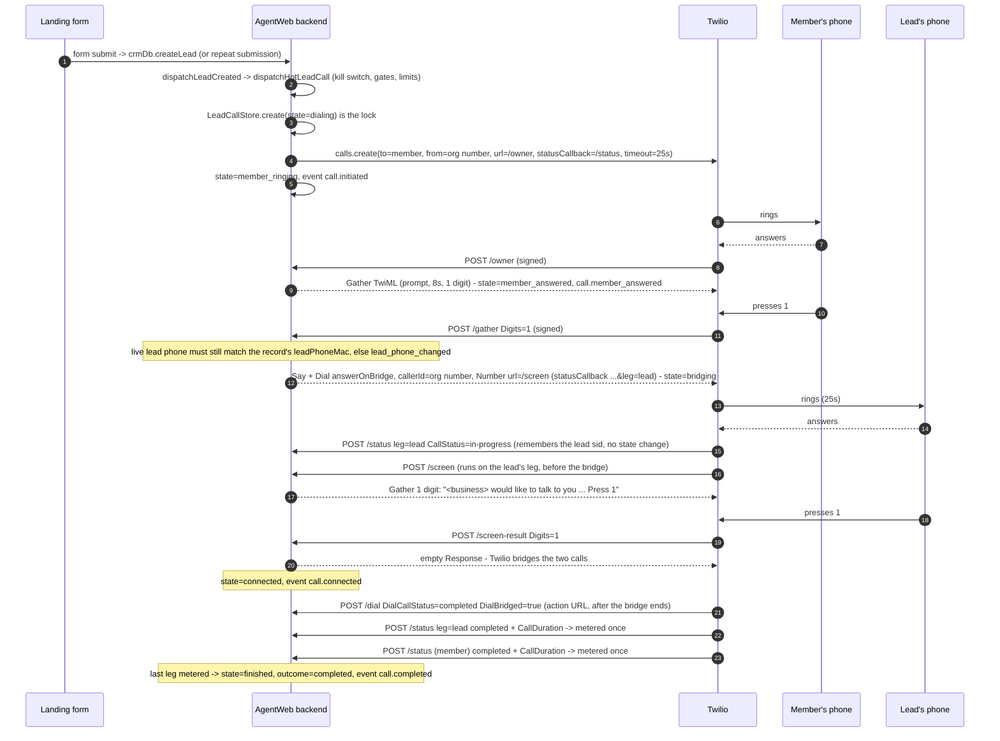

# Hot-lead auto-call (ENG-2271)

When a landing-page form lead arrives with a phone number, AgentWeb phones a
member of the business's team from a Twilio number the org owns and says "New
lead from <business name>. Are you available to take the call now? Press 1." On
`1` it dials the lead, who hears "<business name> would like to talk to you about
your enquiry. Press 1 to be connected now." and must press 1 as well; only then
are the two calls bridged. Which member is rung depends on the
team's priority order and weekly availability windows (see [Who is rung](#who-is-rung)). The outcome and every step are written to the lead's timeline.

It is a second subscriber to the same moment as the Slack lead alert
([lead-notifications.md](./lead-notifications.md)). It never delays, replaces or
suppresses that alert: a skipped or failed call leaves the Slack message as the
fallback.

Status of this document: it describes the code as merged, including the number-provisioning
and team-member verification Emma tools. The behaviour is covered by tests against fakes
and DynamoDB Local; nothing here has been run against a real Twilio account. Everything
marked **to confirm with Twilio** or listed under "Not verified" is an assumption taken
from Twilio's documentation.

## Operator quick reference

- **Turn the whole feature off:** set the AW-Settings item `hot_lead_call_mode`
  to `off` (anything but `on`, or delete it). It takes effect within ~30s per
  backend instance. No operator route or command exists for this: edit the
  AW-Settings item directly. See [Turn it off](#turn-it-off).
- **Turn off one org:** `update_hot_lead_call_settings({enabled: false})` (the org's
  owner/admin, through Emma), or set `hotLeadCall.enabled` to `false` on the org item.
- **A call looks stuck or unbilled:** [Stuck records](#stuck-records) (how to
  find them, what each state means, where the spend events live).
- **A number may be billed but not recorded:** search the backend logs for
  `ORPHAN` (`ORPHAN number`, `ORPHAN RISK`), then [Orphan numbers](#orphan-numbers).
- **Why no call happened:** the lead's timeline shows `call.skipped` with a
  reason, or nothing at all when the refusal is silent by design; see
  [Outcomes and timeline events](#outcomes-and-timeline-events) and
  [Other symptoms](#other-symptoms).
- **Before first use anywhere:** [Go-live checklist](#go-live-checklist). The
  first customer is Haven (a customer org); Harsha (company owner) allocates the
  Twilio rates and approves production org-config writes; Anurag owns go-live.

## Call flow



Branches (all end in `finished` once every leg that was dialed is metered):

| Situation | Webhook that decides | Outcome | Timeline events after `call.initiated` |
| --- | --- | --- | --- |
| Member presses 1, lead answers and presses 1 | `/gather`, `/screen`, `/screen-result` | `completed` | `call.member_answered`, `call.connected`, `call.completed` |
| Lead answers but presses another key, says nothing or hangs up | `/screen-result` (a key) or `/dial` (`completed` with `DialBridged=false`) | `lead_declined`; the member hears "The lead did not confirm. Their details are in your lead alert." and no other member is tried | `call.member_answered`, `call.lead_declined`, `call.completed` |
| Member presses another digit, hangs up on or ignores the prompt, or never picks up (no-answer, busy, failed, canceled) | member `/status` terminal | `member_declined` / `member_no_answer` for the attempt; the record moves to `between_attempts` and the next-attempt request runs (see [Who is rung](#who-is-rung)) | `call.member_declined` or `call.member_no_answer`, then `call.completed` only when no further attempt is queued |
| Member presses 1, lead does not answer | `/dial` with `no-answer`, `busy` or `failed` | `lead_no_answer` | `call.member_answered`, `call.lead_no_answer`, `call.completed` |
| Lead number changed since the call passed the gates (repeat submission overwrote the phone) | `/gather` | `lead_phone_changed` (record stays `member_answered` until the member leg ends); the member hears "We could not reach the lead. Their details are in your lead alert."; no other member is tried | `call.member_answered`, `call.failed` (reason `lead_phone_changed`), `call.completed` |
| Lead number no longer valid at bridge time | `/gather` | `lead_phone_invalid` (record stays `member_answered` until the member leg ends) | `call.member_answered`, `call.failed` (reason `lead_phone_invalid`), `call.completed` |
| Kill switch or config turned off while the member is on the line | `/owner`, `/gather` or `/screen` | `aborted` | at `/owner` (still ringing): `call.failed` (reason `aborted`), `call.completed`; at `/gather` (member was on the prompt): `call.member_answered`, `call.failed` (reason `aborted`), `call.completed`; at `/screen` (lead answered): `call.failed` (reason `aborted`), `call.completed` |
| Member hangs up while the lead is still ringing (`/dial` reports `canceled`) | `/dial`, then `finishIfComplete` | `bridge_unconfirmed` | `call.member_answered`, `call.completed` |
| Bridge ended but `/dial` never reported a result | `finishIfComplete` | `bridge_unconfirmed` | `call.completed` |

### Who is rung

`selectHotLeadCallCandidates(config, at)` (`services/hotLeadCallRoster.ts`) is a
pure function: the verified team members, in team order, who have a window open at
`at` AND only when `at` is inside the calling hours. Weekday and `HH:MM` come from
the same local instant in the calling-hours timezone, so DST days resolve on the
clock the business sees. The orchestrator rings the first candidate that is not in
its cooldown. A team of one rings that person whenever the calling hours are open and
their window allows.

**Next attempt.** When a member leg ends without the member taking the lead
(declined, ignored the prompt, no answer, busy, failed, canceled) the member
`/status` webhook, in ONE transition, meters leg `member:<attemptNo>` and moves the
record to `between_attempts`. It then calls `requestNextHotLeadCallAttempt`
(`services/hotLeadCallAttempts.ts`): if it answers `enqueued: true` the
orchestrator's next-attempt job takes over from `between_attempts`; otherwise the
webhook finishes the record (`call.completed`). When the webhook is the one to find
nobody left, a first attempt keeps its own outcome (`member_declined` /
`member_no_answer`) and a later attempt ends as `no_member_available`. Webhooks
never place calls. A member callback for any CallSid other than the record's
current `memberCallSid` (an earlier attempt that was already metered) is
acknowledged and writes nothing. A lead who declines or cannot be reached never
triggers another member, and neither do `aborted`, `lead_phone_changed` or
`lead_phone_invalid`.

**The next-attempt job** (`hot_lead_call_next`, key `sha256(jobKey|attemptNo)`, so
a replayed callback queues the same job once) runs
`processHotLeadCallNextAttempt`. It only acts on a record that is still
`between_attempts` AND whose `attemptNo` equals the job's (the webhook queues it
with the number of the attempt that just ended, read after its own transition), so
a duplicate or stale job stops without dialing. It then re-checks everything at the
moment it runs: kill switch, org config, entitlement, `maxAttemptsPerLead`, the
lead's age, and who is available NOW (excluding `triedMemberIds`). The conditional
`between_attempts` -> `dialing` move (which stores the new `attemptNo`, `memberId`,
appends to `triedMemberIds`, and removes `memberCallSid` and `outcome` through the
patch's `clear` list, a `REMOVE` in the same conditional update) is the lock for the
attempt; then the member is called and the
record moves to `member_ringing`, exactly like a first attempt. If the placement is
ambiguous the record stays `dialing` with `placement_unknown` and the first signed
callback of that call supplies its sid, for any attempt number. A callback of an
EARLIER attempt's call is never adopted as the new attempt's sid: each ended member
leg leaves a `<sid>#ended` marker in `lastSequence`. A call Twilio definitely
rejects ends only that attempt (`call.failed`, reason `place_rejected`) and the job
goes on to the next member within `maxAttemptsPerLead`; the record fails with
`place_rejected` only when every placement of the pass was rejected. The job closes
a record that is waiting between attempts whenever it cannot ring anyone: config
disabled, not entitled or the kill switch off -> `disabled` (with the switch off it
makes one conditional write and no reads); no one available any more, attempts used
up, the lead too old or no caller number -> `no_member_available`. The reason a
further attempt was refused is logged by the webhook (`no further attempt: <reason>`).

**Records stranded between attempts heal.** A record waits in `between_attempts` after a member leg ended (and was
metered) or after Twilio rejected a call. What closes it depends on which job was working on it:
- *The next-attempt job* (`processHotLeadCallNextAttempt`): any error before it rang anyone closes the record as `failed`
  with outcome `next_attempt_failed` and a `call.failed` event (reason `next_attempt_failed`), then fails its queue row.
- *The placement pass, in either job* (`placeMemberCall`, which the first-attempt job and the next-attempt job both run):
  once a call has been rejected the record waits with no call in flight, so any error later in the same pass (the next
  member's lock write, the limit store) closes it the same way.
- *A re-run by the queue poller* (see below) of a first-attempt job that finds its own record (same job key) waiting
  hands it to the next-attempt path, which queues the next member or finishes the record.
A record that has already left `between_attempts` is never touched by these closes, because a call may be live on it.
The other way to be stranded is a store error after the leg was metered but before the next attempt
was requested. Twilio then redelivers the leg's final status callback (the
`#rc=3&rp=5xx,ct` override), `/status` finds the leg already metered, the record
still `between_attempts` and the leg's `<sid>#ended` marker present, and asks for the
next attempt again. That request is idempotent (the queue key, then the
`between_attempts` -> `dialing` lock, which also names the attempt it follows) and nothing is billed twice.

**What the queue poller does.** `pollAndProcessOnce` (`src/server.ts`, every 30 seconds) reclaims `processing` rows whose
`updatedAt` is older than 5 minutes (the heartbeat stopped, so the process died) and runs the job's processor again with
the same payload; a row that failed is not reclaimed (both sources run with `maxAttempts: 1`). For a first-attempt
job (`hot_lead_call`) a re-run finds the lead's record already created, so it dials nothing: it only resumes the case
above (its own record waiting between attempts). A record left `dialing` by a first attempt that died is not retried
(see Stuck records). For a next-attempt job (`hot_lead_call_next`) a re-run acts on a record of the same call that is
`between_attempts` at the job's attempt number or at a LATER one. At the job's number the lock had not been taken, so
it carries on and places the call. At a later number the job's own earlier run took the lock for the next attempt,
Twilio rejected that placement and the process died before the record was closed; such a record has no call sid, so no
callback can ever resolve it, and the re-run carries the chain on from the record's current attempt (members already
tried are excluded; `maxAttemptsPerLead`, the lead's age, the calling hours, the kill switch and the plan are checked
again, and it closes the record when nobody is left). It leaves alone a record at an earlier attempt number, a record
of another call and a record that is not waiting. If the earlier run's call was placed (the record is `dialing` or
further on) the re-run stops and the record is a Stuck-records case.

**Writes that commit and then report an error.** A store write can apply and still throw (a timeout after the
commit). The steps that decide who dials write a random `claimToken` onto the record: creating the record (first
attempt), the `between_attempts` -> `dialing` lock (next attempts) and the `/gather` move to `bridging`. When such a
write throws, or answers that it lost (the AWS SDK retries a timed-out conditional write, and when the first try had
committed the retry fails its own condition, which the store reports as `false`), the writer re-reads the record, up to
three times if the read itself fails: its own token means the write landed, so it goes on (places the one call,
or returns the Dial TwiML) instead of leaving a `dialing` record nobody will ever call back, or a member hung up on while
`bridging` waits for a lead leg. No token of its own means the write did not land: a failed create leaves no record and
gives the slots back, a failed lock fails the job and closes the waiting record as `failed` / `next_attempt_failed`, and a
failed `/gather` move hangs up, so the member leg's end hands over to the next member. A second writer never finds the
first one's token, so the retry is exactly-once, and a `false` that really is a lost race (another dispatch of the lead,
another worker on the lock) carries somebody else's token and changes nothing. Timeline events (`call.completed` and
the others) and usage events are written after the decision they report, so a write that commits and then errors can
lose one: a usage event lost this way under-bills, and nothing is ever billed twice.

A placement Twilio definitely rejected is recorded the same way: if the update to `between_attempts` errors, or lands and
answers `false`, the record is read back and the move is made again while it is still `dialing`, up to three tries, so the
pass goes on to the next member. If the third read-back still shows `dialing` the record is closed as `failed` with
outcome `place_rejected` where it stands (no call exists, so nothing else would ever resolve it) and the pass ends. An
unreadable record, or one that is not ours, is left alone and the pass ends: that is the `dialing` stuck-record case below.

Closing a waiting record is tried twice and then thrown, so the job fails (the queue row is marked failed) instead of
reporting a close that did not happen, and the record stays `between_attempts`. When the record waits right after an
attempt that had a call, a replayed final callback of that attempt then asks for the next attempt again: the queue key is a duplicate, and a duplicate whose row FAILED is
cleared and queued again (a pending, running or completed row is left alone), so the job runs once more. That needs a
replay: Twilio redelivers a final status callback only when we answered it with a 5xx, so a record whose failure
happened after we answered 200 waits until someone replays the callback (or it is repaired as under Stuck records).

When the re-read itself fails three times in a row after a write that may have landed (the lock and `/gather` read
three times; the first create reads three times in its own step and three more in the member's turn, six in all), the
writer gives up and the outcome is the unknown one: a record that is `dialing` with no `memberCallSid`, or `bridging`
with no `leadCallSid`, and no call in flight. Those are the cleanup case under [Stuck records](#stuck-records).

**Lead age.** The deadline for further attempts is measured from the record's
`startedAt` (when the first member was rung, which was itself within
`maxAgeMinutes` of the submission), not from the submission: a lead is never chased
for much longer than `maxAgeMinutes` after the first call began.

The leg-metering rule behind "finished": the store refuses to move a terminal
record, so each leg is metered while the record is still live and the LAST leg
to be metered performs the terminal transition. A record therefore stays live
until the final status callback of every dialed leg has arrived.

## Inbound callbacks

A lead who calls the org's number back (the number the member and lead calls were
made from) is answered by the same feature, in the other direction: the team is
rung and the caller is connected to the first member who accepts. It is
stateless: no lead call record and no timeline event are created (the call store
is keyed by lead, and an inbound caller is not necessarily one), and nothing is
recorded or sent to voicemail.

```mermaid
sequenceDiagram
  autonumber
  participant Caller as Lead calling back
  participant Tw as Twilio
  participant App as AgentWeb backend
  participant M1 as Member 1
  participant M2 as Member 2

  Caller->>Tw: dials the org's number
  Tw->>App: POST /inbound (the number's voice URL; signed; body To=org number)
  Note over App: find org by number (60s cache), kill switch, config, plan; pick member 1 at this instant
  App-->>Tw: Dial answerOnBridge callerId=org number, Number url=/inbound-screen (the caller hears ringing)
  Tw->>M1: rings (25s)
  M1-->>Tw: answers
  Tw->>App: POST /inbound-screen (on the member's leg)
  App-->>Tw: Gather: "<business>: a lead is calling back. Are you available to take the call? Press 1."
  M1->>Tw: presses 2 (or nothing, or hangs up)
  Tw->>App: POST /inbound-dial DialCallStatus=completed DialBridged=false
  App-->>Tw: Dial to member 2 (priority order, availability re-evaluated now)
  Tw->>M2: rings, M2 answers and presses 1
  Tw->>App: POST /inbound-screen-result Digits=1
  App-->>Tw: empty Response - Twilio bridges the caller and member 2
  Tw->>App: POST /inbound-dial DialBridged=true (after the bridge ends) -> hangup
  Tw->>App: POST /inbound-status (member 2's leg) completed + CallDuration -> metered once
```

Rules (all verified against `routes/twilioVoiceWebhook.ts` and `services/voice/inboundCallback.ts`):

- **Finding the org.** The dialled number is the signed request's `To` (`Called` if `To` is empty). AW-Organizations has no
  index on it, so `services/voice/inboundNumberIndex.ts` scans the orgs that hold a number (`orgDb.listHotLeadCallNumbers`,
  projected to id and number) and keeps the result in memory per backend instance. One snapshot serves every lookup,
  so an unknown number costs no scan of its own (that is the negative cache). The snapshot is refreshed stale-while-revalidate:
  after 60 seconds the next call is still answered from the old snapshot while one background scan runs (shared, retried no sooner
  than every 5 seconds after a failure, failures logged by error name only), so the scan is never in the call path. Only the first
  lookup after a start, with no snapshot, waits for the scan; if that fails the call is refused and the failure is not cached.
  A number bought or released within the last 60 seconds (longer while refreshes fail) is therefore not served yet. The snapshot only *locates* the org: the org is then
  re-read (consistent read) and its live config decides, so a stale entry can only end in a refusal. A number stored on
  two orgs is served to neither. No GSI and no data change was made.
- **Fail closed.** Unknown number, kill switch off, config missing/invalid/disabled, the number no longer the org's, an
  org without an owner, or a plan without the `hot_lead_call` feature: the caller hears "Sorry, we are unable to take your
  call right now. Goodbye." and the call is hung up. Nobody is rung. An unexpected failure in a step is answered per step: `/inbound`
  and `/inbound-dial` give the same message and hangup, `/inbound-screen` and `/inbound-screen-result` a bare `<Hangup/>` (which
  moves on to the next member), and `/inbound-status` a 500 so Twilio redelivers.
- **Who is rung.** `selectHotLeadCallCandidates` at the current instant: verified, inside their window and inside the
  calling hours, in team priority order, skipping members already tried. At most `maxAttemptsPerLead` members are rung per
  callback. Availability (windows, calling hours) is re-evaluated each time the next member is chosen, that is at `/inbound`
  and at each `/inbound-dial` step. A member who has already picked up and presses 1 is connected even if their window closed
  meanwhile (the outbound `/gather` does not re-check windows either). A member removed or un-verified meanwhile is still
  refused: their screen and their "1" check the live team.
- **Nobody available or accepting.** The caller hears "Sorry, nobody is available to take your call right now. Please try
  again later. Goodbye." and the call is hung up. That also applies outside the calling hours.
- **Only a 1 connects.** Anything else (another key, silence, a hang-up, voicemail, no answer, busy, failed) moves on to the next member.
  A Dial that ends `completed` without `DialBridged=false` (unknown: might be a finished conversation) or `canceled` (the
  caller hung up) rings nobody else.
- **Stateless and bounded.** The state is the signed query of each step URL: `orgId` and `tried` (the member ids rung so far,
  comma-separated, each `m` + 7 base-36 characters, unique, at most 5). Each step adds one member and the chain is
  capped by `maxAttemptsPerLead`, so it always ends; a Twilio retry of a step repeats the same decision. The caller ID
  of the member legs is the org's number (not the caller's, which can be withheld).
- **Guard.** The same credentials -> signature steps as the outbound endpoints (`verifiedBody`), but with no lead
  record: the org comes from the dialled number (`/inbound`, no query) or from the signed `orgId` (the other steps).
  A bad signature is 401, unloadable credentials 503; a signed request with a malformed query, or whose handler fails,
  is answered with the spoken refusal (`/inbound`, `/inbound-dial`) or a hangup (the member's screening steps) with 200;
  `/inbound-status` acknowledges with 200 and answers 500 when the org read or billing fails (it carries the same retry override).
  It is deliberately not gated on the kill switch, config or plan: the leg already happened and must still be billed.

Metering: only the **member leg** is metered, with the existing `voice_minute_outbound` rate (it is an outbound call from our
number), by `/inbound-status` (`CallStatus` terminal, with a `ParentCallSid`), idempotency key
`twilio:voice:<member leg CallSid>:member`, billed to the org's owner. **The caller's own inbound leg is not metered yet**:
the rate card has only `voice_minute_outbound`, and no inbound rate was agreed, so none was invented. Until Harsha
allocates an `voice_minute_inbound` rate, inbound minutes are an unrecorded Twilio cost (the caller's leg lasts as long as the
bridged conversation).

Limits to know about:

- **No cap on volume.** The outbound abuse limits (calls per hour/day, per-member cooldown, lead-phone dedupe) do **not** apply,
  and there is no per-caller, hourly or daily cap of any kind: there is no lead, and anyone with the number can dial it. Each call
  rings at most `maxAttemptsPerLead` members. The exposure is the member-leg minutes, billed to the org owner through the usage
  ledger (and the same minutes on AgentWeb's Twilio bill), bounded only by Twilio's own geographic permissions and spend limits.
  A separate ticket covers a cap; it is a go-live decision (item 15).
- Callers are not screened or limited (no per-caller cap, no blocklist) and are not recorded in the lead timeline.
- The member prompt is the org's `announcedName` only; visitor-supplied text is never spoken.
- A freshly provisioned number is pointed at `/inbound` by `buyNumber` (`voiceUrl`, POST). A number bought **before** this
  existed keeps its old voice URL until it is set by hand in the Twilio console (see [Go-live checklist](#go-live-checklist)).
- Not verified against real Twilio (see [Not verified](#not-verified-without-a-real-twilio-account)).

## Components and file map

All paths are under `backend/src/`.

| Piece | File |
| --- | --- |
| Hook (second subscriber to the lead-created moment) | `services/orgLeadNotificationService.ts` `dispatchLeadCreated` calls `dispatchHotLeadCall` first, fire-and-forget. The batch path `dispatchLeadsCreated` deliberately does not. |
| Orchestrator: gates, limits, create-first, place call | `services/hotLeadCallService.ts` (queue source `hot_lead_call`, `maxAttempts: 1`, registered in `app.ts`) |
| Placing one member call (first and later attempts) | `services/hotLeadCallPlacement.ts` |
| Next attempts: the request the webhooks make and the job that rings the next member (queue source `hot_lead_call_next`) | `services/hotLeadCallAttempts.ts` |
| Queueing and running a job of either kind (enqueue, heartbeat, complete or fail) | `services/hotLeadCallQueue.ts` |
| Keyed hash of the lead's phone kept on the call record | `services/voice/leadPhoneMac.ts` (one helper: the orchestrator stores it, `/gather` compares it) |
| Org config type and strict validator | `services/hotLeadCallConfig.ts` |
| Who to ring at a given time (pure routing and the portal preview) | `services/hotLeadCallRoster.ts` |
| Org/list/owner routing for the call | `services/voice/hotLeadCallContext.ts` |
| Global kill switch | `services/voice/hotLeadCallMode.ts` |
| Plan entitlement (the `hot_lead_call` subscription feature) | `services/voice/hotLeadCallEntitlement.ts` |
| Abuse limits, per-member cooldown, slot reservation | `services/voice/hotLeadCallLimits.ts`, `services/voice/limitStore.ts` (DynamoDB), `__tests__/helpers/fakeLimitStore.ts` (tests) |
| Call record (state machine storage) and timeline events | `services/voice/leadCallStore.ts`, `services/voice/leadCallStore.types.ts`, `__tests__/helpers/fakeLeadCallStore.ts` (tests) |
| Twilio seam (`placeCall`, `buyNumber`, `releaseNumber`, `validateSignature`) | `services/voice/voiceProvider.ts` (the only file that imports `twilio`), `__tests__/helpers/fakeVoiceProvider.ts` (tests) |
| Webhook URLs (outbound steps, the inbound steps and the number's voice URL `inboundVoiceUrl`) | `services/voice/voiceUrls.ts` |
| TwiML builders (hand-built XML, XML-escaped) | `services/voice/twiml.ts` |
| Webhook routes, mounted at `/api/webhooks/twilio-voice` | `routes/twilioVoiceWebhook.ts` (`/owner`, `/gather`, `/screen`, `/screen-result`, `/dial`, `/status`; `/owner` serves the prompt to the team member being rung, the name predates teams; and the inbound-callback steps `/inbound`, `/inbound-screen`, `/inbound-screen-result`, `/inbound-dial`, `/inbound-status`) |
| Inbound callbacks: context by dialled number, next member, query validation | `services/voice/inboundCallback.ts` |
| Inbound callbacks: dialled number -> org (60 s in-process snapshot of a projected scan, `orgDb.listHotLeadCallNumbers`) | `services/voice/inboundNumberIndex.ts` |
| Metering of a finished leg, the hand-over to the next member and the rule that finishes a call | `services/voice/callFinalisation.ts` |
| Per-leg usage event | `services/voice/voiceUsage.ts` `recordCallUsage` -> `recordVendorUsage` |
| Rate card and runtime rate overrides | `utils/vendorRateCard.ts`, `routes/adminVendorRates.ts` |
| Twilio credentials | `utils/secretsManager.ts` `getTwilioCredentials` |
| Emma settings tools | `emma/hotLeadCallTools.ts` |
| Settings service: ONE implementation of read, update, preview and verification used by both the REST routes and the Emma tools | `services/hotLeadCallSettingsService.ts` (typed errors in `services/hotLeadCallErrors.ts`) |
| Team settings REST API (portal), mounted at `/api/orgs/me/hot-lead-call` | `routes/orgHotLeadCall.ts` |
| Emma setup tools (number provisioning, team-member verification) | `emma/hotLeadCallSetupTools.ts`, `services/voice/numberProvisioning.ts`, `services/voice/memberVerification.ts`, `services/voice/setupWrites.ts` |
| Admin UI for rates | `partner-portal/src/components/admin/VendorRatesTab.tsx` (Admin > Revenue & billing > Vendor Rates) |

Tests worth knowing: `__tests__/hotLeadCall.e2e.test.ts` (the calls: real
orchestrator + real webhooks + real store on an in-memory DB fake, signed with
Twilio's own HMAC) and `__tests__/hotLeadCall.e2e.gates.test.ts` (gates, calling
hours, dedupe, cooldown, caps and silent refusals) and
`__tests__/hotLeadCall.e2e.inbound.test.ts` (inbound callbacks: priority, hand-over, caps, fail-closed gates, signatures, metering) and
`__tests__/hotLeadCall.e2e.attempts.test.ts` (several members: the reference team,
hand-over through the real next-attempt job, lead screening, replays across
attempts, and the world changing between attempts), sharing
`__tests__/helpers/hotLeadCallE2eWorld.ts`; `__tests__/hotLeadCallService.test.ts`,
`__tests__/twilioVoiceWebhook.test.ts`, `__tests__/hotLeadCall.flagOff.test.ts`
(Slack path identical with the switch off), `__tests__/hotLeadCallLimits.dynamodbLocal.test.ts`
and `__tests__/leadCallStore.dynamodbLocal.test.ts` (real DynamoDB expressions
against DynamoDB Local).

### The at-most-once rule (create-first)

A phone call cannot be retried the way a Slack message can. The call RECORD is
the lock:

1. All gates pass and a limit slot is reserved.
2. `LeadCallStore.create` writes `lead.system.hot_lead_call` with `state=dialing`
   using a create-if-absent conditional write. `false` means a record already
   exists: do not dial. A lead gets at most one call record, ever.
3. `placeCall`. Success: `member_ringing` + `call.initiated`. Twilio rejected it
   (HTTP 4xx other than 408, `placed: 'no'`): `call.failed` (reason
   `place_rejected`) and the pass goes on to the next member; when none is left the
   record is terminal `failed` / `place_rejected`. Anything ambiguous (timeout, 5xx, no
   response, no sid): the record stays `dialing` with `outcome=placement_unknown`
   + `call.failed` (reason `placement_unknown`), and is NEVER retried.
4. A `dialing` record can still be adopted: the first signed member-leg callback
   (`/owner` or the member `/status`) for the same `jobKey` supplies the CallSid,
   moves the record to `member_ringing`, writes `call.initiated`, and the call is
   metered normally.

Later attempts reuse this record (the lead still has one record, ever): see
[Who is rung](#who-is-rung). The per-lead abuse limits (phone marker, hourly and
daily caps) are taken once, for the first attempt; the per-member cooldown is taken
for every attempt.

The queue job row also dedupes the same job key (`sha256(orgId, listId, leadId
[, submissionId])`).

## Org config: `Organization.hotLeadCall`

Validated by `hotLeadCallConfigOf` (strict: any invalid field, or an unknown key,
makes the whole config invalid; a stored config that fails validation means "no
call, Slack only"). Validation applies to every read, including the webhooks.

| Field | Rule |
| --- | --- |
| `enabled` | boolean, required. Enabled requires at least one verified team member, `twilioNumber` and `callingHours`; a half-configured org can only be saved disabled. |
| `team` | required, 1 to 10 members; the order is the priority (first is rung first). Unknown keys are refused at every level. Member ids and phones are unique within the team. |
| `team[].id` | `m` + 7 lowercase letters or digits, generated by the server (`generateMemberId`), never chosen by a client. Call records and cooldown keys refer to it. |
| `team[].name` | 1-40 chars of letters, digits, space and `. , & ' -`. Shown in tool output and the portal, never spoken. |
| `team[].phone` | Canonical E.164, US or CA only (Puerto Rico, Guam and other +1 territories refused); premium, toll-free, personal, shared-cost, UAN and VOIP number types refused. Must differ from `twilioNumber`. |
| `team[].verifiedAt` | system-managed, ISO timestamp (set by confirming the verification code, cleared when that member's phone changes). |
| `team[].windows` | 1 to 7 weekly availability windows `{ days, start, end }`: `days` are 0 (Sunday) to 6 (Saturday), unique, 1 to 7 of them; `start` and `end` are `HH:MM` on the `callingHours` clock; `end` may be `24:00`, `start` must be before `end` (a window never wraps midnight: overnight is two windows). Start inclusive, end exclusive. |
| `twilioNumber`, `twilioNumberSid` | system-managed. Same phone rules; sid must match `PN` + 32 hex. |
| `leadTypes` | non-empty subset of the lead origins; default `["form_fill"]`. In practice the orchestrator only ever calls for `form_fill`; other origins return before any read. |
| `maxAgeMinutes` | integer 1-60, default 10. A lead older than this when the first job runs (`submittedAt`, else lead `createdAt`; a missing or unparseable time fails closed) is skipped as `too_old`. Further attempts must start within this long of the call record's `startedAt`. |
| `maxCallsPerHour` | integer 1-30, default 6. Counts LEADS that get a call, one per lead at its first attempt: a lead can ring up to `maxAttemptsPerLead` members and then the lead's own leg and still uses one slot. |
| `maxCallsPerDay` | integer 1-100, default 20. Counts leads the same way. |
| `memberCooldownMinutes` | integer 1-60, default 2. Per team member: a member who was just rung is passed over for the next available one. |
| `maxAttemptsPerLead` | integer 1-5, default 3. How many member calls may be made for one lead; a member who was already tried is never rung again. |
| `announcedName` | required, trimmed, 1-60 chars of letters, digits, space and `. , & ' -`. Spoken in `<Say>`; XML-escaped by the TwiML builder. |
| `callingHours` | `{ start, end, timezone }`, `HH:MM` 24h, `start != end`, defaults 08:00 / 21:00. It is the window in which calls ARE allowed, in the org's IANA `Area/Location` timezone (UTC, abbreviations and `Etc/` refused). `start > end` wraps past midnight. Start inclusive, end exclusive, minute granularity. The lead's own timezone is not considered. Required to enable. Member windows are read on this same clock. |
| `allowedCountries` | non-empty subset of `["US","CA"]` (default both); the lead's number must resolve to one of them. |

The lead's number is read from the lead row at dispatch AND again at bridge time;
national-format numbers are parsed as US. It never travels in a URL or a query.
A repeat submission with the same email overwrites `lead.phone`, so the call
record keeps `leadPhoneMac`, a keyed HMAC of the number that passed the gates
(`services/voice/leadPhoneMac.ts`, domain label `hlc-lead-phone-v1`; never the
number). `/gather` refuses to dial when the live number's MAC differs
(`lead_phone_changed`). A record without a `leadPhoneMac` cannot prove it and is
refused the same way; the orchestrator always stores one.

## Emma tools

Registered as foundation tools. Org membership comes from the authenticated user
(never from arguments); `get_hot_lead_call_settings` and every write need `org:configure`
(owner/admin). Not available in shared sessions.

Settings (merged). Both tools call the same service as the REST API
([Team settings API](#team-settings-api-rest)), so the portal and chat apply identical rules:

- `get_hot_lead_call_settings({})` needs `org:configure`. It returns the portal view
  (`entitled`, `enabled`, `canEnable`, plain-English `blockers`, `callingHours`,
  `maxAttemptsPerLead`, `announcedName`, `twilioNumberMasked`, the `team` in priority order with
  each person's `id`, `name`, `phoneMasked`, `verified` and `windows`, and `limits`) plus
  `configured`, `callerNumberAssigned`, `leadTypes`, `allowedCountries`, the other limit fields
  and the lead types that exist. No SIDs or full numbers, and no revision token.
- `update_hot_lead_call_settings({...})` takes any of `enabled`, `team`, `memberPhone`,
  `memberName`, `leadTypes`, the limit fields (including `maxAttemptsPerLead`),
  `announcedName`, `callingHours`, `allowedCountries`. `twilioNumber` and `twilioNumberSid`
  are refused (system-managed), and so is `verifiedAt` anywhere.
  - `team` is a FULL replacement, with the semantics of the REST PUT: the order is the priority,
    people missing from the array are removed, an entry without `id` is a new person (server-generated id,
    phone required), an entry with an `id` edits that person and keeps the stored phone when none is sent,
    and a changed phone clears that person's verification and any code in flight.
  - `memberPhone` / `memberName` edit a team of ONE (the first save creates the member, available whenever
    the calling hours are open); on a larger team the tool refuses them and asks for `team`.
  - `callingHours` may be partial in chat: missing parts are filled from the stored hours, then the
    08:00-21:00 defaults.
  - The tool edits the copy it just read; the write is conditional on the stored attribute being
    unchanged, so a concurrent edit fails ("changed by someone else") instead of clobbering.
  - Unattended runs (`context.isUnattendedRun === true`) are refused for any change that turns calling on,
    raises a cap (`maxAgeMinutes`, `maxCallsPerHour`, `maxCallsPerDay`, `maxAttemptsPerLead`), shortens
    the pause between calls to one person, changes the business name that is read aloud, adds a lead type or country, widens the calling hours (or moves
    them to another zone), first-saves the settings, or edits the team. Turning calling off and lowering a limit
    stay allowed. Confirming a verification code has no such refusal (it needs the code).

Setup tools (number provisioning and team-member verification). They need `org:configure`, work while the global
kill switch is off, and are blocked in shared sessions. The three that spend
money or cannot be undone (`provision_hot_lead_call_number`,
`release_hot_lead_call_number`, `start_hot_lead_call_verification`) also REFUSE
unattended runs (`context.isUnattendedRun === true`: scheduled or autonomous
turns) with "This needs a person to confirm in an interactive chat".
`confirm_hot_lead_call_verification` has no such refusal (the settings update has its own, listed above):

- `provision_hot_lead_call_number({areaCode?})` buys one US local
  voice-enabled number (the cost is stated in the tool text, read from the live
  rate card). Needs saved settings, one number per org, at most 2 purchases per
  org per rolling 24h and 6 releases per day (reservations are written to the org
  attribute `hotLeadCallProvisioning`, conditional on it and `hotLeadCall` being
  unchanged, BEFORE Twilio is called; a reservation whose purchase then fails
  still counts). A stored `hotLeadCallProvisioning` that is malformed makes both
  tools refuse ("Contact support"). A person must approve each purchase
  ([Human approval](#human-approval-for-provision-release-and-turning-calling-on)); `confirm` is
  still accepted but ignored, because the model controls it. An ambiguous buy failure is
  logged as `ORPHAN RISK` and is not retried. The first month's rent is
  metered at purchase and later months by the daily rent sweep (see Metering).
- `release_hot_lead_call_number({})` turns calling off first, releases the
  number (a 404 from Twilio counts as already gone; any other failure keeps the
  number assigned), then clears `twilioNumber`/`twilioNumberSid`. Needs the
  same human approval as a purchase.
- `start_hot_lead_call_verification({memberId?})` rings the SAVED phone of a member (the only member, or the one named by `memberId`, required on a larger team) from the
  org number and reads a 6-digit code (inline TwiML, no webhook). Refused when the plan lacks the feature or no caller number exists. See [Verification](#verification-per-member) for storage and limits. Metered as one estimated
  minute (leg `verify`).
- `confirm_hot_lead_call_verification({code, memberId?})` checks the code and
  writes that member's `verifiedAt`, only if the member's phone is still the phone the code was issued for.

Order of setup, which the tool text also teaches Emma:

1. `update_hot_lead_call_settings`: member phone, announced name, calling
   hours (with timezone), optionally lead types and limits. Saved disabled.
2. `provision_hot_lead_call_number` (spends money; the user approves on a card).
3. `start_hot_lead_call_verification`, then `confirm_hot_lead_call_verification`
   with the code the member heard.
4. `update_hot_lead_call_settings({enabled: true})`. Refused unless a member's
   phone is verified, a number is assigned and calling hours are set; then the user
   approves turning calling on on a card
   ([Human approval](#human-approval-for-provision-release-and-turning-calling-on)).

Cost bound through these tools: 2 purchases at the card's $1.15 plus 5
verification calls at $0.014 is about $2.37 per org per day at the provisional
rates. The first month's rent is metered at purchase; later months by the daily
rent sweep.

### Human approval for provision, release and turning calling on

`provision_hot_lead_call_number`, `release_hot_lead_call_number` and
`update_hot_lead_call_settings` with `enabled: true` (only when it turns calling on)
never act on the model's say-so. The first call halts the run with a one-question approval card
(the same deck-of-one mechanism as `services/crmSequenceActivationGate.ts`; the
logic is in `services/voice/hotLeadCallApprovalGate.ts`). The card states the
monthly rent from the live rate card; for turning calling on it says that when a lead
arrives from the landing page AgentWeb will phone the verified team member(s) (name and
last 4 digits) from the org's number (last 4 digits) and then the lead, that calls are
billed to the organization owner per minute at the live outbound rate, and that calling
can be turned off at any time. After the person clicks approve, Emma
calls the tool again with the same arguments and it acts.

- Order: the existing checks run first (unattended, arguments, owner/admin,
  plan entitlement, saved settings, already has / has no number; for turning calling
  on, everything `applyHotLeadCallSettings` checks: validation, plan, the blockers and
  the unattended refusal), so a caller who
  is refused never sees a card. Then: a chat session must exist and be readable,
  must not be a scheduled session, and must not be a support/admin session acting
  as the customer (`isDelegatedAccess` / `isDelegatedAdmin`).
- Binding: the approval is tied to a digest of the action, org, user, chat
  session, the area code (or the number being released, or the exact settings change
  that turns calling on), the price as quoted now (rent, or the per-minute rate) and
  the revision of the stored settings. A different area code, a different change, a
  price change, a settings change between the card and the click or another chat
  session (for example a branched one) needs a new card. The card kind is `hot_lead_call_approval:<action>:<digest>:<nonce>`.
- Validity: the newest card for that digest must be answered "approve" by the
  user (never by "Let Emma decide", which the card does not offer), at most 15
  minutes ago, and not used yet. Declining, ignoring or letting it expire makes the
  next call show a fresh card.
- Single use: immediately before buying or releasing, the approval is claimed
  with `chatbotDb.claimMetaWriteManifestDigest(sessionId, "hotlead:" + kind)`
  (an entry in the session's existing `consumedMetaWriteManifestDigests` map; the
  name says Meta but the function is generic). A lost claim refuses; a crash after
  the claim loses the approval, so the person approves again. Nothing is bought
  twice.
- "Decline" is listed first and is the recommended option, so an answer taken
  without a person choosing resolves to "do not spend".
- `ask_user_question` rejects a model-supplied `kind` that starts with
  `hot_lead_call_approval:`, so the model cannot author a card that passes for an
  approval.
- Accepted decisions:
  - The reserved-kind guard has one door, `ask_user_question`; no other tool can
    emit a deck with a model-controlled `kind` today. The `crm_sequence_activation:`
    prefix is still unreserved (follow-up).
  - An internal admin can click approve on a customer's card (the deck answer route
    allows `user.isAdmin`). It is a staff action recorded as `answeredBy: 'user'`
    without an approver id.
  - A purchase or release that is refused or fails after the claim (cap, Twilio
    error, a settings change racing it) still uses up the approval; the user
    approves again.
  - When another deck is already awaiting an answer, the card is not persisted:
    the model is told to stop and the user sees plain text. A typed "yes" then
    produces another halt, never an action.
- Where it sits for turning calling on: the Emma tool passes a `beforeTurningOn` hook to
  `applyHotLeadCallSettings`, which runs it after all checks and just before the write,
  and only for a change from off to on. The REST route (the portal switch is the
  person's click) passes none and is unchanged.
- Not gated: `start_hot_lead_call_verification` (one capped call to a number the
  admin saved), turning calling off, lowering limits, every other settings edit,
  `enabled: true` on a setup that is already on, and the REST/portal route.

Verification limits: it proves a phone answered and the code was heard. A
voicemail that plays the message back can also pass it. The spoken code is
believed to be visible in the Twilio call log to anyone with access to the
Twilio account (inline TwiML is normally logged; unverified, see "Not verified").

## Verification per member

`Organization.hotLeadCallVerification` is `{ members: { <memberId>: { phone, codeHash, expiresAt, attempts, callSid?, startedAt[] } }, orgStartedAt[] }`
(epoch ms; `startedAt` entries are the starts of the last 24h). One record per team member plus an org-wide list of starts.

- The code is 6 random digits, valid 10 minutes, 5 confirm attempts per code. Only an HMAC is stored,
  bound to the org, the member id AND the phone, so a code heard by one person cannot confirm another and
  a code is worthless once the member's phone differs. The code is never logged or returned.
- Limits: per member 1 start per 2 minutes and 5 per day; per organization 20 starts per day. A refusal carries
  how many seconds to wait (`retryAfterSeconds` in the REST API).
- Attempts are counted (a conditional write) BEFORE the code is compared, and the compare is constant-time,
  so parallel guesses cannot exceed 5 per code. Confirming sets that member's `verifiedAt` in one conditional write
  that also requires the stored settings to be unchanged since they were read, so a phone edited in between
  loses cleanly ("Your settings changed ... start a new verification").
- The start history is kept after a successful confirm and after a phone change (only the pending code is
  cleared), and the org-wide list survives removing a member, so alternating phones or deleting and re-adding people
  does not buy more calls.
- Changing a member's phone (REST or chat) clears that member's `verifiedAt` and pending code in the same write as the
  settings. Removing a member deletes their record.
- A stored record that does not validate (including a single-record shape that no released version wrote) makes start and confirm refuse ("Stored verification state is invalid. Contact support.") instead of
  being replaced, because replacing it would reset the limits. Repair is a data change that needs Harsha's approval.

## Team settings API (REST)

All routes live in `routes/orgHotLeadCall.ts`, mounted behind `authenticateToken` at `/api/orgs/me/hot-lead-call`. The
organization is the caller's own (from the persisted user), never from the URL or body, and EVERY route needs
`org:configure` (owner or admin); other members get 403. Phones are returned only as `phoneMasked` (`***` + last 4
digits). Error bodies are `{ error: string }` plus the fields below.

| Route | Success | Errors |
| --- | --- | --- |
| `GET /` | 200 settings (below) | 403, 404 (no org) |
| `PUT /` | 200 the updated settings, fresh `_revision` | 400 `{error, fieldErrors}`, 403, 403 `{error, code:'not_entitled'}` when enabling without the plan feature, 409 stale or raced, 428 `_revision` missing |
| `POST /members/:memberId/verification/start` | 200 `{expiresInSeconds, nextStartAllowedInSeconds, startsLeftToday}` | 403 (no plan feature with `code:'not_entitled'`, or no caller number), 404 unknown member, 409 raced, 429 `{error, retryAfterSeconds}` (also a `Retry-After` header), 502 phone provider failed |
| `POST /members/:memberId/verification/confirm` body `{code}` | 200 `{verified:true}` | 400 `{error, attemptsLeft}`, 404, 409, 429 `{error, retryAfterSeconds}` (a confirm racing another) |
| `GET /preview?at=<ISO instant>` | 200 `{at, timezone, outsideCallingHours, candidates:[{id,name}], excluded:[{id,name,reason}]}` | 400 `{error, fieldErrors:{at}}` |

`_revision` is the SHA-256 of the canonical JSON (sorted keys) of the stored `hotLeadCall`, so ANY change to it
(another editor, a verification landing, a number purchase) makes an old copy stale: re-GET after confirming a
verification. The PUT body must carry the `_revision` of the copy it edited; the write is additionally conditional
on the stored value, so two racing saves cannot both land.

PUT semantics: `team` (when sent) replaces the whole team; its order is the priority; ids missing from it are
removed; entries without `id` are new people (server-generated id, `phone` required); a phone left out of an
existing entry is unchanged; a changed phone clears that person's verification. Everything else not sent keeps its
value. A body of only `{ _revision, enabled }` is valid. Calling hours are only required when enabling. Unknown keys,
`verifiedAt`, `twilioNumber*` and the tool-only limits are refused with 400; the body is capped at 32 KB of JSON text (32,768 characters, not bytes), 10 people and 7
windows per person. The body is parsed before authentication, like the other `/api/orgs/me/*` routes. Turning calling on needs the plan feature and every requirement of `canEnable`; an explicit
`enabled: true` that cannot work yet is a 400 naming the missing piece, while an edit that merely leaves a running
setup without any verified person (the only verified phone changed) turns calling off. That is silent: the save succeeds
and the response carries `enabled: false` with the blocker in `blockers`, so a client must read `enabled` from the response
rather than assume what it sent. REST error texts are plain English; the Emma tools reword the same refusals with the
names of the tools that fix them.

`fieldErrors` are keyed by position in the submitted body: `team.N.name`, `team.N.phone`, `team.N.id`, `team.N.windows`,
`team.N.windows.M.days|start|end`, `callingHours.start|end|timezone`, `maxAttemptsPerLead`, `announcedName`, `enabled`.

Example (fake numbers):

```
GET /api/orgs/me/hot-lead-call
200 { "_revision": "9f2c...e1", "entitled": true, "enabled": false, "canEnable": false,
      "blockers": ["Verify the phone of at least one person"],
      "callingHours": { "start": "09:00", "end": "18:00", "timezone": "America/Chicago" },
      "maxAttemptsPerLead": 3, "announcedName": "Acme Plumbing", "twilioNumberMasked": "***0111",
      "team": [ { "id": "mk3f9a2b", "name": "Dana Lee", "phoneMasked": "***0100", "verified": false,
                  "windows": [ { "days": [1,2,3,4,5], "start": "09:00", "end": "17:00" } ] } ],
      "limits": { "maxTeamSize": 10, "maxWindowsPerMember": 7, "minAttempts": 1, "maxAttempts": 5, "nameMaxLength": 40 } }

PUT /api/orgs/me/hot-lead-call
{ "_revision": "9f2c...e1",
  "team": [ { "id": "mk3f9a2b", "name": "Dana Lee", "windows": [ { "days": [1,2,3,4,5], "start": "09:00", "end": "17:00" } ] },
            { "name": "Sam Ortiz", "phone": "(415) 555-0122", "windows": [ { "days": [6], "start": "10:00", "end": "14:00" } ] } ] }
200 { ...updated settings, "_revision": "41ab...07" }

PUT with a wrong phone:
400 { "error": "Some settings are not valid: team.1.phone: Enter a valid US or Canadian phone number without an extension",
      "fieldErrors": { "team.1.phone": "Enter a valid US or Canadian phone number without an extension" } }

POST /api/orgs/me/hot-lead-call/members/mk3f9a2b/verification/start
200 { "expiresInSeconds": 600, "nextStartAllowedInSeconds": 120, "startsLeftToday": 4 }
429 { "error": "A verification call was just placed. ...", "retryAfterSeconds": 90 }
```

The preview lists, in call order, who would be rung at `at` (default now). `excluded[].reason` is `unverified` or
`outside_window`; outside the calling hours (or with none set) `outsideCallingHours` is true, `candidates` is empty and
the verified people are reported as `outside_window`.

## Plan entitlement

Calls make AgentWeb pay Twilio, so the feature is tied to the plan, using the
existing subscription-tier mechanism. In the admin Subscription Types editor each
tier has a list of product features; **Hot lead calls** (`hot_lead_call`) is one.
An org is entitled when the tier of its billing owner (`Organization.ownerUserId`;
members and admins follow the owner's plan) lists `hot_lead_call` or `*`.

- A tier row with no saved feature list (rows that predate feature lists) is NOT
  entitled, unlike the other features. The editor shows such a row with
  **Hot lead calls** unticked and saving it does not add the feature; a new tier
  also starts with it unticked. Only an explicit tick (or a saved `*`) grants it.
  Features that cost AgentWeb money are on the
  opt-in-only feature list in `services/subscriptionService.ts`; every
  "all features" default leaves them out, and a future paid-vendor feature joins
  that list.
- Anything unresolvable (no owner, unreadable tier, lookup error) is not entitled.
- Enforced in three places: `provision_hot_lead_call_number` and
  `start_hot_lead_call_verification` refuse with a plain message;
  `update_hot_lead_call_settings` refuses `enabled: true` (saving settings or
  disabling is always allowed); and the orchestrator skips with `call.skipped`
  `not_entitled` before any limit or record, at dispatch and again in the job, so
  an org that loses its plan stops dialing. A call already in flight finishes.
- `release_hot_lead_call_number` and `confirm_hot_lead_call_verification` stay
  available so an org that lost its plan can still stop paying for a number.

## Settings keys (AW-Settings)

| Key | Value | Meaning |
| --- | --- | --- |
| `hot_lead_call_mode` | `on` (case-insensitive, trimmed) | Global master switch. Anything else, a missing row, a read error, or a read slower than 1.5s means OFF. |
| `vendor_rate_overrides` | JSON string | Admin overrides of provisional Twilio rates (see Metering). |

`hot_lead_call_mode` semantics: read from DynamoDB `AW-Settings` (item
`settingName = hot_lead_call_mode`, attribute `settingValue`) and cached per
backend instance for 30 seconds, so a flip takes up to ~30s per instance to
apply, and the failure direction is off. Off means `dispatchHotLeadCall` returns
before any read or write (no lead read, no limit key, no event, no queue job),
and in-flight calls are cut short: a member who picks up after the switch is
turned off hears a hangup (`aborted`) while the leg is still metered. The one
exception to "no writes" is the next-attempt job: with the switch off it reads
nothing and makes one conditional write (and its `call.completed` event) that closes a
record waiting between attempts as `disabled`, so the record does not wait for a
call that will never come. Under
Jest (`NODE_ENV=test`) it is always off unless overridden.

## Secrets and configuration

- Twilio credentials: JSON secret `{"accountSid": "...", "authToken": "..."}` named
  `prod/AgentWeb/Twilio` in production and `dev/AgentWeb/Twilio` otherwise
  (AWS Secrets Manager). The pair `TWILIO_ACCOUNT_SID` + `TWILIO_AUTH_TOKEN` in
  the environment overrides the secret, but only when BOTH are set (never mixed;
  a partial pair is ignored with a warning). A success is cached 5 minutes; a failed load is remembered for 5 seconds (one Secrets Manager read and one log line per window, callers get the same 503 meanwhile) so unauthenticated requests cannot drive a read per request.
  Missing fields throw. The auth token also verifies inbound webhook
  signatures, so rotating it takes effect within the cache TTL without a
  restart.
- `BACKEND_URL` must be the public origin Twilio can reach (scheme and host
  exactly as Twilio will call it, no trailing path). It builds every webhook URL
  AND is the base the signature is verified against, with `req.originalUrl`
  appended (never the Host header). A trailing slash is stripped. An unset
  `BACKEND_URL` throws before any record is created or call placed when
  `NODE_ENV` is set to anything other than `development` or `test` (production,
  staging); only `development`, `test` or an unset `NODE_ENV` fall back to
  localhost.
- The lead leg's `<Dial>` carries `timeLimit="1800"`: a bridged call is cut off
  after 30 minutes (Twilio's `timeLimit` is the maximum duration of the `<Dial>`
  in seconds; its default is 4 hours). Both legs are metered up to that point.
- Webhook mount: `/api/webhooks/twilio-voice`, no auth middleware; every request
  must carry a valid `X-Twilio-Signature`. The route has its own 64 KB flat-form
  body parser, registered before the global 50 MB parsers.

### Twilio account prerequisites

What the code requires (verified from code):

- A Twilio account whose credentials are in the secret above.
- The caller ID must be a number the account owns (the TwiML `<Dial callerId>`
  and the REST `from`). The provisioning tool buys it: `availablePhoneNumbers('US').local`,
  voice-enabled, optionally by area code. The org's number is always a US local
  number, even for a Canadian member.
- Outbound calls to US and Canadian numbers only (`allowedCountries`).
- Public HTTPS reachability of `BACKEND_URL` for the six outbound endpoints (`/owner`, `/gather`, `/screen`, `/screen-result`, `/dial`, `/status`) and the five inbound ones (`/inbound`, `/inbound-screen`, `/inbound-screen-result`, `/inbound-dial`, `/inbound-status`).
- The number's **voice URL** must be `${BACKEND_URL}/api/webhooks/twilio-voice/inbound` (HTTP POST) for callbacks to work. `buyNumber` sets it on every number bought from now on; a number bought earlier must be set by hand in the Twilio console (Phone Numbers > Active numbers > the number > Voice Configuration > "A call comes in" = Webhook, that URL, HTTP POST). Signature validation uses the exact URL, so it must match `BACKEND_URL` exactly.

To confirm with Twilio (not verifiable from this repo): Voice Geographic
Permissions must allow outbound calls to the United States and Canada; whether a
purchased US local number needs a regulatory bundle or address on this account;
whether A2P 10DLC applies (it is an SMS registration and this feature sends no
SMS, so it is believed not to apply); account balance and spend limits;
caller-ID reputation and STIR/SHAKEN attestation for the purchased numbers
(affects whether members see the call as spam).

## Persistent data (data-plane list)

No new table or index. The feature writes:

| What | Where | Written by |
| --- | --- | --- |
| `hotLeadCall` (config) | org attribute on the org item | settings service (REST and Emma), number provisioning, verification |
| `hotLeadCallVerification` (per member: HMAC of pending code, attempts, start history; plus the org-wide start list) | org attribute | verification flow (REST and tools); cleared per member by settings edits |
| `hotLeadCallProvisioning` (purchase/release timestamps for the daily caps) | org attribute | provisioning tools |
| `hot_lead_call_mode` | AW-Settings item | operators |
| `HOT_LEAD_CALL_RENT_METERING` | environment variable of the backend (unset means on; `0`/`false`/`off` stops the rent sweep) | operators |
| `vendor_rate_overrides` | AW-Settings item | admin Vendor Rates tab |
| `system.hot_lead_call` (call record: `state`, `jobKey`, `startedAt`, `updatedAt`, `attemptNo`, `memberId`, `triedMemberIds`, `leadPhoneMac` (keyed HMAC of the lead's phone, see Org config), `claimToken` (random id of the writer that took an exclusive step, see Writes that commit and then report an error), `memberCallSid`, `leadCallSid`, `outcome`, `meteredLegs` (`member:<attempt>` and `lead`), `lastSequence`) | on the lead row (AW-Leads), no phone number | orchestrator and webhooks |
| Timeline events `call.*` | the lead's `engagements` list | `LeadCallStore.addEvent` |
| `hlc#phone#<hmac>`, `hlc#cool#<orgId>#<memberId>`, `hlc#cap#h#<orgId>#<UTC hour>`, `hlc#cap#d#<orgId>#<local date>` | existing table `AW-MCPSessions` (partition key `sessionId`, attribute `ttl`) | limit store |

Notes:

- Call-event details are scalar only, phone-like text is redacted, and values
  containing the words in `ENGAGED_EVENT_KEYWORDS` (`clicked`, `replied`,
  `received`) are dropped so a call event can never mark a lead as engaged.
- Phone numbers are not stored in the record, the limit keys (an HMAC keyed with
  `JWT_SECRET`; rotating `JWT_SECRET` forgets the 24h phone window) or any
  event, and are redacted to the last digits in logs.
- Putting limit rows in `AW-MCPSessions` reuses a table that has a native `ttl`
  attribute. It is scanned only by the eval credential-cleanup inventory
  (`services/evaluationStore.ts` `prepareCredentialCleanup`), which filters on
  `agentUserId`, so `hlc#` rows are read by that scan but never matched or
  touched. This needs ops to confirm in each environment: the table exists, DynamoDB TTL is enabled on `ttl` (create-tables
  does not enable it), and the backend IAM role may `UpdateItem`, `PutItem` and
  `DeleteItem` on it. Correctness never depends on the TTL reaper: counters are
  bucketed per window and claims are tested against their own expiry.

## Metering and spend

Every Twilio call is billed to AgentWeb's account and recorded through
`recordVendorUsage` (provider `twilio`, feature `hot_lead_call`), priced by
`rateKey` from the vendor rate card (`utils/vendorRateCard.ts`).

| Rate key | Unit | Provisional default | Metered |
| --- | --- | --- | --- |
| `voice_minute_outbound` | minute | $0.014 | per leg, from the `/status` webhook; on an inbound callback only the member leg, from `/inbound-status` (the caller's inbound leg is not metered: there is no inbound rate on the card and none was invented) |
| `number_monthly_rent` | number_month | $1.15 | at purchase (first month) and by the daily rent sweep (every later month), same key per number and month |

The defaults are PROVISIONAL placeholders at Twilio's public US list price
(checked 2026-10-19) pending the rate allocation from Harsha (get this before
go-live). They can be changed at runtime without a deploy: admin area >
Revenue & billing > **Vendor Rates** tab, or `GET/PUT /api/admin/vendor-rates`
(admin only). Overrides live in the `vendor_rate_overrides` setting; only
`twilio` keys that exist on the card can be overridden; a value must be a plain
decimal, > 0, <= 10 USD per unit, at most 6 decimals; `null` removes an override.
The 10 USD bound only refuses wild values (14 for 0.014 is refused); a smaller slip
such as 1.4 for 0.014 is accepted, and the Vendor Rates tab's confirm dialog (it
warns when a change is more than 10x up or down) is the safeguard for that. Rates are
cached ~60 seconds. Spend events carry the rate-card version, with an
`+ovr:<updatedAt>` suffix when an overridden rate priced them.

Rules the code enforces:

- Voice: one usage event per leg, with the leg's own CallSid, idempotency key
  `twilio:voice:<CallSid>:<member|lead>`, quantity `ceil(CallDuration / 60)`
  minutes (round up per leg; Twilio's pricing page states a per-minute rate and
  no rounding rule, so rounding up is the conservative choice). A leg with
  `CallDuration` 0 records no event but is still marked metered so the call can
  finish. A missing, empty, blank or non-numeric `CallDuration` is never defaulted to 0: the
  leg is not billed and a warning is logged, so a malformed callback
  undercharges visibly rather than silently.
- The member leg is billed as an outbound minute for the whole time the member is
  on the line, including the bridged conversation, plus the lead leg's own
  minutes. Both are outbound dials from our number.
- The leg is marked metered in the same conditional transition that wins the
  right to bill, then billed. A crash between the two undercounts; it never
  double-bills. Twilio's status-callback retries are idempotent on the leg and on
  `lastSequence`.
- The verification call has no status callback and is metered at an
  estimated one minute. A placement the provider did not confirm returns no CallSid, which
  the usage event is keyed by, so that start is not metered (at most one minute, and starts are capped per person and per day).
- **Recurring number rent is metered by a daily sweep** (ENG-2614). Rent is
  billed per calendar UTC month with the key `twilio:number:<sid>:<YYYY-MM>`. The
  purchase records the first month; `cron/numberRentCron.ts` runs once a day at
  11:00 UTC (`services/voice/numberRent.ts`), reads every org, and for each org
  that holds a `hotLeadCall.twilioNumberSid` records the current month against
  `ownerUserId` with the same key and fields. In the purchase month that write
  is a duplicate and changes nothing; a later month adds one event. A released
  number (fields removed) and a deleted org are not charged from the next sweep
  on, but a month already started stays billed. A number bought on the last day
  of a month is charged twice within a day or two (that month and the next).
  There is no backfill: months before the sweep was enabled are not recorded.
  The recorder returns nothing, so the sweep cannot see a lost write; the next
  daily run retries it, and the recorder's dropped-write alert reports it. The
  sweep logs one line with counts (`[hotLeadCall] number rent sweep completed` at info, or `... completed with skipped or failed orgs` at error level when anything was skipped or failed:
  orgs scanned, numbers found, metered, skipped without an owner, with an invalid
  sid or without a rate-card unit, failed), never a phone number.
  **Kill switch:** set the environment variable `HOT_LEAD_CALL_RENT_METERING` to
  `0`, `false` or `off` and restart; it is on when unset. Events already written
  stay, and re-enabling later cannot double-charge.
  Rent is always charged to the org owner, at purchase as well as in the sweep.
  An org with no `ownerUserId` is charged to the buyer at purchase and then
  skipped by the sweep; every skipped org is logged at error level with its
  orgId and reason, and the cron's summary line is an error whenever anything
  was skipped or failed. Known limits:
  - If the org owner changes mid-month, the new owner's first sweep that month
    writes a second event for the same number (a different billing partition).
  - If the usage recorder has a partial outage and a later sweep succeeds, its
    fallback path can add the usage aggregate a second time (recorder behaviour,
    not specific to rent). The sweep reports `metered` without error in that case.
  - A kill-switch value other than `0`, `false` or `off` (for example `no`)
    leaves the sweep ON, the safe direction for a billing job.
  - The timer is not stored or unref'd, and overlapping runs are harmless: the
    conditional write makes the second one a no-op (same as the seat-credit job).
- Calls made while the org is disabled or the switch is off (a call already in
  flight) are still metered from the list owner's id.

## Abuse limits and their known limits

Gates run cheapest first. Stateless gates run at dispatch and again in the job;
the limits that count run once, just before the record is created, and are given
back if the record is not created:

1. Kill switch, origin `form_fill`, org config valid and enabled, lead exists,
   not a smoke-test lead, not a progressive-capture draft, has a phone.
2. Skip gates with a `call.skipped` event: `no_caller_number`, `unsafe_id` (list
   or lead id outside `[A-Za-z0-9_.:-]{1,200}`, which the webhooks would
   reject), `invalid_phone`, `country_not_allowed`, `outside_calling_hours`,
   `no_one_available` (inside the calling hours, but no verified member has an
   open window), `too_old`, then `not_entitled` (the org owner's subscription tier does not
   include the `hot_lead_call` feature; see [Plan entitlement](#plan-entitlement)).
   Just before a slot is taken the job also loads the Twilio credentials and skips
   with `credentials_unavailable` when it cannot: no slot or record is used, so a
   later submission can try again.
   To stop an anonymous visitor growing a lead row by resubmitting, a lead gets
   at most one `call.skipped` event per distinct reason and at most 5 in total
   (counted from the lead's existing timeline, so two simultaneous submissions
   can overshoot by the number in flight). A second dispatch of a lead that is
   already being dialed (the 24h phone marker is held by that same lead; called
   `in_progress` in the code) writes nothing: it is the same lead racing itself.
3. Limits, taken once per lead at its first attempt, in this order: `duplicate_phone`
   (same org and number within 24h), `org_hourly_cap` (UTC clock hour),
   `org_daily_cap` (org's local calendar day). Both caps count LEADS, not member
   calls (a lead rings up to `maxAttemptsPerLead` members and the lead's leg for one
   slot). Each is one conditional write. Then, for every attempt, first and next, the
   chosen member's cooldown: a member in cooldown is a per-attempt skip, the next
   candidate is used instead. Only when every candidate of a lead's first attempt is
   in cooldown is the lead skipped as `member_cooldown` (its slots are given back);
   on a later attempt, when none is left the record closes as `no_member_available`.
4. `limits_unavailable`: the limit store failed; nothing is dialed, the job
   fails (not retried), an event is written best-effort.

A repeat submission of a lead that already has a call record trips the phone
marker and is silent (the timeline already holds the call). After the 24h phone
window a repeat still cannot dial: the record is permanent.

Known limits, accepted:

- Fixed windows can admit up to 2x a cap across an hour or day boundary.
- Phone-rotating bots can consume the org's hourly and daily caps; the Slack
  alert still fires.
- Whoever submits a number first suppresses calls for that number for 24h.
- A limit-store claim (the phone marker, the cooldown) that the SDK retried after losing the response
  can answer "taken" because its own first try took it. That fails closed: the lead is refused as
  `duplicate_phone` (or the member passed over) and not called; the claim expires with its 24h or cooldown window.
- The cooldown skips a member who took a call within `memberCooldownMinutes` in favour of the next available one; when every candidate is in cooldown the lead is skipped as `member_cooldown`.
- A process crash between reserving and `create` leaves the 24h phone marker and
  the hourly and daily counts held with no record (and, if it fell between a
  member's cooldown claim and the record, that member's cooldown): a repeat of that
  number is refused as `duplicate_phone` with a silent timeline.
- Calling hours and the plan are checked when a call is placed and when each next
  attempt is requested, not again at `/gather`. A member who answers late can still
  have the lead dialed after the window closed: up to about 40 seconds of ring time
  can run past it. Accepted.
- A lead gets one call record ever. A member call Twilio rejected is not retried
  for the same member; the next member is tried instead, and a lead whose every
  placement was rejected is not called again.
- `confirm` on the provisioning tool is ignored. Purchases, releases and turning calling on need a
  person's approval click; the per-org purchase and release caps remain as a second limit.
- Two orgs configured with the same member phone can ring that person
  simultaneously: caps are per org and the cooldown is per member per org.
- Prompt injection: the team phones and settings are changed through Emma
  tools, so text the model reads (a lead's form field, a web page) could try to
  steer `update_hot_lead_call_settings` or `confirm_hot_lead_call_verification`.
  Purchases, releases and turning calling on need a person's approval click, but
  starting a verification is not gated, so use hand-picked orgs until the remaining
  go-live checks are done.
- Verification brute force: a code is 6 digits with 5 attempts per code, 5 codes per
  person per day and 20 per organization per day, so a guesser has roughly a 5-in-a-million
  chance per code and about 25-in-a-million per person per day.
- Verification phone harassment: a person's phone can be rung at most 5 times a day
  by their organization (20 across the team). An owner or admin can enter any number as a team
  member and have it rung that often; the call only reads a code.
- Phone-marker poisoning: whoever submits a number first holds its 24h marker,
  so a third party can submit a victim lead's number first and suppress the call
  for the genuine submission (the Slack alert still fires).

## Outcomes and timeline events

Event types written to the lead timeline (`eventType`, with a scalar `eventData`):

| Event | Written when | Data |
| --- | --- | --- |
| `call.initiated` | Twilio accepted a member call (orchestrator; one per attempt), or a signed member callback adopted the CallSid of an unrecorded call | `attempt`, `memberId` (not when adopted) |
| `call.member_answered` | member picked up (`/owner`), once | - |
| `call.member_declined` | member pressed a key other than 1, or hung up on the prompt | - |
| `call.member_no_answer` | member leg ended before pickup | - |
| `call.lead_declined` | the lead answered but did not press 1 at the screening prompt (`/screen-result`, or `/dial` with `DialBridged=false`), once | - |
| `call.connected` | the lead pressed 1 at the screening prompt (`/screen-result`), or `/dial` reported `DialBridged=true`; an answered lead leg alone is not a connection | - |
| `call.lead_no_answer` | `/dial` reported no-answer, busy or failed | `dialStatus` |
| `call.completed` | last dialed leg metered; the record is `finished` | `outcome` |
| `call.failed` | `reason`: `place_rejected`, `placement_unknown` (both also carry `attempt`, `memberId`), `lead_phone_invalid`, `lead_phone_changed`, `aborted`, `next_attempt_failed` | `reason` |
| `call.skipped` | a gate or limit refused (no Twilio call made) | `reason` (list above) |

Record `state`: `dialing`, `member_ringing`, `member_answered`, `between_attempts`
(an attempt ended without a bridge and its leg is metered; waiting for the next
attempt or the finish), `bridging`, `connected` (live) and `finished`, `failed`, `skipped` (terminal; `skipped` is in
the type but the orchestrator records skips as events only). `outcome` values:
`completed`, `member_declined`, `member_no_answer`, `no_member_available`,
`lead_declined`, `lead_no_answer`, `lead_phone_invalid`, `lead_phone_changed`,
`bridge_unconfirmed`, `aborted`, `disabled` (the next-attempt job found the kill
switch, the org config or the plan off), `place_rejected`, `next_attempt_failed`
(the next-attempt job broke before it rang anyone),
`placement_unknown` (informational on a live `dialing` record). A next attempt
starts with no `outcome` and no `memberCallSid`: the transition removes both. Markers in
`lastSequence`: `<memberCallSid>#gather`, `<memberCallSid>#dial`,
`<memberCallSid>#ended` (the member leg ended without taking the lead),
`<leadCallSid>#screen`, `lead#adopt`.

Webhook endpoints (all under `/api/webhooks/twilio-voice`, query keys `listId`, `leadId`, `jobKey`, plus `leg=lead` on the lead's status callback only): `/owner` (member prompt), `/gather`
(member's key; dials the lead), `/screen` (lead's leg after answering: adopts the
body CallSid as the lead leg, asks for 1), `/screen-result` (the lead's key),
`/dial` (the `<Dial action>`; `DialBridged` tells a conversation from a lead who
screened themselves out), `/status` (per-leg progress and metering). `/screen` and `/screen-result` are
identified only by the signed query ids plus the record state (`bridging`), and
the body CallSid is taken to be the lead leg's, because the request parameters
of the screening leg are not documented.

The inbound-callback steps (`/inbound`, `/inbound-screen`, `/inbound-screen-result`, `/inbound-dial`, `/inbound-status`) are stateless and described under [Inbound callbacks](#inbound-callbacks); their query keys are `orgId` and `tried` only, and `/inbound` has none.

Webhook answers: a bad or missing signature is 401; credentials that cannot be
loaded 503; a signed request that is not for a live call this job owns gets a
bare `<Hangup/>` with 200 (TwiML endpoints) or an empty 200 (`/status`), and
writes nothing; `/status` answers 500 only when a finished leg cannot be billed
(no owner to bill, or metering lost its race three times). Status callback URLs
carry the Twilio retry override `#rc=3&rp=5xx,ct` so Twilio redelivers a 5xx.

## Failure modes and ops runbook

### Turn it off

- **Everywhere, within ~30s:** set the AW-Settings item `hot_lead_call_mode` to
  anything other than `on` (for example `off`), or delete it. Takes up to 30s to
  reach every instance. There is no operator route or command for it: write the
  item directly (table `AW-Settings`, key `settingName = hot_lead_call_mode`,
  attribute `settingValue`). Nothing in flight is retried; a member already on the
  prompt is hung up on and billed for the time used. A lead whose record is waiting between attempts is closed as
  `disabled` by the next-attempt job and no further member is called.
- **One org:** the org owner/admin (or Emma on their behalf) calls
  `update_hot_lead_call_settings({enabled: false})`, or an operator sets
  `hotLeadCall.enabled` to `false` on the org item. Read on every dispatch and
  webhook (an eventually consistent DynamoDB read, so seconds). The job re-runs
  the gates before it creates the record.
- **Release the number** (stops the monthly charge): `release_hot_lead_call_number`
  which turns calling off first (attended chat only).
- **Rollback of the code:** revert the merge. With `hot_lead_call_mode` off the
  feature is inert; existing org attributes and lead records are ignored by older
  code.

### Stuck records

A record can stay live if a final status callback never arrives (Twilio outage,
5xx beyond the three retries, a `BACKEND_URL` problem) or the process crashed
mid-call. No cron cleans these up and no operator tool lists them.

**Finding them.** Start from what you know:

- A report ("the member got a call but ...") or one lead: open the lead's timeline
  (`call.*` events) and its `system.hot_lead_call` record.
- Otherwise run a one-off, read-only scan of `AW-Leads`, off-peak (a full scan
  of a large table consumes read capacity). Shape only, not run against
  production here; adjust region and profile, and use `Dev-AW-Leads` in
  development:

  ```sh
  aws dynamodb scan --region us-west-2 --table-name AW-Leads \
    --filter-expression '#s.#k.#st IN (:a,:b,:c,:d,:e,:f) AND #s.#k.#u < :cutoff' \
    --expression-attribute-names '{"#s":"system","#k":"hot_lead_call","#st":"state","#u":"updatedAt"}' \
    --expression-attribute-values '{":a":{"S":"dialing"},":b":{"S":"member_ringing"},":c":{"S":"member_answered"},":d":{"S":"bridging"},":e":{"S":"connected"},":f":{"S":"between_attempts"},":cutoff":{"S":"<ISO time 2 hours ago>"}}' \
    --projection-expression 'listId, leadId, #s.#k.#st, #s.#k.#u, #s.#k.memberCallSid, #s.#k.leadCallSid, #s.#k.outcome'
  ```

  `updatedAt` is an ISO string, so the comparison is lexicographic and correct.
  Anything live that long (a call lasts minutes) is stuck.

**What each state means and what to do:**

- `dialing`, no `outcome`, no `memberCallSid`, and older than 10 minutes (a ring is 25 seconds; younger ones are being
  placed): the process died between taking the record (the create, or the move from `between_attempts`) and recording
  the call, or a deciding write may have landed and its re-reads failed (see Writes that commit and then report an
  error). Always check the Twilio call log first for a call from the org's number to the member around `updatedAt`.
  None: nothing was placed. The Slack alert already went out and by the once-per-lead rule the lead is simply never
  called; leaving the record is safe (closing it as `failed`, outcome `store_error`, is a data repair that needs
  Harsha's approval). One exists: it was billed and the record never learned its sid. Its first signed callback normally
  adopts it and the call proceeds and is metered; if no callback ever arrived, meter it by hand as under Checking what
  was billed.
- `dialing` with `outcome=placement_unknown`: the placement was ambiguous. Check
  the Twilio call log for a call from the org's number to the member around
  `startedAt`. If one exists and its callbacks never arrived, Twilio billed it
  and we did not meter it.
- `member_ringing` / `member_answered`: the member leg's final callback is missing.
- `between_attempts`: the attempt's leg is metered but the record was neither
  taken over by a next attempt nor finished. A next-attempt job that breaks closes
  the record as `failed` / `next_attempt_failed`; if that close fails too, a REPLAY
  of the leg's final callback re-drives the job (a failed queue row is cleared and
  queued again). Twilio replays only after a 5xx, so otherwise it stays until someone
  replays the callback or the record is repaired. A job whose process died is re-run by
  the queue poller after 5 minutes (see What the queue poller does), which resumes a first-attempt job's own
  waiting record and carries a next-attempt job on, including the case where the job's own lock was rejected and the
  record now waits at a later attempt number with no call sid (a replayed callback cannot help that one: `/status`
  acknowledges a callback for a record that has no call sid, so only the job's re-run recovers it). A re-run that fails before it could close
  the record closes it on the way out, looking the record up again to guard the close with the attempt it really waits
  after; if even that lookup fails, the record is the repair case below. A row that
  FAILED is not re-run by the poller: its error path normally closed the record already, and if that close failed too
  the record is repaired by hand when it has no call sid (Harsha's approval), or healed by replaying the final callback
  when it waits right after an attempt that had a call (a failed row is then cleared and queued again). No call is in
  flight; the lead is simply not called again until then.
- `bridging` with no `leadCallSid`, and older than 10 minutes: the member pressed 1 and the move to `bridging` may have
  landed with its re-reads failing, so the member was hung up on and no lead leg exists. To find either this or the
  `dialing` case above, run the read-only scan above with `:cutoff` set to 10 minutes ago, keep the rows where
  `attribute_not_exists(#s.#k.memberCallSid)` (state `dialing`) or `attribute_not_exists(#s.#k.leadCallSid)` (state
  `bridging`). Check the Twilio call log that the member's call ended without a child call to the lead; meter the
  member's leg by hand if it was not metered. The lead is not called again by itself; closing the record is a data repair
  that needs Harsha's approval.
- `bridging` / `connected`: the bridge ended but a leg callback is missing; the
  call may be unmetered.

**Checking what was billed.** Spend events are in the immutable ledger table
`AW-SpendEvents` (`Dev-AW-SpendEvents` in development), partition key
`billingUserId` (the org's billing owner, which the recorder resolves from the
list owner), sort key `eventId`, and the event id IS the idempotency key:
`twilio:voice:<CallSid>:<member|lead>`. The member CallSid is in the record; the
lead's is in the record once seen, or in the Twilio call log as the child of the
member call. A `get-item` on `(billingUserId, eventId)` shows whether a leg was
metered (a leg that ran 0 seconds has no event by design). Compare the minutes with the
Twilio call log.

**Repairing.** A stuck record only affects that lead (at most one call, ever) and
the metering of that call; it blocks nothing for other leads. Editing the record,
re-allowing a call for a lead, or adding a missing spend event by hand is a
production data change and needs Harsha's approval. Do not do it without that.

### Orphan numbers

Buying and releasing are non-idempotent. Search the logs for `ORPHAN number` or
`ORPHAN RISK`: a number may be billed on the Twilio account and not recorded on
any org. Reconcile in the Twilio console (Phone Numbers > Active numbers)
against `hotLeadCall.twilioNumberSid` of every org, and release strays by hand.
Do not let Emma retry an ambiguous purchase.

### Deleting an organization

Deleting an org (`DELETE /api/org/:orgId`, owner only) releases its caller number after the org item is removed
(`releaseNumberOfDeletedOrg` in `services/voice/numberProvisioning.ts`), best effort: a refusal is logged as
`ORPHAN number: org <id> was deleted but sid <sid> could not be released` (the sid, never a phone) and does not fail the
delete. A 404 from Twilio counts as already released. Reconcile any such log line by hand as under
[Orphan numbers](#orphan-numbers). Removing a member from an org, or an org losing its plan, does not release the number.

### Other symptoms

| Symptom | Likely cause |
| --- | --- |
| Member is called but hears "application error" | The `/owner` fetch failed: `BACKEND_URL` wrong or unreachable (check scheme and host), or credentials could not be loaded (503), or the signature failed (401). Twilio's call log shows the webhook response. |
| Calls never placed, timeline shows `call.skipped` | The `reason` names the gate. `outside_calling_hours`, `no_one_available`, `duplicate_phone` and `member_cooldown` are expected behavior. |
| No event and no call | Kill switch off, org disabled or config invalid, lead not `form_fill`, smoke-test lead, draft lead, or no phone: all silent by design. |
| `call.skipped` `limits_unavailable` | `AW-MCPSessions` missing, IAM denied, or throttled. Fails closed. |
| `no owner to bill for list` in logs | The list owner could not be resolved; the leg was not metered and `/status` answers 500. |
| Slack alert arrives but no call | Expected whenever any gate refuses; the two paths are independent. |

## Compliance and third parties

Two risks come with a public lead form and must be understood before general
availability:

1. **A third party can be called.** An anonymous visitor can type any phone
   number into a landing-page form. After a team member presses 1, that third
   party receives a call from the org's Twilio number (and must press 1 as well
   before anyone is connected), and the same victim number can be entered at
   several orgs, so each org can connect once.
2. **A number-rotating bot can starve genuine leads.** A script that submits a
   different number each time uses up an org's daily and hourly caps; real leads
   after that are skipped (`org_hourly_cap` / `org_daily_cap`). The Slack alert
   still fires for every lead.

Mitigations to decide before general availability (none of them is built):

- CAPTCHA or honeypot enforcement on the lander endpoint.
- A spoken disclosure to the lead (for example about recording) before the
  bridge. The screening prompt (`/screen`) is the place for it; today it only
  names the business and asks the lead to press 1.
- Requiring a name or an email besides the phone number.
- Consent text on the landers.

## Go-live checklist

Owner: Anurag. None of these may be skipped before `hot_lead_call_mode` is turned
on anywhere.

1. Compliance sign-off: consent and disclosure for automated calls
   to team members and for connecting leads, call recording stance (nothing is
   recorded by this feature), regional restrictions.
2. Twilio account: production credentials in `prod/AgentWeb/Twilio`, billing and
   spend limits set, Voice Geographic Permissions allow US and Canada, no other
   restriction on outbound calls (see "to confirm with Twilio").
3. `BACKEND_URL` set to the public HTTPS origin in the production environment and
   reachable from Twilio. Test one signed callback. `JWT_SECRET` must be set in
   production too: it keys the HMAC of the phone-dedupe limit keys and the MAC of
   the verification code (rotating it only forgets the 24h phone window and
   pending codes).
4. `AW-MCPSessions` exists in prod with DynamoDB TTL enabled on `ttl` and the
   backend role allowed `UpdateItem`, `PutItem`, `DeleteItem` on it.
5. Rate card from Harsha: replace or confirm the provisional $0.014/minute and
   $1.15/month, using the Vendor Rates tab or a code change with a
   `VENDOR_RATE_CARD_VERSION` bump.
   Before the rent sweep is first enabled in production, confirm which orgs
   already hold a number (read-only; the sweep meters only the current month, so
   any number bought before it has earlier unbilled months):
   `aws dynamodb scan --table-name AW-Organizations --filter-expression "attribute_exists(hotLeadCall.twilioNumberSid)" --projection-expression "orgId" --select SPECIFIC_ATTRIBUTES`
   (use `--select COUNT` for just the count; no output rows means none). Past
   months of any number found would have to be written by hand, which is a
   production data change that needs Harsha's approval.
6. Deploy with `hot_lead_call_mode` OFF first and test the off switch: with it
   off, submit a test lead and confirm nothing is dialed; then flip it on and off
   again and time the effect (~30s). There is no operator route for it: set the
   AW-Settings item directly.
7. Set up the first customer (Haven) through Emma, in an attended chat: save
   settings, provision a number, verify the member's phone, enable. Each paid step
   needs the org's explicit consent, and the production org-config write needs
   the usual authorization.
8. Staging end-to-end with real phones before production: submit a test lead from
   a real form, member answers and presses 1, lead answers, both hang up; then
   repeat for decline, member no-answer and lead no-answer. Confirm the timeline,
   one spend event per leg with plausible minutes, and that the Slack alert is
   unchanged. Fill in the "Not verified" items below from what Twilio actually
   sent.
9. Flip `hot_lead_call_mode` to `on` only after the org itself is enabled, watch
   the first real leads, keep the off command to hand (effective within ~30s).
10. Plan entitlement: tick **Hot lead calls** (unticked by default, with a cost
    note) only on the paid tier(s) that include it (Subscription Types editor).
    Tiers that saved `*` as their feature list also entitle (decided: `*` means every feature, this one included). See [Plan entitlement](#plan-entitlement).
11. Decide the mitigations in [Compliance and third parties](#compliance-and-third-parties)
    before general availability (CAPTCHA/honeypot, spoken disclosure before the
    bridge, name or email besides the phone, consent text).
12. Dependency bump (whole backend): adding `twilio` raised axios 1.9.0 to 1.13.5,
    jsonwebtoken 9.0.2 to 9.0.3, jws 3.2.2 to 4.0.1, jwa 1.4.1 to 2.0.1 and some
    patch versions. After the deploy, smoke the Slack, Facebook/Meta and Teams
    (botbuilder) HTTP paths and the Google auth paths.
13. Rate-card version: `VENDOR_RATE_CARD_VERSION` moved from 2026-09-14 to
    2026-10-19 because a rate was added, so spend events written after the deploy
    carry the new version string for ALL vendors. Amounts are identical (checked
    byte for byte for v0, Apollo, Placid and Remotion); a reconciliation that
    groups by rate-card version will see a new bucket.
14. Known gap accepted at launch: the small verification call is not behind an
    approval click (it is capped per person and per org). Provision, release and
    turning calling on through `update_hot_lead_call_settings` need a person's
    approval click, and number rent is metered every month by the daily sweep.
15. Inbound callbacks: set the voice URL of every number bought before inbound callbacks existed
    (the existing org number, `hotLeadCall.twilioNumberSid` on its AW-Organizations item) to
    `${BACKEND_URL}/api/webhooks/twilio-voice/inbound`, HTTP POST, in the Twilio console. Until then a
    lead calling it hears whatever the number was left with. Then call it once from a phone that
    is not a team member's: the member should hear the "a lead is calling back" prompt.
    Decide whether the unmetered inbound leg (see [Metering and spend](#metering-and-spend)) is acceptable, and accept in writing that
    inbound callbacks have no per-caller, hourly or daily cap: anyone who learns the number can make it ring the team, and the
    member-leg minutes are billed to the org owner with only Twilio's spend limits as a ceiling.

## Not verified without a real Twilio account

None of these has been observed against Twilio. They are assumptions taken from
Twilio's documentation and encoded in tests with synthetic payloads:

- Inbound callbacks: that `To` on the voice-URL request is the dialled number in E.164; that a `<Dial>` to a member
  with `answerOnBridge` and a `<Number url>` screening step behaves as it does for the lead on an outbound call
  (a hang-up there ends the Dial with `completed` and `DialBridged=false`, which is what moves on to the next member);
  that the member leg's `completed` status callback carries `ParentCallSid` and `CallDuration`; and that the
  callerId = the org's number is accepted on a `<Dial>` answering an inbound call.
- Inbound callbacks: whether Twilio sends `DialBridged=false` when a `<Number url>` screening step hangs up. If it is absent,
  `/inbound-dial` hangs up the caller instead of rolling to the next member (the outbound `/dial` relies on the same assumption).

- `<Number>` status callbacks (`statusCallbackEvent="initiated ringing answered
  completed"`) for a lead that does not answer or is busy: that they arrive
  with `CallStatus` `no-answer`/`busy`, a `ParentCallSid` equal to the member
  CallSid, a `SequenceNumber`, and a `CallDuration` (the code treats a missing
  `CallDuration` as unbilled and logs a warning).
- `<Dial action>` behavior when the member hangs up in the middle of the bridge:
  whether `/dial` is still requested, with which `DialCallStatus`, and whether the
  lead leg is torn down. The code finishes such a call as `bridge_unconfirmed`
  if `/dial` never reports.
- The retry fragment `#rc=3&rp=5xx,ct` on `statusCallback` supplied through the
  REST `calls.create` call (documented for webhook URLs in general; the SDK
  passing the fragment through untouched is assumed), and that Twilio signs the
  URL without it.
- The member leg's REST `statusCallbackEvent: ['completed']` delivering exactly
  one completed callback with `CallDuration`, including for no-answer (assumed
  `0`).
- Voicemail: the member's voicemail answering the call. The prompt would play to
  the mailbox; there is no answering-machine detection and "press 1" will not be
  pressed, so it ends as `member_declined` after the Gather times out, and the
  answered voicemail leg is billed.
- `BACKEND_URL` scheme and port: Twilio signs the exact URL it requested. The code
  strips a trailing slash, so that is not a risk; an `http`/`https` or port
  mismatch between `BACKEND_URL` and the URL Twilio actually calls (for example
  behind a proxy or load balancer) would fail signature checks (401). Confirm
  with the first real callback.
- That the verification code spoken by inline TwiML is visible in the Twilio call
  log (assumed from Twilio logging call instructions; not checked).
- The `X-Twilio-Signature` for form bodies with repeated or empty parameters
  (empty values such as `FinishedOnKey` are signed by Twilio's algorithm; the
  test uses the library's own function).
- That the member leg is billed for the whole call duration including the bridged
  conversation (`CallDuration` of the member call covering the `<Dial>`), so
  metering member and lead legs separately matches Twilio's invoice.
- **Lead confirmation (go-live staging checks, none observed):**
  - What the MEMBER hears while the lead is being screened. With
    `answerOnBridge="true"` on a `<Dial>` whose parent leg is already answered, the
    member is expected to hear the `<Say>` "Calling the lead now, please hold."
    followed by ringing or silence, but this was never listened to. If the member
    hears nothing, or hears something misleading, the fallback design is a Twilio
    Conference (member joins a conference, the lead is called into it and
    screened, then both are in the same room). It is documented here and not built.
  - Billing of the screening leg: whether Twilio bills the lead leg for the time
    spent at the screening prompt (it is the same `<Number>` call, so it is
    expected to be one leg metered by its `completed` status callback with the
    full `CallDuration`, screening included) and whether a lead who declines still
    produces a `completed` status callback with a `CallDuration`.
  - The request parameters of the `/screen` and `/screen-result` requests. The
    handlers rely on the signed query ids and the record state only, and treat the
    body `CallSid` as the lead leg's (a body `CallSid` equal to the member's is
    refused, never adopted).
  - That `DialBridged` (`true`/`false`) is sent on the `<Dial action>` request
    after a screened-out `<Number>`, with `DialCallStatus=completed`. A `completed`
    without `DialBridged` is ignored (the legs' status callbacks then finish the
    record as `bridge_unconfirmed`).
  - That a lead leg's `in-progress` status callback arrives when the lead
    answers, before the screening result. It only records the lead's sid; the
    connection is recorded when the lead presses 1 (or by `/dial`).
- That `DialCallSid` is present on a `/dial` request when the lead did not answer
  (without it the lead leg is treated as never created and not awaited).
- The rate and rounding statements: the provisional rates and "no stated rounding
  rule" are recorded in code comments as checked on 2026-10-19 by the
  implementing agent reading Twilio's public pricing page. Nobody has compared
  them with an invoice.
- Per-minute rounding: whether Twilio bills each leg per started minute or per
  second, so whether `ceil` over- or under-counts against the invoice.
- Number purchase: A2P and regulatory-bundle requirements, and the local-number
  price.

## Known follow-ups

- **Inbound minutes.** The caller's inbound leg of a callback is not metered (no inbound rate on the card); add a
  `voice_minute_inbound` rate. `/inbound-status` is the callback of the CHILD (member) leg; the caller's parent leg has no
  `statusCallback`, so metering it needs one on that leg (set on the number or on the call), or the bridged member leg's duration
  as a proxy. Inbound callbacks also have no
  per-caller or per-org rate limit; see [Inbound callbacks](#inbound-callbacks).
- **Stuck-record cleanup.** A documented sweep for records live longer than a
  call can last (and reconciliation of their Twilio legs). No cron exists.
- **Missed-call Slack line.** The Slack alert does not say whether the call was
  placed, answered or declined; deliberately deferred so the Slack path stays
  untouched.
- **Retry after `place_rejected`.** Every lead gets one call record ever, so
  a definitively rejected placement is never retried. A deliberate retry needs a
  new store operation.
- Voicemail detection and a post-call outcome summary in Emma.
