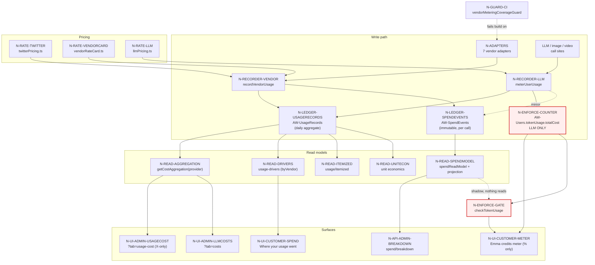

# Brain — Vendor cost metering, admin vendor picker, and customer-facing spend

> **Status:** research only. No code written for this ask yet.
> **Last verified against:** `agentweb` @ `385b7324f` (main), `agentweb-customer-portal` @ `22175227` (main), Linear as of 2026-09-09.
> **Scope:** spans **two repos** — `agentweb/` (backend + partner-portal) and `agentweb-customer-portal/`.
> **Owner of the ask:** Anurag Seth. **Human gate on anything that enforces:** Harsha Vankayalapati.

---

## 0. How to use and maintain this brain

This file is a **graph**, not a narrative. Nodes are stable things (a table, a service, a
surface, a decision, a constraint). Edges are the relationships that make a change in one
node break another. Read §2 for shape, §3 for detail, §5 for what is actually missing.

### Reading rules
- **Node IDs (`N-…`) are the addressable unit.** Cite them in PR bodies, Linear comments and
  other docs: "changes `N-ENFORCE-COUNTER`, verified against `N-CONSTRAINT-NO-DOLLARS`".
- `[[ENG-123]]` is the repo-wide Linear link convention (same as `dev.md`). Keep it.
- Every load-bearing claim carries a `file:line` or a Linear id. **If it has neither, it is a
  guess and should be deleted or verified.**
- Line numbers drift. Trust the symbol name over the number; re-grep before relying on one.

### Maintenance rules — keep the brain small and true
1. **One fact, one node.** If you are about to write the same fact in two places, make it a
   node and link it. Duplicated facts are how a brain starts lying.
2. **Add a node only when it is load-bearing** — something that would change a decision, break
   a build, or surprise the next agent. Implementation detail that any grep would reveal in
   30 seconds does **not** belong here. This file must stay readable in one pass.
3. **Edges over prose.** If two things interact, add a row to §4, don't write a paragraph.
4. **When you change the code, change the node in the same PR.** A node that describes code
   that no longer exists is worse than no node.
5. **Never delete a landmine (§8) because it was fixed** — move it to §8 with a
   `RESOLVED (date, PR)` marker. The reason it was a landmine usually recurs.
6. **Decisions (§7) are append-only.** When Harsha answers one, record the answer, the date,
   and where it was said. Do not rewrite the question.
7. **Log every edit in §10** with date, agent, and what moved. One line.
8. **Do not put the plan's execution state here.** This brain holds *structure and
   constraints*. Task state lives in Linear.

### Freshness check before you trust this file
Run from this repository's root:
```bash
grep -rn "recordVendorUsage(" --include=*.ts backend/src | grep -v __tests__  # adapter inventory
grep -n "VENDOR_ALLOWLIST" -A 30 \
  backend/src/__tests__/vendorMeteringCoverageGuard.test.ts                   # unmetered allowlist
grep -n "VENDOR_RATE_CARD_VERSION" backend/src/utils/vendorRateCard.ts        # rate-card version
grep -n "METERED_VENDOR_PROVIDERS" -A 12 \
  backend/src/services/usageAnalyticsService.ts                               # picker registry
```
If those three disagree with §3, fix §3 first, then continue.

---

## 1. The ask, decoded

**As stated:** we cost LLM calls but not the vendor APIs AgentWeb pays for; that cost is
absorbed by AgentWeb and never hits the customer's cap. Extend
`partner.agentweb.pro/admin?tab=usage-cost` (built for X/Twitter under [[ENG-664]]) with a
**vendor dropdown**, aggregate **all** vendor spend, and show the customer their **cumulative
cost plus breakdown**.

**What the research changes about it — three findings that reshape the work:**

| Finding | Consequence for the ask |
|---|---|
| **The metering is already built for 7 of 10 vendors.** X, v0, You.com, Google CSE, Apollo, enrich.so and Remotion all write vendor rows today. Only ElevenLabs / 2captcha / Placid are unmetered ([[ENG-698]], blocked on a Placid credential, [[ENG-1598]]). | "Aggregate all vendors" is mostly a **read/UI** problem, not a metering problem. |
| **The backend already supports the dropdown.** `getCostAggregation(start, end, limit, provider)` accepts `"llm"`, `"all"`, or any vendor key; the route validates and forwards it. The partner-portal helpers (`providersInData`, `userRowForProvider`, `providerLabel`) exist and are deliberately generic — the tab just **hardcodes `provider = "twitter"`**. | The admin dropdown is a **small, unblocked slice**. See §6 WS-1. |
| **Customer surfaces are forbidden from showing dollars.** Explicit, in code and in ACs: the cost quota is rendered "as a PERCENTAGE only (never dollars, never tokens). Dollars stay admin-only" (`SubscriptionCard.tsx:625`), `toCustomerDrivers` strips every micro-USD ([[ENG-1212]] AC4), and [[ENG-1139]] AC6 says customer APIs cannot reach COGS. | **"Show the customer their cumulative cost" cannot ship as dollars without Harsha reversing a shipped product decision.** See `N-CONSTRAINT-NO-DOLLARS` and Decision D1. |

**And the part of the ask that is genuinely new and genuinely valuable:** vendor spend does
**not** draw down the cap. Measured on 2026-09-08 in the shadow ledger ([[ENG-1250]]):

| Billing subject | LLM-only (what the cap sees) | All-vendor (what we actually pay) | Divergence |
|---|---|---|---|
| Account A | very low | ~27× its LLM figure, in absolute dollars | **+2721%** |
| Account B | negligible | small in absolute terms | **+409×** |
| Account C | high | ~30% of its LLM figure | +31% |
| Account D | high | negligible | +0.31% |

**Identifiers and per-account amounts are deliberately not reproduced here.** They are
customer-linked financial data and this file does not need them — the load-bearing fact is the
*shape*: the gap is real, it is large, and it is wildly account-specific. The full table, with
billing-subject ids and exact figures, is on [[ENG-1250]] (Anurag, 2026-09-08), which is
access-controlled; regenerate it from the shadow ledger with
`backend/src/scripts/spendReconciliationReport.ts`.

Note the percentages over small LLM denominators are volatile — **the rank order is the signal,
the absolute multiples are not**. And they are an *undercount*: ElevenLabs, 2captcha and Placid
are unmetered ([[ENG-698]]), so their spend appears in neither column.

That is the leak. It is also why a **flat cutover is not viable** — see `N-DECISION-PHASING`.

---

## 2. Map at a glance



Red = the gap the ask is really about: **vendor spend reaches the ledger but never reaches the gate.**

---

## 3. Node catalogue

### 3.1 Storage

#### `N-LEDGER-USAGERECORDS` — `AW-UsageRecords` (the live rail)
- **Where:** `backend/src/services/usageRecordDb.ts`
- **Shape:** daily aggregate. PK = **acting** `userId`; SK = `{date}#{model}#{feature}`.
- **Vendor dimension** (added by [[ENG-693]], PR #2212): `provider`, `unit`, `quantity`,
  `costSource` (`measured | allocated`), `billingUserId`, `onBehalfOf`, `lastSessionId`.
  Declared at `usageRecordDb.ts:56-75` / `:114-124`.
- **Vendor rows are namespaced twice** — `model = "{provider}:{operation}"` *and*
  `provider = "{provider}"`. Readers use either; `isVendorEntry(row)` (`:136`) needs
  `provider` + `unit`, the model-prefix test is the belt-and-suspenders fallback.
- **Feature slot carries the account:** X writes `feature = "x-account:{accountId}"`. This is
  how the per-account cut exists without an `accountId` GSI.
- **Gotchas:**
  - No date GSI → cross-user reads are a **full table Scan** (`scanByDateRange`, `:497`).
    ~4.7k items as of 2026-08-16; upgrade path tracked as [[ENG-1273]], data-plane gated.
  - `lastSessionId` is a *breadcrumb, not attribution* — N sessions share one row. **Never
    build a per-session spend report on it** ([[ENG-693]] review note).
  - Pre-[[ENG-693]] rows have no `provider`. They must read as "no vendor", **not** as a $0
    vendor entry ([[ENG-693]] AC4).

#### `N-LEDGER-SPENDEVENTS` — `AW-SpendEvents` (the [[ENG-1250]] rail)
- **Where:** `backend/src/services/spendEventDb.ts`
- **Shape:** append-only, per call. `HASH = billingUserId`, `RANGE = eventId`,
  GSI `BillingUserOccurredAtIndex` on `billingUserId + occurredAt`. **No TTL** (deliberate —
  the table is the auditable ledger). Approved by Harsha 2026-09-03 on [[ENG-1250]].
- **18 fields** incl. `lifecycle: reserved | settled | voided`, `costSource`, rate-card
  version, references (session/task/run).
- **Populated by dual-write** (`spendLedgerDualWrite.ts`), kill-switch
  `SPEND_LEDGER_DUAL_WRITE` — **defaults ON**, unusually, so shadow evidence accumulates.
- **Nothing enforces on it.** [[ENG-1250]] AC6 keeps that with Harsha.
- **Not** `AW-LlmChargeEvents` — that table is explicitly scoped LLM-only ("it is not the
  future cross-vendor wallet") and is TTL'd at 364 days.

#### `N-ENFORCE-COUNTER` — `AW-Users.tokenUsage.totalCost` ⚠️ **the gap**
- **Written by:** `incrementUserTokenUsage`, called **only** from `meterUserUsage`
  (`usageRecorderService.ts:489-531`).
- **`recordVendorUsage` deliberately does not call it** — stated in `dev.md` under ENG-664:
  *"X spend is visible but does not draw down any cap yet."*
- **Also a known undercounter for LLM itself**: it is opt-in per call-site (~58 sites).
  [[ENG-1247]] found the AgentWeb org paused at 36% real usage (reading HIGH); the
  2026-08-26 sweep found **20 of 58 enforced-tier users past their real hard cap with no
  block** (reading LOW) — one Free user at **$101.89 against a $5 cap**.
- **This is the single node the ask is really about.** Everything else is presentation.

### 3.2 Pricing

#### `N-RATE-TWITTER` — `backend/src/utils/twitterPricing.ts`
X only, **live since [[ENG-664]]**, granular: post-create $0.015 ($0.200 with a link),
post-read $0.005, user-read $0.010, owned-read $0.001, DM-read $0.010, DM-create $0.015;
interaction writes recorded at **$0** (X publishes no price) so they are still attributed.
`TWITTER_PROVIDER = "twitter"`. Allocated, never measured.

#### `N-RATE-VENDORCARD` — `backend/src/utils/vendorRateCard.ts`
[[ENG-703]], approved 2026-08-16 at a **60% minimum gross margin**, `VENDOR_RATE_CARD_VERSION
= "2026-09-02"` (`:58` — **bump it in the same commit as any rate edit**).
Covers 9 providers: `v0` ($2.00/landing-page generation), `you.com`, `google_cse`, `apollo`,
`enrich.so`, `2captcha`, `elevenlabs`, `placid`, `remotion`.
`computeAllocatedCost` **throws** on an unpriced unit rather than booking $0 ([[ENG-703]] AC2).

> ⚠️ **`N-CONFLICT-XRATES` — unresolved.** [[ENG-703]]'s approved table also prices X (flat
> $0.0125 read, $0.0375/$0.50 write) and **contradicts the live granular rates** in
> `N-RATE-TWITTER`. The rate card deliberately excludes X pending Harsha's call
> (header comment, lines 18-28). **Do not "unify" these without an explicit decision** — it is
> a live billing-math change. → Decision **D4**.

#### `N-RATE-LLM` — `backend/src/utils/llmPricing.ts`
Token pricing, normalized under [[ENG-207]]. Note [[ENG-693]] AC3: LLM dollars were *always*
allocated; nothing said so until `costSource` existed.

### 3.3 Write path

#### `N-RECORDER-VENDOR` — `recordVendorUsage(ctx)`
- **Where:** `backend/src/services/usageRecorderService.ts:366`
- Writes `N-LEDGER-USAGERECORDS` **and** `N-LEDGER-SPENDEVENTS` in one conditional
  transaction (`incrementUsageWithSpendEvent`) — [[ENG-702]] AC1/AC3 / [[ENG-1250]] §6.
  A ledger-write failure falls back to the legacy aggregate-only path and is reported via
  `usageWriteFailureMonitor` (surfaces as `unmirroredGroups` in reconciliation).
- **Fire-and-forget, never throws.** A metering failure must never fail the vendor call.
- Unpriced units skip the spend event rather than inventing a $0 one.

#### `N-ADAPTERS` — the 7 live vendor adapters
| Provider key | Call site | Unit |
|---|---|---|
| `twitter` | `services/twitterService.ts:489,504` (chokepoint `withRetryOn401`, `meter` is a **required** arg → uninstrumented paths fail to compile) | per rate category |
| `v0` | `services/v0Metering.ts:99` | `generation` |
| `you.com` | `search/youSearchProvider.ts:94` | `query` |
| `google_cse` | `search/googleSearchProvider.ts:41` | `query` |
| `apollo` | `services/apolloServiceFactory.ts:44` | reveal/enrichment |
| `enrich.so` | `services/enrichSoServiceFactory.ts:52` | lookup/validation |
| `remotion` | `services/remotionService.ts:435,455,529,559,582` | `render` (submit / completed / failed / handoff-unobserved) |

**Unmetered, tracked on [[ENG-698]] (Blocked on [[ENG-1598]], a Placid Secrets-Manager
credential decision):** `elevenlabs` (`services/voiceoverService.ts`), `2captcha`
(`emma/solveRecaptchaTool.ts`), `placid` (`controllers/tasks.ts`).

#### `N-RECORDER-LLM` — `meterUserUsage(ctx)`
`usageRecorderService.ts:489`. The **only** writer of `N-ENFORCE-COUNTER`. Handles
`costUsdOverride` so image/video (per-generation, not per-token) deduct correctly — this is
the existing proof that the cap can absorb non-token spend.

#### `N-GUARD-CI` — `backend/src/__tests__/vendorMeteringCoverageGuard.test.ts`
[[ENG-701]]. Nine vendor egress signatures; any module hitting one must either meter or sit in
`VENDOR_ALLOWLIST` (`:157`) with a Linear id and a reason. A **staleness assertion fails the
build when an allowlisted module starts metering** — so the allowlist cannot rot into amnesty.
**Adding a new paid vendor without metering it fails CI.** This is the guard that keeps §3.3 honest.

### 3.4 Read models

#### `N-READ-AGGREGATION` — `getCostAggregation(start, end, topUsersLimit, provider)`
- **Where:** `backend/src/services/usageAnalyticsService.ts:329`
- **Route:** `GET /api/admin/usage/cost-aggregation` (`routes/adminUsage.ts:272`), admin-only,
  `provider` validated to `/^[a-z0-9._-]+$/`.
- **`provider` semantics — already generic:**
  - `"llm"` (**default**, so the LLM Costs tab that sends no param never sees vendor rows),
  - `"all"` — no filter,
  - any vendor key — matches `row.provider === provider || model.startsWith("{provider}:")`.
- Filter runs **before** aggregation, so every cut (`totals`, `byModel`, `series`, `byFeature`,
  `topUsers`, `userCount`, `byXAccount`) is consistently scoped.
- `byXAccount` is **X-specific** — it groups on the `x-account:` feature prefix and
  best-effort resolves `@handle`. No other vendor has an equivalent sub-account dimension today.

#### `N-READ-SPENDMODEL` — spend read models over the immutable ledger
`spendReadModel.ts` (`buildSpendBreakdown` → daily / byProvider / byFeature / byMember /
bySession / in-flight reservations; `explainPause`), `spendProjection.ts`
(`projectMonth`, derived not stored, invariant: Σ settled events = projection ±1 µUSD),
`spendReconciliation.ts` (fidelity + basis divergence).
Exposed at `GET /api/admin/usage/:billingUserId/spend/breakdown` (`N-API-ADMIN-BREAKDOWN`,
`routes/adminUsage.ts:50`). **This is the modern surface and it is already cross-vendor.**

#### `N-READ-DRIVERS` — `GET /api/subscription/usage-drivers`
`llmUsageDriversResolverService.ts`; `toCustomerDrivers` (`:891`) is the customer boundary.
Returns `byModel`, **`byVendor`** ([[ENG-1519]]), `byFeature`, `bySource`, plus
`unavailableGroupings` / `hasUnattributed` caveats. **Shares and call counts only — no dollars.**

#### `N-READ-ITEMIZED` — `GET /api/subscription/usage/itemized`
`routes/subscription.ts:290` + `services/usageItemization.ts`. Reconciles per-charge audit
events against daily aggregates, reports a `precision` of `per_charge | daily_aggregate | mixed`.
Reads `readBilledLedgerRows` — the **union** of the pooled per-member fan-out and the
`billingUserId` scan (fixes the [[ENG-1251]] 60.5% undercount). Currently unused by any UI.

#### `N-READ-UNITECON` — `GET /api/admin/usage/unit-economics?month=YYYY-MM`
[[ENG-1139]], `services/llmUnitEconomicsService.ts`. Per billing subject: tier, usage state,
LLM cost, vendor cost, credits, reconciliation vs the enforced counter.
⚠️ **Its header comment is stale** — it says only X writes vendor rows and 694/695/696/699 are
Blocked. All four have since landed. `vendorCoverage: 'partial'` and the withheld all-in
figure can now be recomputed; only [[ENG-698]]'s three vendors remain missing. → WS-1 task.

### 3.5 Surfaces

#### `N-UI-ADMIN-USAGECOST` — partner portal, `?tab=usage-cost`
`agentweb/partner-portal/src/components/admin/UsageCostByUserTab.tsx` (704 lines), tab slug
registered in `pages/adminNavigation.ts` (`Revenue & billing` → `tab('usage-cost', 25, …)`).
- **Already generic, deliberately:** `providerOfModel` (`:155`), `providersInData` (`:172`),
  `userRowForProvider` (`:197`), `rankedUserRows` (`:212`), `providerLabel` (`:267`).
- **Hardcoded to X at `:503`:** `const provider = TWITTER_PROVIDER_KEY;` with the comment
  *"The provider machinery … is retained so this tab can broaden to other vendors."*
  **This is the exact seam the ask asked for.**
- Fetches `…&provider=twitter`; renders totals, per-user table, per-tool drill-down,
  `byXAccount` rollup, and the X reconciliation panel.
- `providerIsAllocatedEstimate(p)` (`:222`) hardcodes `p === "twitter"` — wrong once other
  vendors appear; **every** vendor row is `costSource: "allocated"`.

#### `N-UI-ADMIN-LLMCOSTS` — `?tab=costs` ([[ENG-353]]/[[ENG-366]])
Sends no `provider`, so it gets the `"llm"` default. **Must stay LLM-scoped** — provider
isolation was an explicit [[ENG-664]] deliverable.

#### `N-UI-CUSTOMER-SPEND` — "Where your usage went"
`agentweb-customer-portal/src/components/usage/SpendBreakdown.tsx`, rendered inside
`RunwayPanel.tsx:290`. Groups: Scheduled tasks / Models / **Tools & data** (`:307`, the
`byVendor` group, footnote *"Charged per call rather than per token, so there's no model to
switch here."*) / Features / Scheduled vs. interactive.
**Percentages and call counts only.** Absence is stated, never rendered as zero.

#### `N-UI-CUSTOMER-METER` — the "Emma credits" meter
Topbar `components/layout/UsageMeter.tsx` ([[ENG-1340]]) + `SubscriptionCard.tsx:629`
(`data-testid="usage-cost-quota"`). Shows **`costPercentUsed`** and a reset date. Its
denominator is `hardThreshold + purchasedMicroUsd + adminGrantedMicroUsd` — so a purchased
top-up raises the "Emma credits" denominator (noted by Anurag on [[ENG-668]], 2026-09-01;
a naming lag, not a modelling conflict). Top-up CTA says **"Add usage · $N"**, never "buy credits".

### 3.6 Enforcement

#### `N-ENFORCE-GATE` — `checkTokenUsage`
`backend/src/services/tokenUsageService.ts:320-420`.
- Reads `usage.totalCost` from `N-ENFORCE-COUNTER` (`:354`) — **LLM only**.
- `versionedCostPolicyEnforced = policy.enforcementState !== "observe"`; legacy env
  `ENFORCE_COST_CAP` retains the same replacement semantics (`:352`).
- Applies credits/top-ups (`applyLlmUsageCredits`), then `evaluateLlmUsageMode`.
- **One boundary only** — [[ENG-1211]] (2026-09-04) deleted the `optimized` middle mode;
  `evaluateLlmUsageMode` can no longer return it. ⚠️ [[ENG-1250]] §3/§4 still describe three
  modes; that text predates the deletion. **Do not rebuild `optimized`.**
- **Pre-flight only, at 5 entry points, no mid-run re-check** — a single run can overshoot
  unboundedly. `agentModeService` never consults the gate; the MCP surface has no enforcement.
- **Stateless admission**: retries and concurrent requests each independently observe
  "below the cap". [[ENG-1250]] absorbed [[ENG-1136]]'s admission-record scope to fix this;
  the precedent to copy is `services/v0UsageGuard.ts` (conditional reserve on
  `AW-V0Usage`, TTL'd reservation, `reserved → succeeded | failed | reused | skipped`).

### 3.7 Constraints and decisions (nodes in their own right)

#### `N-CONSTRAINT-NO-DOLLARS` 🔒
**Customer surfaces never see dollars.** Three independent expressions of the same decision:
- `SubscriptionCard.tsx:625` — *"shown to the user as a PERCENTAGE only (never dollars, never
  tokens) … Dollars stay admin-only; to the user this is simply 'usage'."*
- `toCustomerDrivers` — *"Strip everything a customer must not see ([[ENG-1212]] AC4 /
  [[ENG-1213]] AC4): no micro-USD totals, no raw savings — only shares, counts and day figures."*
- [[ENG-1139]] AC6 — *"Customer-facing APIs cannot access internal COGS, margins, model price
  book, or tier thresholds."* Its tier targets ($7 / $73 / $180) are explicitly internal-only.

**This directly blocks the literal reading of "show the customer their cumulative cost."**
→ Decision **D1**.

#### `N-CONSTRAINT-ALLOCATED-NOT-MEASURED` 🔒
No vendor in scope reports a per-call price. **Every** vendor dollar is an allocation
(our rate × our count) and must be labelled so ([[ENG-666]] AC3, [[ENG-703]] AC3,
[[ENG-693]] AC3). For X specifically it is an **upper bound**: X dedups a repeat read of the
same resource within a UTC day and we do not track resource ids, so allocated ≥ measured.

#### `N-CONSTRAINT-SHARED-WALLET` 🔒
X's credit pool belongs to **AgentWeb's single Developer App**, not to the connected account,
and the dedup is app-wide. So per-user X cost can only ever be *allocated load attribution*,
never a fair split of the billed figure. `dev.md` (ENG-664 section) records the designed
answer — **proportional settlement**: keep the live ledger allocated, then periodically pull
the measured app total, compute `factor = measured / allocated`, and charge each org owner
their allocated-weighted share, so `Σ charged = measured` exactly *and* each pays in
proportion to load. **Design only — not built.**

#### `N-DECISION-CREDITS` — Emma Credits are outcome-priced, not cost pass-through
[[ENG-668]], Harsha 2026-08-17, verbatim: *"the credits should actually be the bridge into
'pay per result' not just 'pay per usage'."*
- $1 ≈ 1 credit as the customer-facing baseline; the underlying vendor cost each credit
  represents **floats by design**.
- **Per-action pricing**: "run a scheduled task" = N credits, fixed, set by product/margin
  judgment — *not* derived live from whichever vendor calls fired underneath.
- **Two tables, not one**: `N-RATE-VENDORCARD` computes what an action *costs us*; the credit
  price decides what we *charge*. Design the debit as "look up a fixed credit price by action
  type", never as "debit N credits = M dollars of measured vendor cost".
- Credits are **plan-included** with an opt-in pay-as-you-go overage toggle. Not a standalone
  "buy credits" product.
- **Consequence for this ask:** a customer-facing per-vendor **dollar** breakdown is not just
  blocked by `N-CONSTRAINT-NO-DOLLARS` — it points at a pricing model the company decided
  against.

#### `N-DECISION-PHASING` — a flat enforcement cutover is not viable
From the 2026-09-08 divergence table (§1): switching enforcement in one step takes
Account A from a fraction of a percent of its cap to over cap **instantly**, and Account B at
409×, while most of the estate would not notice. From the customer's side that is indistinguishable from
AgentWeb silently slashing their limit overnight.
**Recommendation on record: phase per provider, highest-share first (X dominates every
outlier), with affected accounts identified in advance from the shadow ledger.**
§8's per-provider drift check already supports enabling provider-by-provider.

#### `N-GATE-AC6` 🔒 **Harsha-only**
[[ENG-1250]] AC6: *no production enforcement moves to the new rail until shadow reconciliation
passes and Harsha approves.* Also gated: persisting the monthly projection (§3b), retiring
`extraCostUsage` (AC7), and any new table/index/retention change (`CLAUDE.md` data-plane rule).
**Shadow status as of 2026-09-08:** fidelity CLEAN, ledger $0.110000 vs live $0.110000, drift
$0.000000, `readyForCutoverEvidence: true` — but only **1 clean day / 2 assessable groups**,
against §9's requirement of **7 days**.

#### `N-DEADEND-EXTRACOST` ☠️
**Do not build on `incrementExtraCostUsage` / `checkExtraCostUsage`.** `checkExtraCostUsage`
has **zero** production callers; `incrementExtraCostUsage` has exactly one
(`crmEnrichmentService.ts:1958`); its allowance is silently stripped by the admin tier-save
path; it writes to `AW-Users` where no cost dashboard reads. [[ENG-1250]] AC7 retires it.

---

## 4. Edges — what breaks what

| From | → To | Relation / why it matters |
|---|---|---|
| `N-ADAPTERS` | `N-RECORDER-VENDOR` | Every vendor call must go through it, or `N-GUARD-CI` fails the build. |
| `N-RECORDER-VENDOR` | `N-LEDGER-USAGERECORDS`, `N-LEDGER-SPENDEVENTS` | One conditional transaction. A ledger failure degrades to aggregate-only + an alert, never a lost vendor call. |
| `N-RECORDER-VENDOR` | ❌ `N-ENFORCE-COUNTER` | **The missing edge.** This absence *is* the ask. |
| `N-RECORDER-LLM` | `N-ENFORCE-COUNTER` | The only writer. Also the source of the LLM undercount ([[ENG-1247]]). |
| `N-RATE-TWITTER` ⟂ `N-RATE-VENDORCARD` | conflict | Two price books disagree about X. → D4. |
| `N-LEDGER-USAGERECORDS` | `N-READ-AGGREGATION` | Full Scan; `provider` filter applied pre-aggregation. |
| `N-READ-AGGREGATION` | `N-UI-ADMIN-USAGECOST` | Tab pins `provider="twitter"`; **unpinning it is WS-1**. |
| `N-READ-AGGREGATION` | `N-UI-ADMIN-LLMCOSTS` | Default `"llm"` keeps vendor rows out. Don't regress this. |
| `N-READ-DRIVERS` | `N-UI-CUSTOMER-SPEND` | `byVendor` → "Tools & data". Already ships vendor attribution to the customer — **as shares**. |
| `N-CONSTRAINT-NO-DOLLARS` | `N-UI-CUSTOMER-SPEND`, `N-UI-CUSTOMER-METER` | Hard gate on the customer half of the ask. |
| `N-ENFORCE-COUNTER` | `N-ENFORCE-GATE` → `N-UI-CUSTOMER-METER` | Change the counter's basis and the customer's meter jumps. → `N-DECISION-PHASING`. |
| `N-LEDGER-SPENDEVENTS` | `N-READ-SPENDMODEL` ⇢ `N-ENFORCE-GATE` | Dashed: shadow only. Making it solid needs `N-GATE-AC6`. |
| `N-CONSTRAINT-SHARED-WALLET` | any per-user X charging | Forces proportional settlement, not raw allocated drawdown. |
| `N-DECISION-CREDITS` | customer-facing $ display | Credits float above cost by design; showing vendor $ contradicts it. |
| [[ENG-1259]] | this whole epic | *"do not let ENG-664–669 go out ahead of this"* — scheduled chats ran the full expensive flow before deciding there was nothing to do ($21.61 for "Schedule skipped"). Under usage billing that becomes a customer line item. **Merged (PR #2418), so the block is cleared** — but re-check before any customer-visible charging. |

---

## 5. Gap analysis — what the ask needs vs what exists

| # | Capability the ask implies | State | What is actually missing |
|---|---|---|---|
| 1 | Meter every paid vendor | **7/10 done** | ElevenLabs, 2captcha, Placid → [[ENG-698]], blocked on [[ENG-1598]] (Placid credential). |
| 2 | Rates for every vendor unit | **done** | `N-RATE-VENDORCARD` v`2026-09-02` + `N-RATE-TWITTER`. Only the X-rate conflict (D4) is open. |
| 3 | Admin API scoped by vendor | **done** | `getCostAggregation(provider)` already takes `llm | all | <vendor>`. |
| 4 | **Admin vendor dropdown** | **NOT done** | `UsageCostByUserTab.tsx:503` pins `"twitter"`. Needs: fetch strategy for the option list, `providerIsAllocatedEstimate` generalised, `byXAccount` panel made conditional, X reconciliation panel shown only for X, `providerLabel` extended. |
| 5 | Cumulative + per-vendor breakdown for admin | **partly** | `N-API-ADMIN-BREAKDOWN` already returns `byProvider` per billing subject from the immutable ledger — **but no partner-portal UI renders it.** Cheapest path to "cumulative + breakdown" is a UI over this existing endpoint. |
| 6 | Unit economics incl. vendor half | **stale** | [[ENG-1139]] AC3 withheld the all-in figure because 4 of 5 slices were blocked. They landed. Recompute coverage; only [[ENG-698]] remains. |
| 7 | **Customer sees vendor spend** | **partly, in shares** | "Tools & data" already ships ([[ENG-1519]]). **Dollars are blocked** by `N-CONSTRAINT-NO-DOLLARS` + `N-DECISION-CREDITS`. → D1. |
| 8 | **Vendor cost counts against the cap** | **NOT done** | The missing `N-RECORDER-VENDOR → N-ENFORCE-COUNTER` edge. Gated by `N-GATE-AC6`; needs 7 days of shadow (1 clean day so far) and a phasing decision. |
| 9 | Fair charging for a shared wallet | **design only** | Proportional settlement, `dev.md` ENG-664 section. Not built. |
| 10 | Admission that survives retries/concurrency | **NOT done** | Stateless today. Precedent: `v0UsageGuard.ts`. Folded into [[ENG-1250]] from [[ENG-1136]]. |

---

## 6. Proposed workstreams

Ordered so that **nothing customer-facing or enforcing ships before the evidence and the
decisions exist.**

### WS-1 — Admin vendor picker (unblocked, small, ships this week)
*No human gate: read-only, admin-only, no enforcement, no schema, no customer copy.*

Unpin `UsageCostByUserTab.tsx:503` (`provider = TWITTER_PROVIDER_KEY`) into a dropdown over
every metered vendor, plus `all` and `llm`. The backend filter and the portal's provider
helpers already exist; what is missing is the control, an option list, and honest per-provider
copy. Fetch strategy is **resolved**: server-scoped re-fetch, with the server returning
`availableProviders`.

> **➜ Full implementation plan, step by step, with anchors and tests: §10.**

Two adjacent cleanups belong in the same PR because they are the same staleness:
`providerIsAllocatedEstimate` hardcodes `"twitter"` though every vendor row is allocated, and
`llmUnitEconomicsService.ts`'s header still claims 694/695/696/699 are Blocked (they landed).

### WS-2 — Admin cumulative + breakdown per billing subject (unblocked)
Build the partner-portal view over the **existing** `N-API-ADMIN-BREAKDOWN`
(`GET /api/admin/usage/users/:billingUserId/spend/breakdown?month=YYYY-MM`). It already
returns daily / byProvider / byFeature / byMember / bySession / in-flight / allowance /
projection / `explainPause`. This is [[ENG-1250]] §7's *"no admin should need direct DynamoDB
inspection to explain a pause"* — currently answered by an API with no UI.
**Cheapest high-value slice in the whole ask.**

### WS-3 — Close metering coverage (blocked)
[[ENG-698]]: ElevenLabs, 2captcha, Placid. Gated on [[ENG-1598]] (Placid credential into
Secrets Manager — Harsha). Until this lands, every "all-in" figure is an **undercount**, and
the §1 divergence percentages are understated. Say so wherever the number is shown.

### WS-4 — Extend the shadow week and produce the phasing list (in flight, [[ENG-1250]])
Run `scripts/spendReconciliationReport.ts` daily to 7 clean days. Output the per-account
would-block list. **Stop there** — do not flip. This is the evidence `N-GATE-AC6` requires.

### WS-5 — Enforcement cutover (Harsha only, do not start unilaterally)
Requires: WS-4 evidence + D2 + D3. Then, per `N-DECISION-PHASING`, enable provider-by-provider
against the persisted projection (§3b — itself a data-plane gate), **not** by adding an
`incrementUserTokenUsage` call to `recordVendorUsage`.
> ⚠️ The one-line "fix" — making `recordVendorUsage` call `incrementUserTokenUsage` — is
> tempting and **wrong**. It routes new spend through `N-ENFORCE-COUNTER`, the counter
> [[ENG-1247]] proved wrong in **both** directions, it bypasses reserve/settle/void and
> idempotency, it makes the flat cutover `N-DECISION-PHASING` rejects, and it violates
> [[ENG-1250]] AC1 ("exactly once") and AC7.

### WS-6 — Customer surface (blocked on D1)
If D1 = *no dollars* (the status quo): extend `N-UI-CUSTOMER-SPEND` — richer "Tools & data"
(per-vendor rows, not just the group), a cumulative share, and a plain-language line naming
what a vendor call is. Zero boundary change; `toCustomerDrivers` keeps stripping micro-USD.
If D1 = *credits*: the breakdown renders in **Emma credits** per `N-DECISION-CREDITS`, which
needs the action-type → credit-price table ([[ENG-668]], "not yet decided").
If D1 = *dollars*: a reversal of a shipped decision — needs Harsha in writing, plus a review
of the customer-facing copy (`CLAUDE.md` external-copy gate).

---

## 7. Decisions needed (append-only)

| ID | Question | Owner | Status | Why it blocks |
|---|---|---|---|---|
| **D1** | In what **unit** does a customer see vendor spend — percentage of allowance (status quo), Emma credits, or dollars? | Harsha | **OPEN** | `N-CONSTRAINT-NO-DOLLARS` + `N-DECISION-CREDITS` both say not dollars. Blocks WS-6 entirely. |
| **D2** | Does vendor spend draw down the **same** cap as LLM spend, or a separate vendor allowance? | Harsha | **OPEN** | [[ENG-666]] AC4 assumes one pool; [[ENG-1139]] models a separate "non-LLM/overhead envelope" ($2/$13/$30). These are different products. |
| **D3** | How are the accounts in the §1 divergence table transitioned — grace credits, a warning cycle, or effective-next-rollover? | Harsha | **OPEN** | `N-DECISION-PHASING`. Named as Harsha's explicit call on [[ENG-1250]] (2026-08-26). |
| **D4** | X rates: keep the live granular `twitterPricing.ts`, or adopt [[ENG-703]]'s flat table? | Harsha | **OPEN since 2026-08-18** | Flagged in `vendorRateCard.ts:18-28`. Changing it is a live billing-math change. |
| **D5** | Does the admin dropdown default to `all` or `twitter`? | Anurag | open, low stakes — **§10.2 recommends `all`** | Cosmetic; pick one, note it in the PR. |
| **D6** | Is `N-UI-ADMIN-USAGECOST` (over `AW-UsageRecords`) or `N-API-ADMIN-BREAKDOWN` (over `AW-SpendEvents`) the long-term admin surface? | Anurag + Harsha | **OPEN** | Two surfaces over two rails will drift. [[ENG-1139]] AC7 and [[ENG-666]] AC2 both forbid a parallel dashboard. Decide before WS-2 hardens. |

---

## 8. Landmines

1. **Do not add a second metering rail.** [[ENG-666]] AC2 and the charter: adding a vendor
   must need no schema change. Extend `recordVendorUsage`.
2. **Do not touch `N-DEADEND-EXTRACOST`.**
3. **Do not reintroduce `optimized` mode** — [[ENG-1211]] deleted it; [[ENG-1250]]'s §3/§4 text
   predates that and will tempt you.
4. **Do not build per-session spend on `lastSessionId`** — it is a breadcrumb; N sessions share
   one aggregate row.
5. **Do not let vendor rows leak into `?tab=costs`.** Provider isolation was an explicit
   [[ENG-664]] deliverable; the `"llm"` default is what enforces it.
6. **Do not present allocated as measured.** Every vendor dollar is allocated
   (`N-CONSTRAINT-ALLOCATED-NOT-MEASURED`); X's is an **upper bound**.
7. **Do not silently clamp an attribution gap.** `x-reconciliation` returns
   `attributionGapUnits` precisely because the dedup clamp used to hide missed instrumentation
   ([[ENG-664]] AC3).
8. **Do not put `ENG-1250` in a PR title.** The GitHub↔Linear integration transitions the row
   to `Merged` on it, and an epic reading `Merged` silently stops being tracked (Anurag,
   2026-09-08 — it happened twice on #2811/#2814). Section references belong in the PR **body**.
9. **Do not "fix" a stale `vendorMeteringCoverageGuard` allowlist entry by deleting it.**
   Meter the module. Deleting the entry is how amnesty becomes permanent.
10. **Do not assume the shadow ledger's clean fidelity means the shadow period is done.**
    1 clean day, 2 assessable groups, $0.11 of assessed spend, against §9's 7 days.
11. **Do not present an all-in vendor figure while [[ENG-698]] is open** without saying it is an
    undercount (ElevenLabs / 2captcha / Placid contribute to neither column).
12. **Do not add `--maxWorkers` to jest** (machine constraint, `~/.claude/CLAUDE.md`). Use
    `npm test`; the config caps at 2.

---

## 9. Verification recipes

All paths are relative to this repository's root unless marked otherwise.

```bash
# Which vendors are metered right now
grep -rn "recordVendorUsage(" --include=*.ts backend/src | grep -v __tests__

# Which paid vendors are knowingly NOT metered
grep -n "VENDOR_ALLOWLIST" -A 30 backend/src/__tests__/vendorMeteringCoverageGuard.test.ts

# Does vendor spend touch the enforcement counter?
# (expect: no hit inside recordVendorUsage — that absence IS the gap)
grep -n "incrementUserTokenUsage" backend/src/services/usageRecorderService.ts

# The provider seam in the admin tab
grep -n "providersInData\|AGGREGATION_SCOPES\|providerHasDedupCaveat" \
  partner-portal/src/components/admin/UsageCostByUserTab.tsx

# The customer dollar boundary (backend half)
grep -n "toCustomerDrivers" -A 6 backend/src/services/llmUsageDriversResolverService.ts

# Targeted suites (jest config already caps workers at 2 — do NOT pass --maxWorkers)
(cd backend && npx jest src/__tests__/usageAnalyticsService src/__tests__/spend \
  src/__tests__/vendorMeteringCoverageGuard src/routes/__tests__/adminUsage)
(cd partner-portal && npx jest src/components/admin/__tests__)
```

**The customer-portal half lives in a separate repository, `agentweb-customer-portal`.** Clone
it alongside this one; the nodes that live there (`N-UI-CUSTOMER-SPEND`,
`N-UI-CUSTOMER-METER`) name their paths relative to *that* repo's root — e.g.
`src/components/usage/SpendBreakdown.tsx`, `src/components/settings/SubscriptionCard.tsx`
(grep it for `never dollars`).

Linear (read-only GraphQL, key in `~/.claude` or the session that created this file):
`ENG-666` (parent epic) · `ENG-1250` (accounting v2) · `ENG-668` (credits) · `ENG-703` (rates)
· `ENG-664` (X reference implementation) · `ENG-698` (remaining coverage) · `ENG-1139`
(unit economics) · `ENG-1519` (customer vendor attribution) · `ENG-515` (the original
customer breakdown request, still Backlog).

---

## 10. WS-1 — Admin vendor picker: implementation plan

**Node:** `N-UI-ADMIN-USAGECOST` (+ a small additive change to `N-READ-AGGREGATION`).
**Gates:** none. Read-only, admin-only, no schema, no enforcement, no customer copy.
**Repos:** `agentweb/backend` and `agentweb/partner-portal` (deploy independently — see §10.7).
**Rough size:** ~30 lines backend, ~120 lines partner-portal, ~80 lines tests.

### 10.1 Goal and non-goals

**Goal.** The Usage & Cost tab stops being X-only. An admin picks a vendor from a dropdown and
sees that vendor's spend by user, with a per-tool drill-down and an honest allocated label —
plus an "All vendors" roll-up. Same page, same shape, one more control.

**Non-goals — do not let these creep in:**
- No change to `N-UI-ADMIN-LLMCOSTS` (`?tab=costs`). Its `"llm"` default must keep working.
- No enforcement, no cap change, no customer surface (`N-GATE-AC6`, D1).
- No per-vendor **sub-account** dimension beyond X's existing `byXAccount` — no other vendor
  writes an equivalent to `feature = "x-account:{id}"`.
- Not the cumulative per-billing-subject view — that is WS-2, over a different endpoint.

### 10.2 The one real design call — resolved

Two workable options were weighed (§6 WS-1). **Take the server-scoped re-fetch, and have the
server also supply the option list.**

| | Server-scoped re-fetch (**chosen**) | Client-side filter of `provider=all` |
|---|---|---|
| `totals` / `userCount` / `byXAccount` | server-computed, already correct per selection | must be re-derived client-side; `userCount` cannot be (it is not a `topUsers` sum) |
| Option list | needs a source — **solved by returning it from the server** | data-driven for free |
| Payload | one provider's rows | every row in the window |
| Switching | one request | instant |

The deciding factor is `userCount`: it exists precisely *because* summing the capped `topUsers`
slice understated the headline past 100 spenders ([[ENG-664]] review round). Re-deriving it in
the browser reintroduces the bug the field was added to fix. Making the server return
`availableProviders` removes the only real advantage the client-side option had.

**Recommendation for D5 (default selection): `"all"`.** The tab's own label is "Usage & Cost",
not "X cost", and the epic's question is *"who burned our vendor budget"* — a per-vendor answer
first hides the total. X stays one click away and keeps its own panels.

### 10.3 Backend — `N-READ-AGGREGATION`

**Step B1 — a registry of the vendors worth offering.**
In `backend/src/services/usageAnalyticsService.ts`, export:

```ts
/**
 * Vendors with a LIVE metering adapter (a `recordVendorUsage` call site), i.e.
 * the providers an admin can meaningfully select. Deliberately NOT derived from
 * vendorRateCard's VendorRateProvider: that card prices elevenlabs / 2captcha /
 * placid, which are priced but NOT yet metered ([[ENG-698]], blocked on
 * [[ENG-1598]]). Offering them would render a permanently empty view that reads
 * as "this vendor costs nothing".
 *
 * Add a key here in the same PR that adds its adapter.
 */
export const METERED_VENDOR_PROVIDERS = [
  "twitter", "v0", "you.com", "google_cse", "apollo", "enrich.so", "remotion",
] as const;
```

**Step B2 — return the option list.**
Add `availableProviders?: string[]` to the `CostAggregation` return type, computed from
`allItems` **before** the provider filter (the scan already happened — this is free):

```
availableProviders = ["all", "llm", ...sorted(union(
    METERED_VENDOR_PROVIDERS,
    distinct providers actually present in the window
))]
```

Union, not either alone: the registry keeps a vendor discoverable before it has accrued any
spend (the reason [[ENG-664]] always offered `twitter`), and the window scan surfaces a provider
that started metering after this list was last edited. Deriving "present" must use the same
two signals the filter uses — `row.provider` **or** the `"{provider}:"` model prefix — or a row
written by an older adapter path drops out of the list while still being filterable.

**Step B3 — route.** No change needed. `routes/adminUsage.ts:272` already validates
`provider` against `/^[a-z0-9._-]+$/`, which admits `all`, `llm`, `you.com` and `enrich.so`.

**Step B4 (optional, cheap, high value).** Extend
`backend/src/__tests__/vendorMeteringCoverageGuard.test.ts` (`N-GUARD-CI`) with a two-way
assertion: every key in `METERED_VENDOR_PROVIDERS` appears as a `provider:` literal at some
`recordVendorUsage` call site, and every such literal appears in the list. That makes the
dropdown self-maintaining — a new adapter that forgets the registry fails the build, in the
same spirit as the existing staleness assertion.

### 10.4 Partner portal — `UsageCostByUserTab.tsx`

Anchors are against the file as of `385b7324f`; re-grep the symbol, not the number.

| # | Where | Change |
|---|---|---|
| F1 | `:503` | `const provider = TWITTER_PROVIDER_KEY;` → `const [provider, setProvider] = useState<string>(DEFAULT_PROVIDER);` Delete the "X-only for now" comment — it is the thing being undone. |
| F2 | `loadAggregation` (`:508`) | Take `p: string = provider` and send `&provider=${encodeURIComponent(p)}`. Call it from the selector's `onChange` with the new value (don't rely on state having settled). |
| F3 | filter `Paper` (`:564`) | Add a 4th `Grid item` with an MUI `TextField select` (or `Select` + `InputLabel`), `size="small"`, `data-testid="provider-select"`. Re-balance the row `md={4}×3` → `md={3}×4`. |
| F4 | `providersInData` (`:172`) | Prefer `agg.availableProviders` when present; otherwise fall back to today's derivation over `topUsers[].byModel`. The fallback is what makes the two deploys order-independent (§10.7). |
| F5 | `providerLabel` (`:267`) | Extend: `v0` → "v0 (Vercel)", `you.com` → "You.com search", `google_cse` → "Google Custom Search", `apollo` → "Apollo", `enrich.so` → "enrich.so", `remotion` → "Remotion Lambda". Keep the `all` / `llm` / `twitter` entries. Unknown keys still fall through to the raw key. |
| F6 | `providerIsAllocatedEstimate` (`:222`) | `p === "twitter"` is now wrong — **every** vendor row is `costSource: "allocated"`, and so are LLM dollars ([[ENG-693]] AC3). Replace with two predicates: `isAllocated(p)` → `true` for everything except… nothing, so drop it in favour of always showing a short allocated note; and `hasDedupCaveat(p)` → `p === "twitter"`. See §10.5. |
| F7 | `<XReconciliationPanel />` (`:617`) | Render only when `provider === "twitter"`. It compares against X's own cycle window, which has no meaning under another vendor, and it fires a second request on every tab open today regardless. |
| F8 | `XAccountTable` (`:454`, used at `:698`) | No code change needed — it already returns `null` on an empty list, and a non-X selection produces no `x-account:` rows. Under `"all"` it correctly still shows the X rollup. Consider retitling to "By X account (X spend only)" so it does not read as an all-vendor cut. |
| F9 | Header (`:555`) | Make the title and blurb provider-aware: `` `${providerLabel(provider)} usage & cost by user` ``, and drop "Other metered vendors will be added here later" — they have been. |
| F10 | `UserUsageRow` (`:274`) | The `provider` prop is currently accepted and never used. Use it for the drill-down column header: `"Model"` for `llm`, `"Tool"` for a vendor, `"Tool / model"` for `all`. (Or delete the prop — but labelling a `twitter:post` row "Model" is exactly the mis-read [[ENG-1519]] was filed for.) |
| F11 | `filteredTotals` comment (`:543`) | Says "The tab requests provider=twitter, so agg.totals is already X-scoped." Update to "…is already scoped to the selected provider." The code is right; only the comment goes stale. |

### 10.5 Copy — the two caveats are different facts

Today one alert conflates them. Split:

- **Allocated (all providers, incl. `all` and `llm`).** *"These are **allocated** costs — our
  own rate card applied to metered call counts, not a vendor-invoiced figure."* Grounded in
  `N-CONSTRAINT-ALLOCATED-NOT-MEASURED`; [[ENG-693]] AC3 makes this true of LLM dollars too, so
  showing it under `llm` is a correction, not noise.
- **Upper bound (X only).** Keep today's sentence — X charges a repeat read of the same
  resource within a UTC day once, and we do not track resource ids, so allocated ≥ measured.
  **This is X-specific; do not generalise it.** No other vendor in the list dedups.
- **Coverage (whenever `all` is selected, until [[ENG-698]] lands).** *"ElevenLabs, 2captcha and
  Placid are not metered yet, so an all-vendor total is an undercount."* Landmine §8.11 —
  an all-in figure that silently omits inputs reads as the envelope being comfortably met.

Internal admin copy, so no external-copy review gate (`CLAUDE.md`).

### 10.6 Tests

`partner-portal/src/components/admin/__tests__/UsageCostByUserTab.test.tsx` (275 lines).

**⚠️ One existing test asserts the opposite of this change** and must be rewritten, not deleted:
`:191` *"is X-only by default: allocated caveat shown, no provider selector"*. It encodes the
[[ENG-664]] scoping decision. Replace it with a test that the selector **is** present and that
the default selection is D5's answer, and note the supersession in the test name so the history
is readable.

Also update: `:119` (`providersInData` — now prefers `availableProviders`), `:141` (`flags only
twitter as an allocated estimate` — the predicate is being replaced).

New cases:
1. Selector lists `all`, `llm` and every provider in `availableProviders`, `all` first.
2. Falls back to deriving options from `topUsers[].byModel` when `availableProviders` is absent
   (old-backend compatibility).
3. Changing the selection issues a new request carrying `provider=<key>` — assert the URL.
4. Headline totals come from `agg.totals` for the selected provider, not a sum over rows.
5. The X reconciliation panel renders for `twitter` and **not** for another vendor.
6. The dedup caveat appears only for `twitter`; the allocated note appears for every selection.
7. The undercount note appears for `all` (drop this test when [[ENG-698]] lands, and say so in a
   comment so it is removed rather than mystifying someone).
8. `providerLabel` renders a friendly name for each of the seven vendors and passes an unknown
   key through unchanged.

Backend: extend `usageAnalyticsService` tests for `availableProviders` — union behaviour,
`all` first, a provider present in data but absent from the registry still listed, and the
existing provider-isolation assertions unchanged.

**Run both suites locally — CI does not run them.** Verified 2026-09-09: `.github/workflows/`
contains no jest invocation at all. `tests.yml` runs *production builds* per changed project
(`Backend build`, `Partner portal build`) plus control-plane checks; the product suites are the
author's responsibility, per `CLAUDE.md` (*"Routine product suites… are not merge gates"*, and
Atem as the test compute plane). A green PR is therefore **not** evidence that these tests ran.

### 10.7 Deploy order and rollback

The two projects deploy separately. **Backend first, portal second** is the natural order, but
F4's fallback makes either order safe:

| | Old portal + new backend | New portal + old backend |
|---|---|---|
| Behaviour | ignores `availableProviders`, still pins `twitter` | falls back to deriving options from `byModel`; the extra `provider` param is already validated by the old route |

Rollback is a partner-portal revert alone — the backend change is additive and unread by
anything else.

### 10.8 What this deliberately leaves open

- **Provider deep-link (`?tab=usage-cost&provider=v0`).** `AdminDashboard.tsx:1535` calls
  `setSearchParams({ tab: tabName })`, which **replaces** the whole query string, so a
  `provider` param would be wiped on every tab switch. Fixing that is a cross-cutting change to
  the dashboard's URL handling — worth doing, not worth coupling to this slice.
- **The `N-READ-AGGREGATION` full Scan** ([[ENG-1273]]). A dropdown makes admins re-query more
  often, which raises the read volume against a table with no date GSI. Fine at ~4.7k items;
  note it if the tab starts feeling slow.
- **D6** — whether this tab or `N-API-ADMIN-BREAKDOWN` is the long-term surface. WS-1 does not
  settle it; it makes the existing tab honest about what it already reads.

---

## 11. Changelog

| Date | Agent | Change |
|---|---|---|
| 2026-09-09 | Claude (Opus 5, session `01V1YmrhcpmhFp2ktSinNc3e`) | Created. Research pass over ENG-664/666/693/694-703/1135/1139/1214/1247/1250/1251/1259/1340/1519/1816 + both repos. No code changed. |
| 2026-09-09 | Claude (Opus 5, same session) | Added §10 — WS-1 implementation plan (fetch strategy resolved: server-scoped re-fetch + server-supplied `availableProviders`). Changelog renumbered §10 → §11. |
| 2026-09-09 | Claude (Opus 5, same session) | §10.6 corrected: CI runs no jest job at all (builds only) — the earlier "CI path-filters the portal tests" wording implied they run somewhere. |
| 2026-09-09 | Claude (Opus 5, same session) | CodeRabbit PR #2841: scrubbed real billing-subject ids and per-customer spend from §1 and §7 (kept the divergence shape, pointed at the access-controlled ENG-1250 comment); replaced machine-specific absolute paths in §0/§9 with repo-relative ones. |
