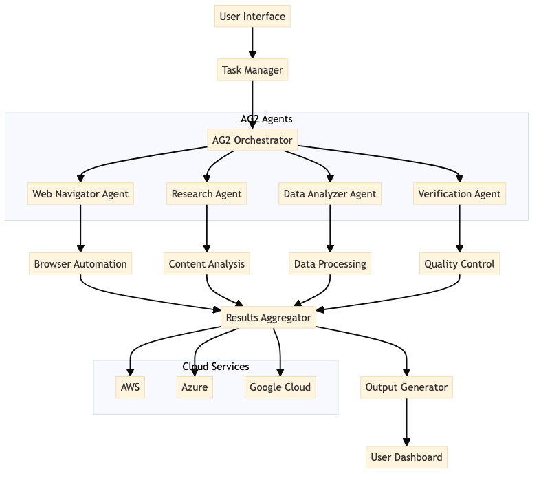

# AgentWeb's Journey with AG2: Revolutionizing Web Automation

## Introduction

In the rapidly evolving landscape of AI-powered automation, AgentWeb made a strategic decision to integrate AG2 (AutoGen) into its platform, marking a significant milestone in its development journey. This integration has transformed how AgentWeb handles complex web automation tasks, particularly in research and analysis scenarios.

## The Challenge

Before adopting AG2, AgentWeb faced limitations in handling complex research tasks that required multiple steps of analysis, verification, and synthesis. While the platform excelled at single-task automation, it needed a more sophisticated approach for tasks that required deep research capabilities and multi-step reasoning.

## The Solution: AG2 Integration

The integration of AG2 brought several key advantages to AgentWeb:

1. **Multi-Agent Collaboration**: AG2's multi-agent framework allows different specialized agents to work together on complex tasks. For example, one agent can focus on data collection while another analyzes the information, and a third agent verifies the results.

2. **Enhanced Research Capabilities**: The platform now offers a "Deep Research Mode" powered by AG2, which enables comprehensive research with detailed reports and citations. This feature is particularly valuable for users who need thorough analysis of web content.

## AgentWeb + AG2 Architecture

## Implementation Details

The integration was implemented with several key features:

- **Deep Research Reports**: AG2 enables comprehensive research capabilities with intelligent web navigation and content analysis. The system can gather information from multiple sources, synthesize findings, and generate detailed reports with proper citations and references.

- **Citation Support**: The system automatically tracks and provides citations for research findings, ensuring transparency and verifiability of information sources. Each piece of information is properly attributed to its source, making it easy for users to verify and follow up on research.

- **Rich Format Support**: Research reports can include various visual elements such as diagrams and tables, making complex information more accessible and easier to understand. The system can automatically generate and format these visualizations based on the research data.

- **Extensive Web Resource Search**: AG2's multi-agent framework enables thorough web searches across multiple sources, ensuring comprehensive coverage of topics. The system can navigate through various web resources, extract relevant information, and combine insights from different perspectives.

## Value to AgentWeb Customers

The integration of AG2 has brought significant value to AgentWeb customers:

- **Enhanced Research Capabilities**: Customers can now conduct comprehensive web research with automated data collection, analysis, and verification. The system handles complex research tasks that previously required significant manual effort.

- **Improved Efficiency**: By automating complex web tasks and research workflows, customers can focus on strategic decision-making rather than time-consuming data gathering and analysis.

- **Better Quality Outputs**: The multi-agent system ensures high-quality results through automated verification and validation, reducing the risk of errors and inconsistencies in research reports.

- **Cost Reduction**: Automated web research and analysis capabilities help customers reduce the time and resources needed for comprehensive research tasks, leading to significant cost savings.

## Future Developments

Looking ahead, AgentWeb plans to further leverage AG2's capabilities:

- Expanding the range of specialized agents for different types of web automation tasks
- Enhancing the integration with other AI models (Claude 3.7, GPT-4o, and Gemini 2.5 Pro)
- Developing more sophisticated templates that utilize AG2's multi-agent capabilities

## Conclusion

The integration of AG2 has positioned AgentWeb at the forefront of AI-powered web automation, offering users unprecedented capabilities in handling complex web tasks with intelligent, collaborative agents. As AG2 and similar technologies continue to evolve, we're eager to explore new possibilities and innovations in the field of web automation.

Ready to experience the power of AI-driven web automation? Visit **[agentweb.pro](https://agentweb.pro)** to start your journey with AgentWeb. 